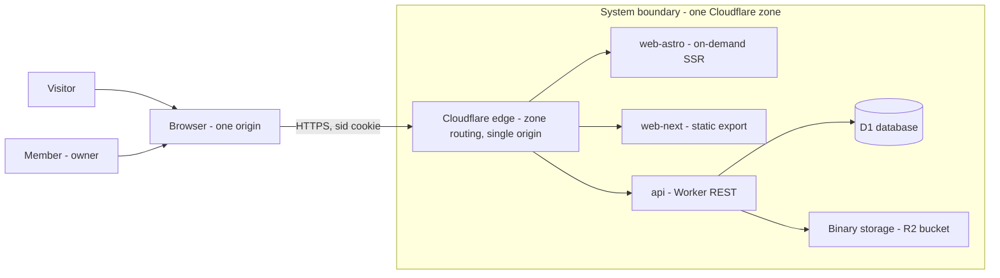
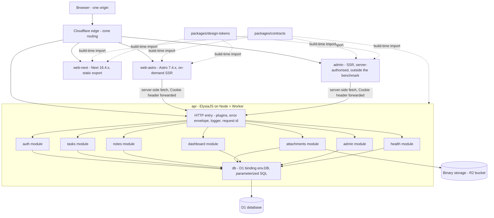
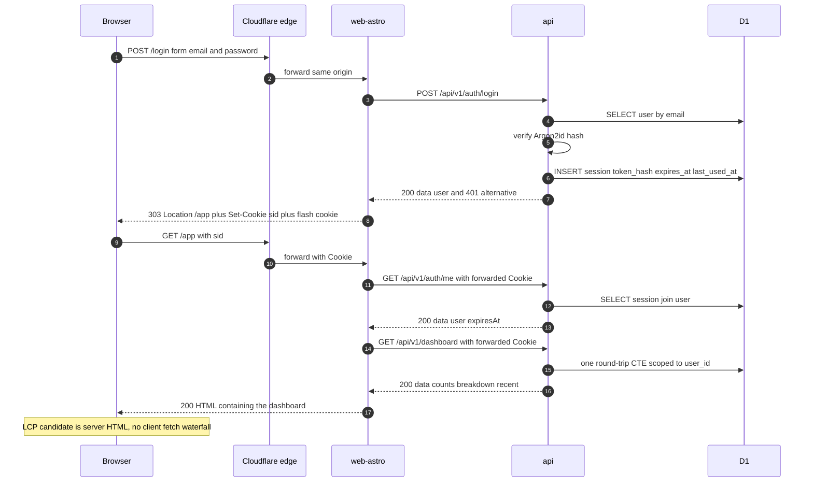
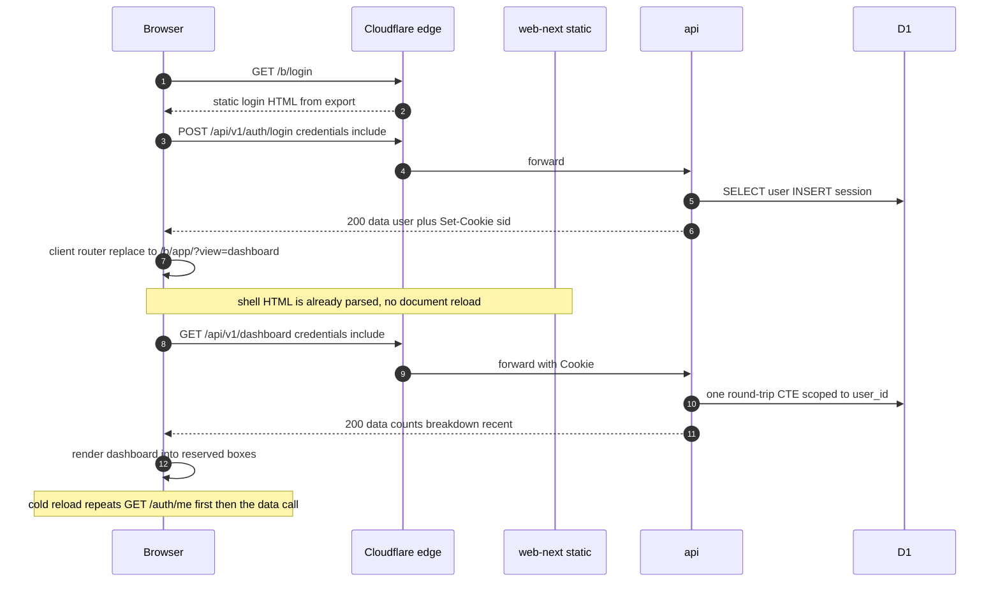
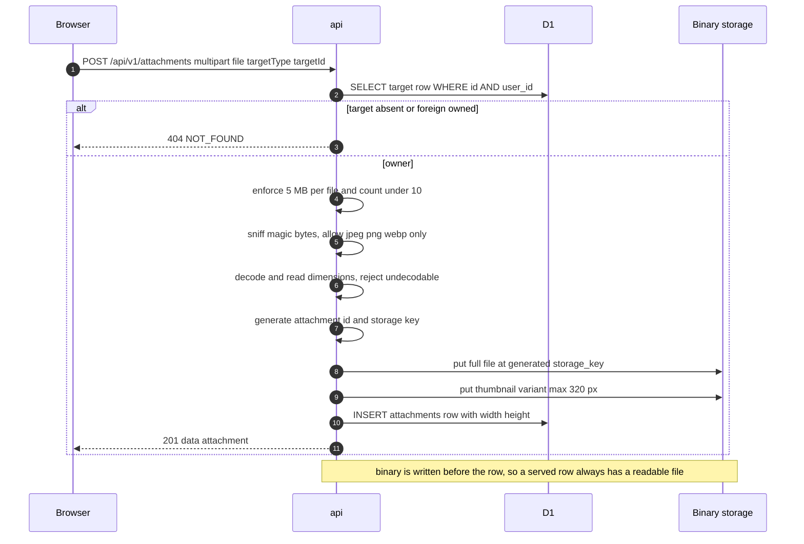
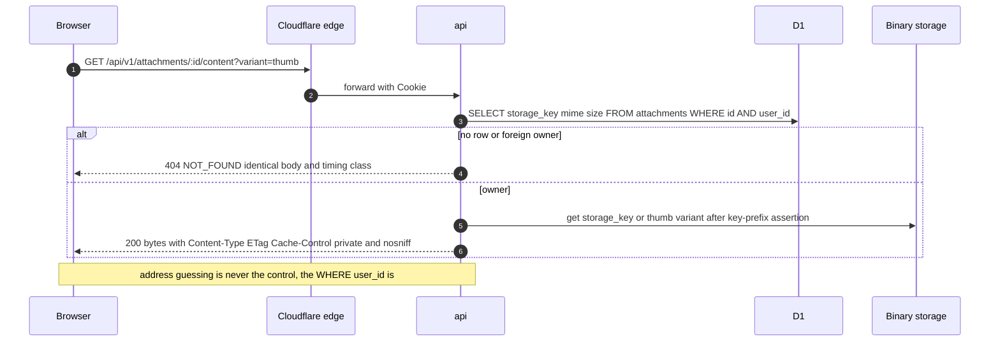
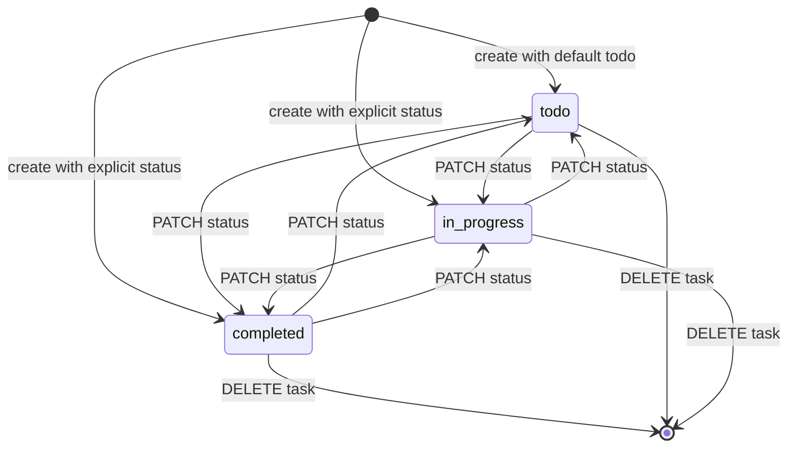
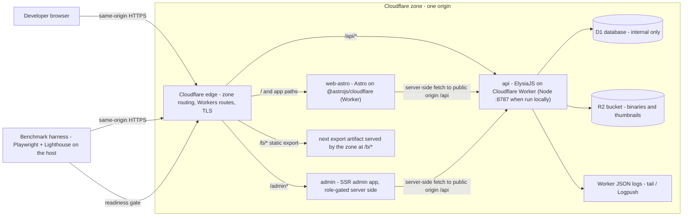

# 03 — System Architecture

Scope: the runtime shape of the product — who talks to what, which process owns which decision, and how
the two rendering paths differ. It consumes `01` (requirements), the architect-locked inputs and the
locked API surface. It does not define requirement text, endpoint bodies (`06`), schema DDL (`05`),
security controls in depth (`07`), the benchmark protocol (`08`) or test cases (`09`). Versions and
framework behaviour come from the verified-facts table; items marked `A-xx` are unverified assumptions.

## 1. System context

Two roles only (`00` §4). A **Visitor** reaches the landing, login and register pages. A **Member** —
the owner of every row they can see — reaches the dashboard, tasks, notes, account and attachment
binaries. No admin *inside the benchmarked product*, no sharing, no public content, no second
authorization axis. Account administration is the approved extension BCR-01 and lives in its own
deployable, `apps/admin`, outside the measured surface.

The system boundary is one Cloudflare zone and one Cloudflare-hosted origin. Everything needed runs inside
it: three frontend deliverables (two measured member apps and the admin app), the API on Node and Worker, one D1 database and one R2 bucket. There is **no external system**
other than the browser and Cloudflare edge (zone routing, with TLS terminating at the edge). No email
transport (A-06), no CDN, no analytics (NFR-OBS-004 forbids third-party requests outright).



Trust boundaries: the browser is untrusted input; the edge route is **not** an authorization point; the Worker
is the only component that decides access; D1 and the R2 bucket are inside the trust
boundary but are never reachable from the browser.

## 2. Architecture style and components

**Deliverable shape: 3 deployables + 1 database + 1 Cloudflare-hosted origin.**

| # | Deliverable | Runtime form | Deployable? |
|---|---|---|---|
| 1 | `apps/api` | ElysiaJS process on Node, listens on :8787; the same app also deploys as a Cloudflare Worker | yes |
| 2 | `apps/web-astro` | Astro on-demand SSR (`@astrojs/node` standalone) | yes |
| 3 | `apps/web-next` | Next static export artifact — **no runtime process** | yes (build artifact) |
| 4 | `apps/admin` | Admin SSR (`@astrojs/node` standalone), route prefix `/admin`, outside the benchmark | yes |
| 5 | Cloudflare D1 | one database, one schema (SQLite) | datastore |
| 6 | Cloudflare zone routing | provides the single origin for all of the above | infrastructure, not a product application |

The style is a **modular monolith API inside a four-deployable system** (ADR-01, ADR-15): two measured
frontends, one admin app outside the benchmark, and the API. Modules share
one Worker, one D1 binding and one migration history; they are separated by directory, route
prefix and repository ownership, not by network calls. The two frontends never share component source
(ADR-12) and never talk to each other.



### 2.1 Component responsibilities and boundaries

| Component | Responsibility | Boundary — what it must NOT do | Owns (data/state) |
|---|---|---|---|
| `web-astro` | Render every page per request; decide the page's auth state **before** emitting HTML; forward the incoming `Cookie` to the API; render forms that post to its own endpoints; reload the document after a write | Must not bind D1 or the R2 bucket, generate storage keys, decide ownership, cache another user's data across requests, re-fetch client-side data already rendered in HTML, serve binaries, or hold credentials | Per-request render context only; one short-lived `flash` cookie (success wording). No durable data |
| `web-next` | Serve one static shell for all authenticated views; parse `?view=&id=&mode=`; bootstrap identity via `GET /api/v1/auth/me`; fetch data client-side; render loading/empty/error states | Must not read `sid` (it is `HttpOnly`), be treated as access control, contain user data in build output or source maps, bind D1 or the R2 bucket, or upload directly to storage | In-memory per-view response cache and route state; cleared on every auth transition |
| `admin` | Render account administration per request (SSR, server-authorised): member list, create, edit role/status, disable/enable, delete; enforce the admin role gate in the server before emitting HTML | Must not read or render another member's tasks or notes, ship any admin route into `web-astro` or `web-next`, or be included in the benchmark scenarios | Render context only; no durable data |
| `api` | Own session issuance and verification, authorization, validation, persistence, upload validation, binary streaming, readiness | Must not render HTML, hold UI state, trust a client-declared owner, MIME type, size or filename, serve R2 objects statically, or log secrets | `users`, `sessions`, `tasks`, `notes`, `attachments` rows; binaries and thumbnails; D1 `rate_limits` counters |
| `api` → `auth` module | Register, login, logout, `/auth/me`, Argon2id hashing, session row lifecycle, cookie set/clear, auth rate limits | Must not read task/note tables except through its own repository calls; must not expose password material in any response or log | `users`, `sessions` |
| `api` → `tasks` module | Task CRUD, list with `q`/filters/sort/cursor, ownership predicate in every statement | Must not compute dashboard aggregates (that is `dashboard`), write attachment rows, or build SQL from strings | `tasks` |
| `api` → `notes` module | Note CRUD, pinned ordering, search, cursor pagination | Must not touch tasks; must not change `pinned` on a title/body edit (FR-NOTE-006) | `notes` |
| `api` → `attachments` module | Multipart intake, size and count limits, content sniffing, decode validation, generated storage keys, thumbnail generation, owner-scoped streaming, delete | Must not derive a key from a client filename, accept a client MIME claim, write outside the R2 bucket's key namespace, or serve a row whose binary is missing (NFR-REL-003) | `attachments` rows, R2 binary objects, thumbnails |
| `api` → `dashboard` module | One round trip returning counters, breakdown, overdue count and 5 + 5 recent items for the session owner | Must not return global counts, other users' rows, or run per-widget queries from the client | No rows; reads `tasks`/`notes` under the same ownership predicate |
| `api` → `health` module | Liveness and readiness for the edge and the harness | Must not require auth, be rate-limited, or leak versions, binding names or counts | No data |
| `packages/contracts` | Single source of entity types, Zod schemas, error codes, copy strings, route constants, formatting helpers | Must not import Astro, React, Next, Elysia or a D1 driver; must not perform I/O; must not contain framework code | Shape authority for both apps and the API |
| `packages/design-tokens` | `tokens.css` + `tokens.json`, the only source of colour, type, space, radius, breakpoints | Must not contain component CSS, selectors for a specific markup structure, or application logic | Token values |
| Binary storage (R2 bucket) | Hold full-resolution binaries and one ≤320 px thumbnail per attachment under server-generated keys | Must not be URL-addressable, be the authority for existence (the row is), or be reachable except through the API's stream handler | Bytes and derivative objects |
| D1 | Hold all durable relational state; enforce enums, ownership, referential integrity, uniqueness, the attachment target check | Must not be reachable from a frontend or from outside the Worker; must not be the only place ownership is checked | Every row |
| Cloudflare zone routing | Present one origin; route `/`, `/b/*`, `/api/*`; serve the Next artifact; terminate TLS; refuse `/uploads/*` | Must not make authorization decisions, rewrite response bodies, cache authenticated responses, or forward `/uploads` anywhere | Origin identity, routing table, TLS material |
Data ownership follows the locked split: `users`/`sessions` belong to `auth`; `tasks`/`notes` to their
modules; `attachments` to `attachments` with `task_id`/`note_id` nullable FKs and
`CHECK (num_nonnulls(task_id, note_id) = 1)`. Deleting a task or note cascades attachment **rows** in the
database; binary removal is a separate storage call performed after the transaction commits.

## 3. Rendering paths

The two frontends are not two configurations of one design. They produce HTML at different times, from
different execution models, with different data available. Everything below follows from that.

### 3.1 Astro — on-demand SSR, multi-page navigation

- **The adapter is mandatory.** On-demand rendering requires an adapter; `output: 'server'` only flips
  the per-route default. This project uses `@astrojs/cloudflare` to run Astro as a Worker, routed on the
  same Cloudflare-hosted origin as the API and static Next assets. `astro.config.mjs` sets
  `adapter: cloudflare(...)` and has no `server.port`; the Worker has no listen port.
  (docs.astro.build/en/guides/on-demand-rendering; ADR-13 records the adapter as a choice among the four
  official adapters, not a law.)
- **Free-tier bindings.** `imagesBindingName: false` and `session: false` mean no Cloudflare Images
  binding and no KV session binding. Images live in R2; the app owns its session through the `sid` cookie
  sent to the API Worker.
- **`prerender` per route.** Because `output: 'server'` makes every route on-demand by default, each page
  declares `export const prerender = false` explicitly, so a future global default change cannot silently
  prerender a per-user page. A repository test asserts every page module contains that declaration.

| Route | `prerender` | Reason |
|---|---|---|
| `/` | `false` | must read `sid` to choose the dashboard CTA over the register CTA (FR-LAND-003; ADR-13) |
| `/login`, `/register` | `false` | a signed-in Member is offered the dashboard instead (permission matrix row 2) |
| `/app` | `false` | per-user aggregates (FR-DASH-002) |
| `/tasks`, `/tasks/[id]`, `/tasks/[id]/edit` | `false` | per-user rows; dynamic segment resolved per request |
| `/notes`, `/notes/[id]` | `false` | per-user rows |
| `/account` | `false` | per-user profile read |
| `/404` | `false` | keeps one header/nav render path |

- **Cookie forwarding.** `Astro.request.headers.get('cookie')` is copied verbatim into the server-side
  request to the API (`Cookie` header), with `Accept: application/json` and a generated request id.
  Nothing else is forwarded. The API's `401` becomes
  `Astro.redirect('/login?next=' + encodeURIComponent(pathname + search))` — before any protected markup
  exists in the response. (`Astro.cookies`/`Astro.request` exist only on on-demand routes; a prerendered
  page could not read them — that is the structural reason for the table above.)
- **SSR data fetch.** Each document performs its API reads server-side and renders the result into HTML:
  dashboard one call (`GET /api/v1/dashboard`), list pages one call each, detail pages one call plus
  image URLs the browser resolves later. Server-side calls target the public origin
  (`PUBLIC_API_BASE_URL`, e.g. `https://<origin>/api/v1`) read via `process.env` at request time — never
  `import.meta.env`, which is inlined at build.
- **Writes.** Forms post to Astro endpoints (`src/pages/*.ts` handlers such as `POST /tasks/create`) which
  forward requests to the API, pass `Set-Cookie` from login/register verbatim, then answer `303` to the
  destination with a short-lived `flash` cookie carrying the success wording (FR-UI-004 must survive the
  reload an MPA performs).
- **Navigation.** Every navigation is a new document: new HTML, revalidated hashed CSS/JS, fresh image
  requests. History and deep links are native browser behaviour; no router exists. There is no framework
  runtime on the client — enhancement is plain inline `<script>` for dialog focus, lightbox and
  double-submit guards.
- **Runtime env.** All configuration is runtime: `PUBLIC_API_BASE_URL`, `LOG_LEVEL`.
  One build artifact is promotable; image and environment are independent. (The Worker's own configuration —
  D1/R2 bindings, `vars`, compat flags — is declared in `wrangler.toml`/`wrangler.jsonc`; there is no port
  or `NODE_ENV` to set.)

### 3.2 Next.js — static export, single shell, query-param client router

- **Export configuration.** `output: 'export'`, `basePath: '/b'`, `images: { unoptimized: true }`,
  `trailingSlash: true` so each route emits `<route>/index.html` and the zone can serve the directory index.
- **What the export forbids** (verified, nextjs.org/docs/app/guides/static-exports): dynamic routes
  **without** `generateStaticParams`; **Proxy** (renamed from middleware in Next 16); ISR/revalidation;
  Draft Mode; Route Handlers **that rely on `Request`**. A `GET` Route Handler with
  `export const dynamic = 'force-static'` is emitted as a static file — none is used here, because no
  per-user response can be a static file. `cookies()`/`headers()` do not throw under export; no request
  exists at build time, so they return empty values.
- **Single static shell.** `/tasks/[id]` cannot exist: `generateStaticParams` runs at build time and can
  only enumerate ids that exist then, while task ids are created by users at runtime. The route strategy
  is therefore one document for every authenticated view:

| View | URL | Static file |
|---|---|---|
| Landing | `/b/` | `out/index.html` |
| Login / Register | `/b/login`, `/b/register` | `out/login/index.html`, `out/register/index.html` |
| Dashboard | `/b/app/?view=dashboard` | `out/app/index.html` |
| Task list | `/b/app/?view=tasks` | same file |
| Task detail | `/b/app/?view=tasks&id=<uuid>` | same file |
| Task edit | `/b/app/?view=tasks&id=<uuid>&mode=edit` | same file |
| Note list / detail | `/b/app/?view=notes[&id=<uuid>]` | same file |
| Account | `/b/app/?view=account` | same file |
| Not found | any unmatched path | `out/404.html`, served by the zone |

  The router reads `useSearchParams` inside a `<Suspense>` boundary whose fallback is the same skeleton
  (A-24: exact constraint to be re-confirmed against the pinned 16.4.x at T-701) and drives
  `history.pushState`/`replaceState`, so FR-TASK-014 (URL-authoritative state, Back/Forward) holds
  without any server involvement.
- **Auth bootstrap.** The shell cannot know identity at parse time. On boot it issues
  `GET /api/v1/auth/me` with `credentials: 'include'`: `200 {data:{user, expiresAt}}` renders the app;
  `401` replaces the route with `/b/login?next=…`. Immediately after a successful login the probe is
  skipped because identity is already server-derived. The gate is **UX only** — the API is the gate (§5).
- **Skeleton and CLS budget.** Header, sidebar and content boxes are dimension-stable and identical for
  every view; every skeleton occupies exactly the final element's box; thumbnails reserve a fixed 4:3 box
  with declared `width`/`height`; toasts are fixed-position overlays that never push content
  (NFR-PERF-002, FR-ATT-010). The auth-check state is a shell state, not a spinner over empty layout.
- **`basePath` effects.** Assets live under `/b/_next/*`; every `fetch` targets the absolute same-origin
  path `/api/v1/...` (`NEXT_PUBLIC_API_BASE_URL=/api/v1`, build-time) because `basePath` does not rewrite
  `fetch`; links are `next/link` with basePath-relative hrefs.

### 3.3 Comparison of the two paths

| Dimension | Astro (MPA + SSR) | Next.js (SPA over static export) |
|---|---|---|
| First paint of an authenticated page | First byte is final HTML containing data; the LCP candidate is server HTML. No JavaScript is required to show content | First byte is the same shell for every user: chrome + skeleton. Content appears after two sequential client round trips (auth probe → data), unless the probe result is already in memory |
| Data fetch origin | Astro **server** → API over the public origin (through the zone), once per document; the incoming cookie is forwarded | **Browser** → API over the public origin, once per view after bootstrap; the browser attaches the cookie, JS never reads it |
| Navigation cost | Full document per navigation: HTML + revalidated CSS/JS + images. History and scroll restore are native | One-time JS/CSS cost for the shell and shared bundle; later navigations are a client transition plus a JSON payload, with no HTML re-parse and no shell re-render |
| Auth gating | Server-side, before any HTML: no/expired cookie → `302 /login`; protected markup never reaches an unauthenticated browser | Client-side, after parse: shell renders, probe returns `401`, route is replaced. Advisory only; every protected byte still comes from an authorized API call |
| Deep-link behaviour | URL resolves on the server per request with data included; `?next=` return path is a server redirect | Same URL returns the identical static shell; the id is parsed client-side and fetched after hydration. End state matches; one round trip later |
| Payload composition | HTML carrying data + CSS + minimal inline JS + images. Each navigation re-sends the page chrome inside the document | Static shell HTML + shared JS bundle (React, router, Zod) once per session, then JSON per view. JSON is smaller than HTML, but the bundle is an entry cost paid before the first authed paint |
| What the path cannot do | No client-side transitions: a filter or sort change costs a document unless scripted enhancement is added; authenticated pages cannot be cached by a CDN or served as files | No per-user HTML, no server redirect, no proxy/middleware, no ISR, no dynamic route segment; `/tasks/[id]` is impossible; the landing CTA cannot be resolved from the cookie without a client probe (FR-LAND-003/005 tension — §12) |

The comparison is deliberately not symmetric at the mechanism level — that asymmetry *is* the measured
variable (NFR-RESEARCH-001 requires identical features, not identical mechanisms).

## 4. Communication and data flows

### 4.1 Browser ↔ API contract

| Concern | Rule |
|---|---|
| Success envelope | `{ "data": <payload> }`; lists `{ "data": [...], "page": { "limit": 20, "nextCursor": "<opaque>\|null" } }`. Never a bare array or scalar. `204` has no body |
| Error envelope | `{ "error": { "code", "message", "requestId", "details": [ { field, code, message, file? } ] } }`; closed code set `VALIDATION_FAILED` 422, `UNAUTHENTICATED` 401, `NOT_FOUND` 404, `CONFLICT` 409, `PAYLOAD_TOO_LARGE` 413, `UNSUPPORTED_MEDIA_TYPE` 415, `RATE_LIMITED` 429, `INTERNAL` 500. Ownership failure is `NOT_FOUND`, never `403` (NFR-SEC-005) |
| Ids and time | UUID strings; timestamps ISO-8601 UTC with `Z`; `due_date` is `YYYY-MM-DD` |
| Pagination | Opaque `cursor` = base64url of the last row's sort key plus `id`; the server builds a keyset predicate and fetches `limit + 1` rows to decide `nextCursor`. Malformed cursor → `VALIDATION_FAILED`. `offset` is not accepted (FR-TASK-003) |
| Credentials | `credentials: 'include'` on every browser call. This is a **browser/CORS rule, not a framework feature**: it requires a concrete `Access-Control-Allow-Origin` (never `*`) plus `Access-Control-Allow-Credentials: true`, and `SameSite=None; Secure` for cross-site cookies. In production the same-origin Cloudflare zone routing makes the cookie first-party, so no CORS is configured at all; `include` is kept only so the dev cross-origin case (§6.4) behaves identically |
| Caching | JSON responses `Cache-Control: no-store`. Binary responses `Cache-Control: private, max-age=86400`, strong `ETag`, `304` on `If-None-Match` |
| Content types | `application/json; charset=utf-8` for JSON; `multipart/form-data` for uploads only |

### 4.2 API ↔ D1 contract

| Concern | Rule |
|---|---|
| Binding | One D1 binding `env.DB` for the whole Worker; no connection pool and no connection string (the binding is the connection). Query errors are caught and never crash the isolate (NFR-REL-004) |
| Query count | One round-trip per list or detail operation — attachments aggregated with a second grouped query or `json_group_array` rather than an N+1 loop; the dashboard is one round-trip using CTEs. A `env.DB.batch([...])` counts as one round-trip |
| Parameterization | Every value is a bound parameter via `env.DB.prepare(...)`; no string interpolation of input into SQL (NFR-SEC-008). Identifiers come from fixed allowlists, never from input |
| Ownership | Every owned-row statement carries `AND user_id = ?sessionUserId` in the same statement that reads or mutates the row; a separate pre-check is not used |
| Transactions | There is no `statement_timeout`; the Workers CPU/wall-clock cap bounds any runaway statement instead. The atomicity unit is a single `env.DB.batch([...])` (D1 is single-writer serialised); the binary is written to the R2 bucket before the attachment row so a row never points at a missing object (NFR-REL-003) |

### 4.3 Flow (a) — login → cookie → first authenticated Astro render



Failure branches: `401` at `/auth/me` → `302 /login?next=%2Fapp` with no protected markup; `CONFLICT` at
register → form re-rendered with the email retained and the password cleared (FR-AUTH-002); any `5xx` →
error state with retry (FR-UI-003).

### 4.4 Flow (b) — login → cookie → shell boot → `/auth/me` → data in Next.js



Cold boot (reload or deep link) inserts `GET /api/v1/auth/me` before the data call; `401` replaces the
route with `/b/login?next=<whitelisted internal path>` and clears the per-view cache. The skeleton is on
screen for the whole interval and must not change size.

### 4.5 Flow (c) — multipart upload → sniff → store → metadata → thumbnail



Rejections are per file and name the file and reason: `UNSUPPORTED_MEDIA_TYPE` (415),
`PAYLOAD_TOO_LARGE` (413), `VALIDATION_FAILED` (422) for count and target-type errors. On any failure the
written file is unlinked; a crash between write and unlink leaves an orphan binary, swept by §11. Astro
reloads the target document after success; Next appends the new thumbnail in place (FR-ATT-003).

### 4.6 Flow (d) — authenticated binary read



The key is built only from the server-generated `storage_key`; it is asserted to remain inside the
owner's key prefix before reading (NFR-SEC-009). `If-None-Match` matching the stored
`ETag` returns `304`.

### 4.7 Task status transition model



All six transitions are legal; there is no workflow restriction beyond the three canonical values
(FR-TASK-009). Repeated identical status changes are idempotent (NFR-REL-005). Deleting removes the row
and cascades attachment rows.

## 5. Authentication and session flow

### 5.1 Cookie and token

| Property | Value | Driver |
|---|---|---|
| Name | `sid` | canonical constant (FR-AUTH-004) |
| Value | opaque token, 32 random bytes from a CSPRNG, base64url-encoded | NFR-SEC-002 |
| `HttpOnly` | yes — no script access, no duplication into storage | FR-AUTH-004, FR-AUTH-012 |
| `SameSite` | `Lax` | NFR-SEC-006: blocks cookie attachment on cross-site unsafe methods while keeping top-level navigation usable |
| `Path` | `/` | one cookie for `/`, `/b` and `/api` |
| `Domain` | absent | prevents cookie scope from extending to subdomains; all apps share the Cloudflare-hosted origin |
| `Secure` | set in production (Worker env) | NFR-SEC-003; the measured stack runs over TLS at the Cloudflare edge so the production-shaped cookie works |
| `Max-Age` | 604800 (7 days) at login; re-issued with the remaining absolute lifetime on refresh | api-surface cookie contract |
| Server storage | `sessions.token_hash` = SHA-256 of the token (`BLOB`, unique, `CHECK length(token_hash) = 32`). The plaintext token never persists | NFR-SEC-002 |

### 5.2 Rotation, expiry, revocation

| Mechanism | Rule |
|---|---|
| Absolute expiry | `created_at + 7 days`, stored in `expires_at`, never extended. A session dies at day 7 regardless of activity (FR-AUTH-006) |
| Idle expiry | `last_used_at + 24 h`; evaluated on every read. An idle session is refused even before its absolute expiry |
| Refresh | At most once per hour: if `now - last_used_at ≥ 1h`, the row's `last_used_at` is updated and the cookie re-issued with `Max-Age` equal to the remaining absolute lifetime. No token rotation on refresh — concurrent requests from two tabs would race and one would be refused; a leaked token is bounded by the 24 h idle window and the 7-day absolute cap |
| Issuance | New token on register and on login only. Logging in while a session exists is refused (permission matrix row 4) |
| Revocation on logout | `DELETE FROM sessions WHERE token_hash = ?1`, then `Set-Cookie: sid=; Max-Age=0; Path=/`. Other tabs and devices are refused at their next request (FR-AUTH-007, FR-AUTH-013) |
| Cross-tab invalidation | Any authenticated response with `401` clears client state: Astro's next document request redirects; Next.js clears its per-view cache and replaces the route (FR-AUTH-010) |

### 5.3 Authoritative vs advisory enforcement

The server is the only place a rule is decided (G-2, NFR-SEC-004). Each row names the layer that
*decides* and the layer that merely *avoids a pointless request*.

| Control | Authoritative layer | Advisory layer | Why the advisory layer is not the protection |
|---|---|---|---|
| Route gate on `/app`, `/tasks*`, `/notes*`, `/account` | API: every request without a valid `sid` is `401 UNAUTHENTICATED` | Astro: server-side `302 /login` before HTML; Next.js: client redirect after the `401` probe | `curl` without a cookie against the protected endpoints still yields `401`; forged markup never exists in either app |
| Post-login return to the requested destination | API: the destination is re-fetched with the session cookie | Astro: `?next=` server redirect, path validated as app-internal; Next.js: `?next=` client replace, same whitelist | A crafted `next` outside the whitelist is discarded; no open redirect and no data exposure |
| Ownership filter on tasks, notes, attachments | SQL predicate `AND user_id = ?sessionUserId` inside the same statement; absent and foreign rows produce an identical `404` | The UI never performs a per-row permission check — there is nothing for it to check | Cross-owner test matrix asserts `404` for every operation on a foreign id (NFR-SEC-005) |
| Aggregate counts | `dashboard` SQL scoped by `user_id` | — (no client computation) | No global totals endpoint exists; a foreign row can never contribute to a counter |
| Attachment binary retrieval | `attachments` SQL join on `user_id`; path built from the server key only | Not the UUID: unguessability is a property, not a control (NFR-SEC-010) | Anonymous and cross-owner requests to real addresses return `404` with no bytes |
| Rate limiting | The D1 `rate_limits` table `(bucket, key, window_start, count)` read and written by the Worker: 10/min/IP auth mutations, 20/min/user uploads, 300/min/user other authed, `/health` exempt | Disabled submit button, client-side count check (FR-UI-012) | A scripted burst bypassing the UI is still throttled with `RATE_LIMITED` 429 |
| CSRF / same-origin on unsafe methods | Worker middleware: `SameSite=Lax` plus `Origin`/`Sec-Fetch-Site` validation on `POST`/`PATCH`/`DELETE`; `multipart/form-data` is form-CORS-safelisted, so the origin check is mandatory for uploads | Forms are same-origin by construction; no token is rendered into pages | A cross-site form post arrives without the `Lax` cookie (`401`) and with a foreign `Origin` (refused as `401`) — indistinguishable from an absent session |
| `/uploads/*` | Cloudflare zone routing: the path is never routed to an origin and returns `404` | — | Binaries exist only behind `/api/v1/attachments/:id/content` |
| Next.js authenticated rendering | API: every protected payload requires the cookie | **Next.js client gate is UX only** — it prevents a broken screen, not access | Disabling JavaScript or editing the shell yields no data: the data comes from the API under the cookie |

## 6. Deployment and runtime topology

### 6.1 Topology

The accepted Cloudflare Workers free-tier limits are 100,000 requests/day, 10 ms CPU/request, and 50
subrequests/request. Argon2id password hashing and `@jsquash` image decoding/thumbnail generation are CPU-
heavy operations that remain part of the design and may approach or exceed the CPU budget; this is a known
platform constraint, not a reason to remove either operation. The API is one ElysiaJS application with two
runtimes: locally, `wrangler dev` runs the app as a Node process on `:8787` against emulated D1/R2 state;
in production it is a Cloudflare Worker, where the D1 and R2 bindings are provided by the platform.
`apps/api/src/index.ts` is the Worker entry and the only place a response leaves the app. There is no
container/Docker/Compose deployment; Cloudflare zone routing / Workers routes provide the shared origin.



There is no `web-next` process in production: its static export is served by Cloudflare at `/b/*`
(see §12, O-1). `apps/admin` is a third SSR deployable on the same origin; it shares the API and the
session cookie but never appears in the member apps and is excluded from the benchmark scenarios. Cloudflare zone routing and Workers routes provide one origin; horizontal scaling is out of scope (A-03).

### 6.2 Path table

| Path | Served by | Notes |
|---|---|---|
| `/` | Astro `@astrojs/cloudflare` Worker | Astro owns the root; on-demand for the cookie-aware CTA |
| `/login`, `/register`, `/app`, `/tasks*`, `/notes*`, `/account`, `/404` | Astro `@astrojs/cloudflare` Worker | all on-demand |
| `/b/`, `/b/login`, `/b/register`, `/b/app/`, `/b/404.html` | Cloudflare static assets | Next static export, served at `/b/*` |
| `/b/_next/*` | Cloudflare static assets | immutable hashed assets, long `Cache-Control` |
| `/admin`, `/admin/members*` | SSR admin app (`apps/admin`) | server-side role gate; not present in either member app |
| `/api/*` | API Worker | prefix preserved; Elysia routes `/api/v1/*` |
| `/uploads/*` | Cloudflare zone route returns `404` | never routed to a Worker |
| `/healthz` | Cloudflare static asset | zone liveness only, no application data |

Cloudflare zone routing / Workers routes select `/b/*`, `/api/*`, `/uploads/*` and `/` handling; the Astro
Worker owns app routes; it is not a catch-all routing layer.

### 6.3 Health, readiness, logs, harness access

- `GET /api/v1/health`, public, unauthenticated, exempt from rate limiting, returns `{ status, db }` with
  `200` when the D1 binding answers and `503` otherwise. Readiness (not just liveness) is what the harness
  gates on before a run (NFR-REL-007). A `storage` signal (R2 `head()`) is added when the attachments
  module lands (D-5 deferred); until then the surface carries no storage signal; see §12 O-3.
- Zone liveness: `/healthz` static file. Astro liveness: HTTP `200` on `/login`.
- Logs: one JSON object per request emitted by the Worker via `console.log`, plus Astro request logs; read
  with `wrangler tail` or shipped by Logpush. No log driver, no on-host rotation, no SaaS collector
  (NFR-OBS-001, NFR-OBS-004).
- Harness access: Playwright drives `https://<origin>/` and `https://<origin>/b/` through the zone, in the
  same browser, viewport and network profile, never while the other app is under load (NFR-PERF-007).
  TLS terminates at the Cloudflare edge with the zone certificate; the measured stack uses that trusted
  HTTPS origin so `Secure` cookies behave as in production.

### 6.4 Development equivalent, and why it is never measured

| App | Dev mechanism | Consequence |
|---|---|---|
| `web-astro` | `astro dev` serves the page shell; Vite dev proxy routes `/api` → `http://localhost:8787` | Astro page shell plus API dev server; no CORS needed |
| `web-next` | `next dev` cannot use `rewrites` under `output: 'export'`; it uses an absolute `NEXT_PUBLIC_API_BASE_URL=http://localhost:8787/api/v1` plus a dev-only CORS allowlist `['http://localhost:3000']` with `credentials: true` | ports differ but the site is the same, so the `Lax` cookie still travels (cookie scope ignores ports); CORS is still required because the origin differs. `origin: '*'` must never be used — with `credentials: true` browsers reject it. `Secure` is off because dev is `http` |
| `api` | `wrangler dev` on `:8787` with local D1/R2 under `.wrangler/state`; `src/index.ts` is the only entry (ADR-16) | One runtime from test to production; no second server script to keep in sync |

Local dev servers are excluded from measurement (C-09, NFR-PERF-006). Production preview uses `wrangler dev`
on the built Astro Worker; the dev CORS allowlist is registered only outside production and is absent
from the measured stack.

## 7. Repository and project structure

```
rweb-task-management/
├── apps/
│   ├── api/                      # ElysiaJS (Node + Worker) + TypeScript, the only component that binds D1 and the R2 bucket
│   │   ├── src/{server.ts,app.ts,config/,plugins/,modules/{auth,tasks,notes,attachments,dashboard,admin,health}/,db/,lib/,scripts/}
│   │   ├── migrations/           # numbered forward-only SQL, applied by `wrangler d1 migrations`
│   │   ├── test/{unit,integration}/
│   │   ├── wrangler.jsonc        # Worker config: D1 + R2 bindings, compat date, routes, Cron Triggers
│   │   └── .wrangler/state/      # local dev D1/R2 state (gitignored) — replaces the dev upload root
│   ├── web-astro/                # Astro 7.4.x, output 'server', @astrojs/cloudflare Worker
│   │   └── src/{pages,layouts,components,lib,styles,assets}/
│   ├── web-next/                 # Next.js 16.4.x App Router, output 'export', basePath '/b'
│   │   └── src/{app,components,lib,styles}/
│   └── admin/                    # SSR admin app at /admin, server-authorised, outside the benchmark
│       └── src/{pages,components,lib,styles}/
├── packages/
│   ├── contracts/                # types + Zod schemas + error codes + copy + route constants
│   ├── design-tokens/            # tokens.css + tokens.json, single source for both frontends
│   ├── test-utils/               # fixture factories, dataset generator, API client for tests
│   └── config/                   # shared tsconfig bases, eslint flat config, prettier
├── assets/                       # shared static media (landing hero, preview shots, seed images)
├── infra/                        # Cloudflare zone routing (routes), Workers/Pages config, TLS via the zone (gitignored secrets)
├── scripts/                      # seed, dataset generator, benchmark runner, storage sweep
├── docs/                         # final comparative report + diagrams (non-planning)
├── .wrangler/state/              # local dev D1/R2 state (gitignored) — replaces the dev upload root
├── .planning/                    # this blueprint
├── DEVELOPMENT-GUIDELINES.md
└── # package.json / pnpm-workspace.yaml / tsconfig.base.json / .nvmrc / .env.example
```

Version comments follow the verified-facts table, not the older annotations in the locked tree (§12, O-2).
`modules/dashboard/` is added because endpoint #7 exists (§12, O-4). `src/scripts/` holds the one-shot
sweep entrypoints of §11.

**Dependency direction (enforced by review and by the pnpm strict resolver):**

| Rule | Reason |
|---|---|
| `apps/*` may import `packages/*`; `apps/*` never import each other | the two frontends must share contracts, not code paths |
| `packages/*` never import `apps/*` | keeps packages buildable in isolation |
| `packages/contracts` has exactly one runtime dependency, `zod` | it ships to both browsers and the server (NFR-MAINT-001) |
| `packages/design-tokens` has no dependencies at all | it is a CSS/JSON artifact |
| No frontend imports a D1/R2 driver, `node:*`, or any API source | the database and bucket are reachable only through the API (C-04) |
| Business rules (validation, formatting, copy, transitions) exist only in `packages/contracts` | NFR-MAINT-005: framework-specific code is confined to rendering, navigation and data-fetch adapters |

**TypeScript strategy.** One base in `packages/config/tsconfig.base.json`: `strict`,
`noUncheckedIndexedAccess`, `exactOptionalPropertyTypes`, `noImplicitOverride`, `verbatimModuleSyntax`.
Apps extend it; only the API overrides `module`/`moduleResolution` to `NodeNext`, the frontends use
`bundler`. The single permitted path alias is `@taskapp/contracts` (plus `@taskapp/design-tokens` for CSS
imports); per-app `paths` redefinition is review-blocking. One root `typecheck` covers all workspaces.

**Environment variables.**

| Name | Consumer | Build-time or runtime | Example |
|---|---|---|---|
| `SESSION_COOKIE_NAME` | api (Worker) | runtime — Worker `vars` | `sid` |
| `SESSION_TTL_DAYS` | api (Worker) | runtime — Worker `vars` | `7` |
| `APP_ORIGIN` | api (Worker) | runtime — Worker `vars` | `https://<origin>` — the only accepted `Origin` for unsafe methods (NFR-SEC-006) |
| `UPLOAD_MAX_BYTES` | api (Worker) | runtime — Worker `vars` | `5242880` |
| `DB` (D1 binding) | api (Worker) | runtime — binding | D1 database, accessed as `env.DB` |
| `BUCKET` (R2 binding) | api (Worker) | runtime — binding | R2 bucket, accessed as `env.BUCKET` |
| `PUBLIC_API_BASE_URL` | web-astro (server-side only) | runtime — read via `process.env` | `https://<origin>/api/v1` |
| `NEXT_PUBLIC_API_BASE_URL` | web-next | **build-time** (inlined) | `/api/v1` |
| `LOG_LEVEL` | api, web-astro | runtime | `info` |

`.env.example` is committed, `.env` is gitignored. The session idle window (24 h) and refresh throttle
(1 h) are typed constants in `apps/api/src/config`, not environment, so a benchmark cannot be run against
different session semantics than the documented ones.

**Root scripts.** `dev`, `build`, `test`, `test:e2e`, `lint`, `typecheck`, `db:migrate`, `db:seed`,
`bench`, plus `db:sweep` for §11. `db:migrate` = `wrangler d1 migrations apply`; the §11 sweep runs as a
Worker Cron Trigger. `build` produces the Astro Worker and the Next static export; the
measured stack runs production build output only.

**Branching and review.** Trunk-based: short-lived `feat/<area>-<slug>`, `fix/…`, `docs/…` branches off
`main`; conventional commits; a PR needs one review, green `typecheck`/`lint`/`test`, no direct pushes to
`main`, and `main` is always deployable. Any change to a shared shape, route or enum updates `.planning/`
in the same PR. The full rule set lives in `DEVELOPMENT-GUIDELINES.md`; this section states only the shape
it presumes. Toolchain rationale is in ADR-10 (versions) and ADR-11 (workspace manager).

## 8. Interactions and screens

Route inventory and component/state definitions belong to `14-ui-ux-specification.md` §4-§7; this section
maps each screen to the API operations it needs.

| Screen | Astro route | Next route | API endpoints used | States to implement |
|---|---|---|---|---|
| Landing | `/` | `/b/` | none (FR-LAND-005); Next additionally probes #4 for the signed-in CTA (§12 O-5) | signed-out CTA, signed-in CTA, both without layout shift; no loading/empty/error state |
| Login | `/login` | `/b/login` | #2, #4 (already-signed-in redirect), #3 on the account menu only | idle, submitting, field error, form error, `RATE_LIMITED`, expiry message |
| Register | `/register` | `/b/register` | #1, #4 | idle, submitting, per-field error, `CONFLICT` on email, success → dashboard |
| Dashboard | `/app` | `/b/app/?view=dashboard` | #7, #4 | loading (Astro: n/a in HTML), empty per widget, error + retry, overdue marker, search submit |
| Task list | `/tasks` | `/b/app/?view=tasks` | #8, #4, #20 (thumbnails), #11 (inline status) | loading skeletons, empty (no tasks), no-results + clear filters, error + retry, toast on status change, pagination end marker |
| Task detail | `/tasks/[id]` | `/b/app/?view=tasks&id=<uuid>` | #10, #4, #20, #11, #12 | loading, `NOT_FOUND` state, error + retry, attachment gallery, lightbox open/loading/error, delete confirmation |
| Task edit | `/tasks/[id]/edit` | `/b/app/?view=tasks&id=<uuid>&mode=edit` | #10, #11, #18, #21 | form idle/invalid/submitting, per-file upload progress, rejected-file list, success toast |
| Note list | `/notes` | `/b/app/?view=notes` | #13, #4, #20, #16 (pin toggle) | loading, empty + CTA, no-results, error + retry, pin/unpin toast |
| Note detail | `/notes/[id]` | `/b/app/?view=notes&id=<uuid>` | #15, #4, #16, #17, #18, #21, #20 | loading, `NOT_FOUND`, error + retry, lightbox, confirm delete, upload states |
| Account | `/account` | `/b/app/?view=account` | #5, #3, #4 | loading, error, logout immediate (no confirmation), profile read-only (permission matrix row 24) |
| Not found | `/404` | `/b/404.html` + `?view=` fallback | none | static message, link back to a safe route |
| Admin console (extension) | — | — | #23, #24, #25, #26 | `apps/admin` `/admin`: loading skeletons, empty result + clear filters, error + retry, create/edit validation, delete confirmation; not in either member app |
| Admin member edit (extension) | — | — | #23, #25, #24 (create) | `apps/admin` `/admin/members/[id]`: prefilled form, role/status segments, read-only email, `409` self-lockout message, save toast |
| Health (not a screen) | — | — | #22 | used by the harness and the zone's readiness only |

Cross-cutting: every data-dependent screen implements loading, empty, error-with-retry and non-blocking
success (FR-UI-001..004); every destructive action uses the in-app confirmation (FR-UI-007); every list
state lives in the URL (FR-TASK-014, FR-NOTE-003). Wording comes from the shared copy deck, never from a
screen-local string (NFR-MAINT-006).

## 9. Quality attributes and how they are satisfied

| Attribute | Requirement IDs | Mechanism in this architecture | Verification pointer |
|---|---|---|---|
| Authorization and non-disclosure | NFR-SEC-004, NFR-SEC-005, FR-TASK-019, FR-NOTE-013, FR-ATT-008 | one guard chain in the API; ownership predicate inside every owned-row statement; `404` for absent and foreign alike; no per-row UI check exists to be mistaken for a control | `07` ownership matrix; `09` cross-owner suite |
| Credential and session integrity | NFR-SEC-001, NFR-SEC-002, NFR-SEC-003, FR-AUTH-004, FR-AUTH-012 | Argon2id; opaque token; SHA-256 at rest; cookie attributes per §5.1 | `07`; `09` auth tests |
| CSRF and origin integrity | NFR-SEC-006 | `SameSite=Lax`; `Origin`/`Sec-Fetch-Site` on unsafe methods; no CORS in production; `/uploads` unreachable | `07` threat register; `09` forged-request tests |
| Upload safety and binary privacy | NFR-SEC-009, NFR-SEC-010, FR-ATT-002/007/008/011 | sniff + decode validation; server-generated keys; owner-scoped stream; row-last write ordering | `07`; `09` upload battery |
| No user data in static output | NFR-SEC-012, FR-LAND-004 | the export contains no runtime data by construction; grep gate over `out/` and bundles | `09` static-output gate (T-713) |
| LCP | NFR-PERF-001 | Astro: data in the first byte, no client waterfall. Next: shell + dimension-stable skeleton, then data | `08` S1–S6 |
| CLS | NFR-PERF-002, FR-ATT-010 | declared image dimensions, skeleton boxes equal to final, overlay toasts, no late banners | `08` S1–S11 |
| INP | NFR-PERF-003 | Astro list content is not hydrated; Next keeps row handlers small and avoids synchronous work on interaction | `08` S7–S11 |
| Payload attribution | NFR-PERF-004/005/007 | per-resource-class capture; server-timing on documents and per-request timing on the API; DB-facing traffic reported separately | `08` run manifest |
| Reliability and integrity | NFR-REL-001..007 | D1 constraints + `env.DB.batch([...])` transactions (single-writer serialised) + row-last R2 write + readiness gate + Worker query-error containment | `07`; `09` induced-failure tests |
| Backup and restore | NFR-REL-008 | `wrangler d1 export` (or D1 Time Travel PITR) plus R2 object copy, one rehearsed restore (§11) | `09` restore rehearsal record |
| Accessibility | NFR-A11Y-001..007 | shared tokens, shared component state inventory, focus management rules in `14` | `09` accessibility pass |
| Maintainability and contract single source | NFR-MAINT-001/002/005/006 | `packages/contracts` as the only shape source; dependency-direction rules; one copy deck | `09`; repo rules |
| Observability | NFR-OBS-001..005 | Worker `console.log` JSON (one object per request) with request id and acting user id → Workers tail/Logpush; server-timing; zero third-party requests | `08` log/trace sample |
| Research validity | NFR-RESEARCH-001..009 | one origin, one Worker, one D1 database, one dataset; parity gate before runs; build id per run | `08` |
| Compatibility | NFR-COMPAT-003/004 | recorded Workers compat date + D1 + browser (pinned Chromium); Astro on `@astrojs/cloudflare`; Cloudflare zone routing / Workers routes provide one origin | `10`; `08` manifest |

## 10. Technology justification table

| Item | Version | Confirmed requirement or constraint that needs it | If deferred | Class |
|---|---|---|---|---|
| Node.js | **24.11.1 pinned** (`.nvmrc`); floors: Astro ≥ 22.23.4, Next ≥ 20.9 | NFR-COMPAT-003, A-08; machine already at 24.11.1 | Unpinned runtime makes results non-reproducible across teammates | Baseline |
| pnpm | 9 | ADR-11; strict resolution catches undeclared deps and contract drift | npm workspaces fallback: same layout, weaker strictness | Baseline (fallback documented) |
| TypeScript | 5.x strict | NFR-MAINT-004 | Type drift between contracts and both apps | Baseline |
| Cloudflare Workers runtime | current, recorded compat date | C-03, A-08 | No shared API; the comparison loses its instrument | Baseline |
| Node.js runtime (API) | 24.11.1, same `.nvmrc` | hosts `wrangler dev`, Vitest and the build tooling (ADR-16); not a deploy target | A second entry point diverging from the Worker path | Baseline |
| ElysiaJS | current | C-03; routing, validation hooks and error envelope for `/api/v1/*` on both Node and Worker | Hand-rolled routing and error envelope | Baseline |
| Elysia cookie handling (built-in `cookie` plugin) | current | FR-AUTH-004 | Manual cookie parsing and signing errors | Baseline |
| Workers form-data parsing (Web `FormData`) | current | FR-ATT-001, FR-ATT-002 | Hand-rolled multipart parser | Baseline |
| D1 `rate_limits` table | — | NFR-SEC-007 | Brute-forceable login; threshold test impossible | Baseline (D1-backed counters) |
| Workers security headers middleware | current | NFR-SEC-014 | Security headers hand-written per route | Baseline |
| CORS (dev-only middleware) | current | **dev only** (§6.4) | Dev cross-origin requests fail; production needs none | Baseline (dev), absent in production |
| D1 | current | ADR-03, NFR-SEC-008 | No database access | Baseline |
| `wrangler d1 migrations` | current | ADR-03; forward-only numbered migrations | Manual SQL application; no migration record | Baseline |
| D1 (SQLite) | current | C-03, api-surface; case-insensitive unique email (`COLLATE NOCASE`); substring search via `LIKE` (FR-TASK-011, FR-NOTE-008) | Duplicate emails differing in case; unindexed `LIKE` scans (acceptable at A-04 row counts) | Baseline |
| `@noble/hashes` (Argon2id) | current | NFR-SEC-001 | Weak or hand-rolled password hashing | Baseline |
| `file-type` | current | NFR-SEC-009 (magic-byte sniffing) | Extension/MIME trust → renamed-file bypass | Baseline |
| `@jsquash` (Wasm WebP/JPEG codec) | current | FR-ATT-004 (≤320 px thumbnail), FR-ATT-010 (dimensions), decode validation | No thumbnails; list payloads carry full images; CLS budget unenforceable | Baseline |
| `zod` | current | ADR-09, NFR-MAINT-001 | Duplicated validators in three packages | Baseline |
| Astro + `@astrojs/cloudflare` | **7.4.x**, Worker | C-01, FR-AUTH-008 (server gate) | No SSR path; comparison impossible | Baseline |
| Next.js + React | **16.4.x**, `output: 'export'` | C-02 | No SSG path; comparison impossible | Baseline |
| Vitest + `@cloudflare/vitest-pool-workers` | current | ADR-14, NFR-MAINT-003 | Slower suite, worse ESM ergonomics; no real-D1 integration tests | Baseline |
| Playwright | current, pinned Chromium | NFR-COMPAT-001, NFR-RESEARCH-004; also the benchmark driver | No reproducible browser; INP unmeasurable | Baseline |
| Cloudflare zone routing | current | ADR-05, NFR-COMPAT-004; serves the Next artifact and routes the rest to one origin | Two origins → cookie/CORS redesign | Baseline |
| Wrangler deploy flow | current | ADR-15, NFR-RESEARCH-003 | Host drift between members; run manifests not comparable | Baseline |
| Durable Objects | — | **No confirmed driver**: rate limiting lives in the D1 `rate_limits` table; single Worker needs no shared in-memory state | Multi-isolate rate limits would need shared state; not required by any confirmed requirement | **Optional / deferrable** |
| R2 bucket | current | C-06; binaries and thumbnails outside the database behind the unchanged `BinaryStore` interface | Multi-host or off-host durability; `BinaryStore` makes it a later swap (ADR-07) | Baseline |
| CDN | — | **No confirmed driver**; NFR-OBS-004 forbids third-party origins | No gain on one origin; would add a variable to the benchmark | **Optional / deferrable** |
| Worker Cron Triggers | current | §11 session purge + orphan sweep; single-runner per schedule | Cleanup must be scheduled another way | Baseline |
| APM / OpenTelemetry collector | — | **No confirmed driver**: NFR-OBS-001..004 are satisfied by Worker JSON logs + server-timing | No distributed traces; not required | **Optional / deferrable** |
| Kubernetes | — | **No confirmed driver**: four part-time contributors (A-05) | Entirely disproportionate operational burden | **Rejected** |

## 11. Operational mechanisms

All mechanisms assume one Worker. Each is written to remain correct if a second isolate ever
appears.

| Mechanism | What runs it | Trigger / schedule | Concurrency and idempotency with one Worker | Failure handling | Roadmap phase |
|---|---|---|---|---|---|
| Orphan binary sweep | Worker Cron Trigger handler (`sweep --orphans`) in the Worker, invoked by its Cron Trigger | before and after each benchmark campaign; Cron Trigger schedule | Cron Triggers are single-runner per schedule (no `pg_try_advisory_lock` needed); deletes only R2 objects with no `attachments` row **and** older than 24 h, so a re-run deletes nothing new | if the R2 bucket is unreadable, abort without deleting and log the error; objects are never deleted on a read error | P8 |
| Session cleanup | same Worker, `sweep --sessions` Cron Trigger handler | Cron Trigger (nightly) | one `DELETE` of expired-absolute or idle-expired rows; idempotent | failure logged, retried next schedule; sessions continue to be refused by the read-path checks regardless | P5 |
| Dataset seeding | `scripts/seed --dataset=m1` (`packages/test-utils` generator) via `wrangler d1 execute` | before each campaign, after migration; once for local development | deterministic ids; refuses to run while a run-manifest lock file exists; deletes and recreates only benchmark accounts | any error aborts and leaves the database untouched (single `batch()`); rerun from scratch | P4 |
| Migration run | `wrangler d1 migrations apply --remote` as a deploy/CI step | on every deploy, before the Worker accepts traffic | forward-only, `d1_migrations` table; never at Worker boot, so no runtime lock contention | fail closed: the deploy aborts; no partial schema is served | P5 |
| Log retention / disk guard | Worker `console.log` → Workers tail/Logpush; harness preflight | continuous; preflight once per campaign | no shared state | Logpush delivery failure is non-blocking; the harness still gates on readiness rather than producing invalid samples | P8 |
| Backup / restore rehearsal | `wrangler d1 export` (or D1 Time Travel PITR) plus R2 object copy into `backups/<date>/`, with a recorded checksum | once before the first campaign, then before each campaign | single writer; checksum recorded next to the export | restore into a clean stack and compare the dataset checksum; a failed rehearsal blocks the campaign (NFR-REL-008) | P10 |

Every item is a one-shot command or a Cron Trigger schedule: nothing is a long-running extra process, and
nothing competes with request latency during a measured run.

## 12. Objections and open questions

| # | Item | Objection / question | Evidence | Proposed resolution |
|---|---|---|---|---|
| O-1 | Locked topology lists `/b/*` upstream as `web-next:3000` (static files) | This describes a server process, while the confirmed deployment uses static assets | `arch-fixed-inputs.md` §1 | Resolved as **the Next static export is served by Cloudflare at `/b/*`**; there is no Next runtime. A static file-server here would add nothing to the comparison |
| O-2 | Locked tree annotates `web-astro` as "Astro 5" and `web-next` as "Next.js 15 App Router" | Contradicts the verified facts (Astro 7.4.x, Next 16.4.x), which explicitly override | fixed inputs §3 vs §7 | Tree comments corrected to 7.4.x / 16.4.x; the §7 table wins |
| O-3 | `GET /api/v1/health` returns `{ status, db }` only | NFR-REL-007 requires readiness to reflect **database and storage**; the storage signal is missing and the harness cannot gate on it | api-surface #22; NFR-REL-007 | Add `checks: { db, storage }` to the health payload (shape change → needs approval). Until then the harness gates on `status` and treats a storage failure as an upload-test failure, not a readiness failure |
| O-4 | Locked module list is `{auth,tasks,notes,attachments,health}` | Endpoint #7 `/dashboard` exists with aggregate semantics but belongs to no listed module | api-surface #7 vs fixed inputs §3 | Add `modules/dashboard/` (read-only aggregate). No new endpoint, no new table |
| O-5 | FR-LAND-005 requires **zero** API requests on the landing page, while FR-LAND-003 requires a session-dependent CTA resolved after hydration on the Next side | On Next the two cannot both hold: a static document cannot read the `HttpOnly` cookie, so the swap needs one `/auth/me` request | FR-LAND-003, FR-LAND-005 | Interpret FR-LAND-005 as *no content/data request* and permit exactly one auth probe on `/b/`; Astro's landing makes zero requests. Next's landing therefore carries one XHR, disclosed in `08` S1. **Needs requirements-owner confirmation** |
| O-6 | `GET /auth/me` is marked "Auth: optional" | "Optional" is not a behaviour. It must be callable without a session and answer `200` or `401` — it is the bootstrap for Next and the redirect decision for Astro | api-surface #4 | Define it as public-but-session-aware: `200 {data:{user,expiresAt}}` or `401 UNAUTHENTICATED`; never `403` |
| O-7 | Session model has one `expires_at`, but the contract requires absolute 7 days **and** idle 24 h **and** hourly refresh | Three timers cannot be derived from one column unambiguously | api-surface cookie section; §5.2 | `expires_at` = absolute `created_at + 7d`, never extended; idle window computed from `last_used_at`; refresh updates `last_used_at` at most hourly. No new column; semantics stated in `05`/`06` |
| O-8 | Thumbnail size: storage section said "max 480 px long edge" | FR-ATT-004 requires ≤ **320 px**; 480 would silently widen every list payload | api-surface §Storage vs FR-ATT-004 | Use **≤ 320 px** for the stored thumbnail and every ``; the 480 figure is superseded |
| O-9 | Task list query surface is narrower than the requirements | FR-TASK-012 needs due-state and has-attachments filters; FR-TASK-013 needs ascending directions and a priority sort — the locked params offer neither | api-surface #8 vs FR-TASK-012/013 | Extend `GET /tasks` with `dueState`, `hasAttachments`, `sort` in ascending and descending forms and a `priority` key; the keyset cursor must carry the chosen sort key. **Needs API-owner approval** |
| O-10 | Roadmap T-1003 said "≥5 repetitions" while NFR-RESEARCH-004 says "≥10" | The benchmark would run to a weaker protocol than the requirement | roadmap T-1003 vs NFR-RESEARCH-004 | Follow NFR-RESEARCH-004 (≥10, first discarded); roadmap line corrected |
| O-11 | `PUBLIC_API_BASE_URL` | `PUBLIC_` implies client exposure in Astro, but this value is the origin the Worker route serves; reading it via `import.meta.env` would bake it at build and break promotion | fixed inputs §4 env list | Keep the name for now; mandate `process.env` access and document that it must never be read at build. Recommend renaming to `API_BASE_URL` |
| O-12 | Next route `/b/app/?view=…` | With `basePath: '/b'` the shell needs a nested `src/app/app/page.tsx`; a single-segment shell (`/b/?view=…`) would be simpler and identical in behaviour | `14` §4 | Keep as locked (route suffixes mirror Astro's `/app`); recorded so nobody "fixes" it mid-project |
| O-13 | Dev-mode CORS | The lock permits "absolute API base URL + CORS allowlist" for Next dev; this is the documented CORS-middleware footgun area | fixed inputs §1, §7 | Concrete allowlist `['http://localhost:3000']`, `credentials: true`, registered only outside production, never `origin: '*'` |

**Open questions requiring a decision (not blocking this document):**

| ID | Question | Default taken here |
|---|---|---|
| OQ-1 | Is one auth probe on the Next landing acceptable (O-5)? | Yes, one probe, disclosed in `08` |
| OQ-2 | Does the API owner accept the `GET /tasks` filter/sort extension (O-9)? | Yes; without it FR-TASK-012/013 cannot pass |
| OQ-3 | Is `checks.storage` in `/health` approved (O-3)? | Requested; harness degrades gracefully until then |
| OQ-4 | Absolute 7-day expiry means an active daily user is logged out at day 7 — acceptable? | Yes, it is the locked contract |

## 13. Assumptions introduced here

| ID | Assumption | If wrong |
|---|---|---|
| A-22 | Cloudflare zone routing serves the static `/b/*` export and routes `/api/*` to the Worker on one origin (any current zone/route config supporting both works) | Route order differs; the zone smoke check catches it before a campaign |
| A-23 | *(intentionally unused — reserved, so no ID is reused)* | — |
| A-24 | Under the pinned Next 16.4.x, `useSearchParams` inside a `<Suspense>` boundary behaves as documented for the shell router; to be re-confirmed at T-701 | The router is restructured; the route strategy (ADR-04) is unaffected because the URL stays authoritative |
| A-25 | `@jsquash` Wasm WebP/JPEG codec loads successfully in the Worker (compatible runtime and compat flags) | Upload decode and thumbnails fail; the fallback is a documented codec/compat-flag setup step, and the upload endpoint cannot ship without it |
