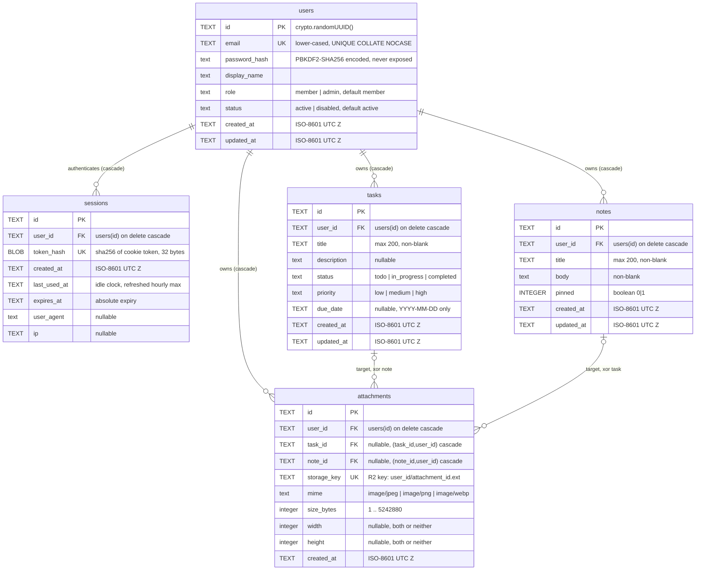

# 05 — Database Design

Scope: logical and physical data design for the shared **D1 (SQLite)** database behind `apps/api`. No
migration file, DDL execution or seed script is produced here. The skeleton in `local://api-surface.md`
is binding; every deviation is listed in §11.2.

## 1. Conceptual model

### 1.1 Entities and ownership

| Entity | Table | Owned by | Owner axis | Lifecycle |
|---|---|---|---|---|
| User | `users` | auth module | itself | created at registration; deleted only through the admin extension (BCR-01), cascading to the member's rows |
| Session | `sessions` | auth module | `user_id` → `users` | created at login/register, revoked at logout, expires absolutely (7 d) and idly (24 h) |
| Task | `tasks` | tasks module | `user_id` → `users` | created at #9, updated at #11, hard-deleted at #12 |
| Note | `notes` | notes module | `user_id` → `users` | created at #14, updated at #16, hard-deleted at #17 |
| Attachment | `attachments` | attachments module | `user_id` → `users`, plus the owning target (`task_id` **xor** `note_id`) | created at #18, hard-deleted at #21 or by target cascade at #12/#17 |

Ownership is a single axis: `row.user_id = session.user_id`. No second axis, no role table, no join
table. `attachments.user_id` is redundant with the target's owner by design and is kept consistent by a
**composite foreign key**, not by application discipline (§3.5).

### 1.2 Cardinalities

- `users 1 — 0..n sessions`; a session belongs to exactly one user. `ON DELETE CASCADE`.
- `users 1 — 0..n tasks`, `users 1 — 0..n notes`. `ON DELETE CASCADE`.
- `tasks 0..1 — 0..n attachments` and `notes 0..1 — 0..n attachments`: an attachment targets **exactly
  one** task or note, never both, never neither (`CHECK` that exactly one of `task_id`/`note_id` is
  non-null); a target
  has zero or more attachments, capped at 10 by the API (§6).
- No attachment exists without a target. There is no staging/unattached state; the consequence for
  "attach at creation" is open question Q1 (§11.1).
- `users 1 — 0..n attachments` (ownership denormalised for authorization and cascade).

### 1.3 Deliberately not modelled

| Not modelled | Reason |
|---|---|
| `tags` / `task_tags` | The brief lists no tagging feature; a tag vocabulary is a new product concept, not a schema detail. |
| Sharing, membership, workspace, roles | A-02 and `00` §4 fix a single-tenant product with one authorization axis; a membership table would add a second axis and reopen every access rule. |
| `deleted_at` (soft delete) | No undo requirement exists, and a retained row would have to be filtered from every list, count and cursor, while risking the existence leakage NFR-SEC-005 forbids. |
| `attachment_targets` (`target_type` + `target_id`) | Polymorphism without FK integrity; two nullable FKs with an exclusivity check is the locked alternative. |
| `audit_log` / `activity_history` | No FR requires history; nothing to retain (§7.4). |
| `email_verification` / `password_reset` tokens | A-06 declares both out of scope. |
| `thumbnails` table | Thumbnails are derived files at a path derived from the attachment id; metadata would have no owner and no independent lifecycle. |
| `attachment_position` column | Replacement: `ORDER BY (created_at, id)` with the batch-offset convention (§3.5, Q4). |
| Counters / aggregate table for the dashboard | #7 computes 7 figures over at most a few hundred rows per owner; a materialised counter is a cache with an invalidation bug surface. |
| `jsonb` blobs | §3.8. |
| Separate `status` / `priority` lookup tables | Closed 3-value vocabularies; a lookup table adds a join and a migration surface with no benefit (§3.10). |

## 2. Mermaid ERD



Read the attachment links as "an attachment optionally targets one task, and a task has zero or many
attachments" — two links plus the exclusivity `CHECK` express the xor; Mermaid cannot.

## 3. Logical schema

Conventions: `TEXT` timestamps are UTC ISO-8601 with a `Z` suffix (§3.9); identifiers are `TEXT` PKs
carrying a UUID generated in the Worker with `crypto.randomUUID()`; all access is hand-written
parameterized SQL, so no column relies on an ORM for defaulting.


**CHECK policy.** A `CHECK` exists only where a violating row is *corrupt regardless of which client
wrote it* (enum membership, target exclusivity, hash shape, byte bounds, non-blank required text).
Format and length policy a future client could legitimately relax (email syntax, 20 000-character body
limit, 100-character display-name limit) stays in the Zod schemas in `packages/contracts` — one source
of truth, no duplicate regex to drift.

### 3.1 `users`

| Column | Type | Null | Default | Key / constraint |
|---|---|---|---|---|
| `id` | `TEXT` | NO | UUID from `crypto.randomUUID()` | **PK** `users_pkey` |
| `email` | `TEXT` | NO | — | **UNIQUE** `users_email_key` `COLLATE NOCASE`; stored lower-cased |
| `password_hash` | `text` | NO | — | `CHECK (password_hash LIKE '$pbkdf2$%')` — narrowed by `0005`; accounts holding any other format were reset by that migration |
| `display_name` | `TEXT` | NO | — | `CHECK (trim(display_name) <> '')` |
| `role` | `TEXT` | NO | `'member'` | `CHECK (role IN ('member','admin'))`; admin extension BCR-01 |
| `status` | `TEXT` | NO | `'active'` | `CHECK (status IN ('active','disabled'))`; `disabled` blocks login and invalidates live sessions |
| `created_at` | `TEXT` | NO | ISO-8601 UTC from the Worker | — |
| `updated_at` | `TEXT` | NO | ISO-8601 UTC from the Worker | set explicitly by #6 |

`password_hash` stores the full PBKDF2-SHA256 encoded string (NFR-SEC-001, ADR-17 — iterations live inside
the string, so tuning needs no migration). `migration 0005` narrows the `CHECK` to this format and resets
accounts holding any other one: their sessions are deleted and the hash is replaced with a PBKDF2 sentinel
whose preimage was discarded, so no password authenticates against it while the row and owned data stay.
The `CHECK` guards against a plaintext or wrong-algorithm value ever being written; it is not a parameter
check.

`role` and `status` exist only for the approved admin extension (BCR-01, `design/09-admin-console.md`).
Ownership authorization never consults them: every task, note and attachment query stays
`WHERE user_id = $sessionUserId`, and a member is never given cross-member read access. `status = 'disabled'`
is checked at session resolution, so a disabled member's outstanding cookies stop working immediately.

Registration needs no pre-flight "does this email exist" query: the unique index is the authority and a
`SQLITE_CONSTRAINT_UNIQUE` violation maps to `CONFLICT` (409).

### 3.2 `sessions`

| Column | Type | Null | Default | Key / constraint |
|---|---|---|---|---|
| `id` | `TEXT` | NO | UUID from `crypto.randomUUID()` | **PK** |
| `user_id` | `TEXT` | NO | — | **FK** → `users(id)` `ON DELETE CASCADE` |
| `token_hash` | `BLOB` | NO | — | **UNIQUE**; `CHECK (length(token_hash) = 32)` |
| `created_at` | `TEXT` | NO | ISO-8601 UTC from the Worker | — |
| `last_used_at` | `TEXT` | NO | ISO-8601 UTC from the Worker | idle clock |
| `expires_at` | `TEXT` | NO | — | `CHECK (expires_at > created_at)` |
| `user_agent` | `TEXT` | YES | — | — |
| `ip` | `TEXT` | YES | — | — |

The raw token never reaches the database: only `sha256(token)` as 32 bytes (hashing happens in the
Worker; the 32-byte `CHECK` makes the hash-not-token rule verifiable). Effective validity is computed
in the lookup, not stored: a session is usable when `expires_at` is after the current time **and**
`last_used_at` is after a Worker-computed 24-hour-ago cutoff. Both clocks are absolute on the
row, so there is no second expiry column to keep in sync. The hourly at-most-once refresh is a
conditional update:

```sql
UPDATE sessions SET last_used_at = ?
WHERE id = ? AND last_used_at < ?;   -- cutoff = now - 1 h, computed in the Worker
```

That statement is idempotent and cannot extend a session's absolute expiry — which is what keeps the
7-day maximum honest.

### 3.3 `tasks`

| Column | Type | Null | Default | Key / constraint |
|---|---|---|---|---|
| `id` | `TEXT` | NO | UUID from `crypto.randomUUID()` | **PK** |
| `user_id` | `TEXT` | NO | — | **FK** → `users(id)` `ON DELETE CASCADE` |
| `title` | `TEXT` | NO | — | `CHECK (trim(title) <> '')`, `CHECK (length(title) <= 200)` |
| `description` | `TEXT` | YES | — | — |
| `status` | `TEXT` | NO | `'todo'` | `CHECK (status IN ('todo','in_progress','completed'))` |
| `priority` | `TEXT` | NO | `'medium'` | `CHECK (priority IN ('low','medium','high'))` |
| `due_date` | `TEXT` | YES | — | date only (`YYYY-MM-DD`), no time |
| `created_at` | `TEXT` | NO | ISO-8601 UTC from the Worker | — |
| `updated_at` | `TEXT` | NO | ISO-8601 UTC from the Worker | set explicitly on every write |

Unique constraint `tasks_id_user_id_key (id, user_id)` — exists solely as the target of the composite
attachment FK (§3.5). No other natural key: two tasks may share a title.

`title` is non-blank after trimming at the DB level because a blank title is a broken row for every
consumer (list row, detail heading, delete confirmation naming the target — FR-UI-007). `description`
carries no DB length check: the contract maximum is policy, storage is `text`.

### 3.4 `notes`

| Column | Type | Null | Default | Key / constraint |
|---|---|---|---|---|
| `id` | `TEXT` | NO | UUID from `crypto.randomUUID()` | **PK** |
| `user_id` | `TEXT` | NO | — | **FK** → `users(id)` `ON DELETE CASCADE` |
| `title` | `TEXT` | NO | — | `CHECK (trim(title) <> '')`, `CHECK (length(title) <= 200)` |
| `body` | `TEXT` | NO | `''` | `CHECK (trim(body) <> '')` |
| `pinned` | `INTEGER` (boolean) | NO | `0` | — |
| `created_at` | `TEXT` | NO | ISO-8601 UTC from the Worker | — |
| `updated_at` | `TEXT` | NO | ISO-8601 UTC from the Worker | set explicitly on every write |

Unique constraint `notes_id_user_id_key (id, user_id)` — FK target, same reason as §3.3.

The `body` default is retained from the locked skeleton but is **inert**: the non-blank `CHECK` means an
`INSERT` that omits `body` fails. Consequence: "body is required" (FR-NOTE-001) is enforced by the
database, not merely by the validator.

### 3.5 `attachments`

| Column | Type | Null | Default | Key / constraint |
|---|---|---|---|---|
| `id` | `TEXT` | NO | UUID from `crypto.randomUUID()` | **PK** |
| `user_id` | `TEXT` | NO | — | **FK** → `users(id)` `ON DELETE CASCADE` |
| `task_id` | `TEXT` | YES | — | **FK** `(task_id, user_id)` → `tasks(id, user_id)` `ON DELETE CASCADE` |
| `note_id` | `TEXT` | YES | — | **FK** `(note_id, user_id)` → `notes(id, user_id)` `ON DELETE CASCADE` |
| `storage_key` | `TEXT` | NO | — | **UNIQUE** `attachments_storage_key_key`; an R2 object key |
| `mime` | `TEXT` | NO | — | `CHECK (mime IN ('image/jpeg','image/png','image/webp'))` |
| `size_bytes` | `INTEGER` | NO | — | `CHECK (size_bytes > 0 AND size_bytes <= 5242880)` |
| `width` | `INTEGER` | YES | — | `CHECK (width > 0)`, paired with `height` |
| `height` | `INTEGER` | YES | — | `CHECK (height > 0)`, paired with `width` |
| `created_at` | `TEXT` | NO | ISO-8601 UTC from the Worker | upload order key |

Table constraints:

- `CHECK ((CASE WHEN task_id IS NULL THEN 0 ELSE 1 END + CASE WHEN note_id IS NULL THEN 0 ELSE 1 END) = 1)`
  — exactly one target (D1's SQLite has no `num_nonnulls`; this is the same predicate spelled out). This
  forbids both "no target" (an attachment nobody can see, invisible garbage) and "both targets" (an
  attachment served under two owners' lists and deleted by whichever cascade fires first). A
  `(target_type, target_id)` pair cannot express this.
- `CHECK ((width IS NULL) = (height IS NULL))` — dimensions are both-or-neither. A half-recorded pair
  cannot produce the CLS-safe fixed aspect-ratio box FR-ATT-010 requires, so it is corruption rather
  than missing information.

**Why the composite FK matters.** With a plain `FK (task_id) → tasks(id)`, nothing stops a row with
`user_id = A` and `task_id` = a task owned by B: the API would be the only thing keeping tenants apart,
and a single missed `WHERE user_id` would leak bytes across accounts. `(task_id, user_id) →
tasks(id, user_id)` makes cross-tenant attachment rows unrepresentable. It costs one extra unique index
per parent table and gives the attachment→parent join in #10/#15 an exact index. Default `MATCH SIMPLE`
semantics mean the FK is not enforced on the `NULL` side, which is what makes two nullable composite FKs
work with the exclusivity check.

**Ordering (FR-ATT-012).** Canonical order is `ORDER BY created_at, id`. `created_at` is written by the
Worker, so N files uploaded in one request would otherwise share a timestamp; the attachments repo
therefore assigns the i-th file of a batch a strictly increasing ISO-8601 UTC `created_at` (a monotonic
Worker clock, or `created_at = base + i ms` when a single base instant is used), preserving upload order.
If that convention is ever violated the order is
still *stable* across requests (the `id` tiebreak is immutable), just not upload order — degraded, not
nondeterministic. Every table's timestamps are Worker-computed; nothing defaults inside D1.

`storage_key` is generated server-side as `<user_id>/<attachment_id>.<ext>` (never from the client
filename). It is stored rather than derived so the storage layout can change (prefix sharding, object
storage) without rewriting ids, and so the sweep job (§7.2) has an authoritative path per row.

### 3.6 Cross-table summary of constraints

| Constraint | Table | Enforced by |
|---|---|---|
| Exactly one target | `attachments` | `CHECK (non-null task_id) + (non-null note_id) = 1` |
| Attachment owner = target owner | `attachments` | composite FK `(task_id, user_id)`, `(note_id, user_id)` |
| Binary size bound | `attachments` | `CHECK size_bytes` |
| Image type closed set | `attachments` | `CHECK mime IN (...)` |
| Enum closure | `tasks` | two `CHECK ... IN (...)` |
| Required text non-blank | `tasks.title`, `notes.title`, `notes.body`, `users.display_name` | `CHECK trim(...) <> ''` |
| Secret never plaintext | `users` | `CHECK password_hash` accepts only PBKDF2-SHA256 |
| Session token never stored | `sessions` | `CHECK length(token_hash) = 32` |
| Cascade on target delete | `attachments` | FK `ON DELETE CASCADE` on the composite key |

The per-target limit of 10 attachments (FR-ATT-002, A-07) is **not** a table constraint: a `CHECK` cannot
count sibling rows, and a trigger would duplicate logic the upload transaction already serialises (§6).
Q3 records the residual risk (a direct SQL writer could exceed 10).

### 3.7 Normalization

3NF, with two deliberate, *proven* redundancies:

1. `attachments.user_id` duplicates the owner reachable through `task_id`/`note_id`. Authorization
   (#19/#20/#21) and cascade on user delete need the owner without a join, and the composite FK makes
   the duplicate impossible to desynchronise. Application-maintained it would be a defect;
   constraint-maintained it is a cache with a proof.
2. `attachments.width/height/size_bytes` are derivable from the object. The content endpoint must emit
   `Content-Length`/dimensions without decoding (FR-ATT-010, FR-ATT-005), and `size_bytes` is the value
   upload validation already measured. Recomputing on read would open every object on every list render.

Everything else is fully normalised: no repeating groups, no arrays, no enum-in-text duplication across
tables, no column functionally dependent on another non-key column in the same row.

### 3.8 Why no JSON/document columns

Attachment metadata is the only plausible document field and it fails on the three things the product
needs: (a) per-attachment deletion (#21) needs a row identity and unique `storage_key`; (b) cascade from
a deleted task must remove exactly its attachments — with a JSON array the DB cannot cascade, so the
API would rewrite the parent row and produce orphan R2 objects on a mid-rewrite crash; (c) the
10-per-target cap and the ownership rule are `COUNT`/`WHERE` problems, which are SQL, not JSON-path,
operations. No JSON/document column is used anywhere.

### 3.9 Types and storage conventions

- `TEXT` timestamps in ISO-8601 UTC with a `Z` suffix for every instant; `TEXT` `YYYY-MM-DD` for
  `due_date` (A-15). Because every stored instant carries an explicit offset and is UTC, a lexicographic
  comparison equals a chronological one — D1 needs no timezone session state, and "overdue" cannot change
  with a session setting. Both frontends therefore see one definition of "today".
- `TEXT` for `ip` (an address string); `BLOB` for the session hash; `TEXT COLLATE NOCASE` for email;
  `TEXT` plus a `CHECK (length(...) <= 200)` for titles (a real bound); `TEXT` for free-length fields.
- Timestamps are computed in the Worker before the statement is issued — D1 has no `now()` that the
  application controls, so every `created_at`/`updated_at`/`expires_at` is a bound parameter.
- D1 has no server-side session state and no configurable per-query timeout: each Worker's database work is
  bounded by the Workers CPU/wall-clock limit, so there is nothing to set or reset.

### 3.10 No extensions, and why not native ENUM

D1 (SQLite) has no extension mechanism, and the three things an extension-providing engine would cover are
handled by native D1 features:

- **Case-insensitive email.** `email` is stored lower-cased and the unique index is declared
  `COLLATE NOCASE`, so `WHERE email = ?` and the uniqueness rule are both case-insensitive by
  construction — a future query cannot forget `lower()` and silently miss.
- **Substring search.** The requirement is a **substring** match on title-or-description, not stemming or
  ranking, so it is a parameterized `LIKE '%q%' ESCAPE '\'` (ASCII case-insensitive by default in
  SQLite), riding on the ownership-leading indexes as a residual filter. No extension or trigram index is
  required.
- **UUIDs** come from `crypto.randomUUID()` in the Worker and are bound as `TEXT`.

**Native ENUM types are avoided.** SQLite has no ENUM type, so `text + CHECK` is the only option — but it
is also the better one here. A closed vocabulary in a dedicated type is attractive until a value must be
added or renamed: in engines that support ENUM the change cannot be rolled back and dropping a value
means recreating the type and rewriting every dependent column. Removing `completed`, or
renaming `in_progress`, is a plausible product change; with `text + CHECK` it is one
`ALTER TABLE ... DROP CONSTRAINT` / `ADD CONSTRAINT` pair inside a normal migration. The cost of `text` is
a few bytes per row and the need for a `CHECK` — both irrelevant at A-04 scale, and the closed set is
enforced identically.


## 4. Indexes

Nine secondary indexes plus ten primary-key and unique constraints. Every row names the endpoint from
`local://api-surface.md` that it serves; §4.4 is the other half of the argument. Numbers #16, #17, #19
and #20 are retired with the trigram search indexes and are not re-used.

### 4.1 Primary keys and unique constraints

| # | Name | Table | Columns / expression | Type | Query served (endpoint) | Why |
|---|---|---|---|---|---|---|
| 1 | `users_pkey` | `users` | `(id)` | btree unique | #4 `auth/me`, #5 `users/me`, #6 PATCH | PK |
| 2 | `users_email_key` | `users` | `(email COLLATE NOCASE)` | btree unique | #2 login `WHERE email = ?`; #1 duplicate detection via a unique-constraint error | Single-column equality; also the uniqueness rule itself |
| 3 | `sessions_pkey` | `sessions` | `(id)` | btree unique | #3 logout delete; hourly refresh | PK |
| 4 | `sessions_token_hash_key` | `sessions` | `(token_hash)` | btree unique | **every** authenticated request: session resolution by cookie hash (#4, #8–#21) | 32-byte equality; the only access path to a session |
| 5 | `tasks_pkey` | `tasks` | `(id)` | btree unique | #10/#11/#12 by id | PK |
| 6 | `tasks_id_user_id_key` | `tasks` | `(id, user_id)` | btree unique | FK target for `attachments(task_id, user_id)`; exact join in #10 | Constraint support, not an optimisation attempt |
| 7 | `notes_pkey` | `notes` | `(id)` | btree unique | #15/#16/#17 | PK |
| 8 | `notes_id_user_id_key` | `notes` | `(id, user_id)` | btree unique | FK target for `attachments(note_id, user_id)`; join in #15 | Constraint support |
| 9 | `attachments_pkey` | `attachments` | `(id)` | btree unique | #19 metadata, #20 content, #21 delete | PK, and the only path from a URL to a row |
| 10 | `attachments_storage_key_key` | `attachments` | `(storage_key)` | btree unique | §7.2 orphan sweep: row lookup by key-derived key; plus the uniqueness rule | Equality on a unique key |

### 4.2 Task indexes

| # | Name | Columns / expression | Type | Query served (endpoint) | Why this order |
|---|---|---|---|---|---|
| 11 | `tasks_user_updated_at_id_idx` | `(user_id, updated_at DESC, id DESC)` | btree | #8 default list `sort=-updated_at` + cursor; #7 "5 most recently updated tasks" | `user_id` equality first (the ownership filter is on every query), then the sort key descending with the tiebreak descending — so the index output *is* the required order and no sort step is needed; `id DESC` matches the cursor comparison direction, making the whole predicate one index range |
| 12 | `tasks_user_status_updated_at_id_idx` | `(user_id, status, updated_at DESC, id DESC)` | btree | #8 `status=` + default sort + cursor; #7 status counts | Equality columns in selectivity-then-usage order, then the sort pair; one index answers both "filtered page" and "count per status" |
| 13 | `tasks_user_priority_updated_at_id_idx` | `(user_id, priority, updated_at DESC, id DESC)` | btree | #8 `priority=` + default sort; #7 priority breakdown | Same shape as #12 for the other low-cardinality filter |
| 14 | `tasks_user_created_at_id_idx` | `(user_id, created_at DESC, id DESC)` | btree | #8 `sort=-created_at` + cursor | Created-at ordering cannot use the `updated_at` index |
| 15 | `tasks_user_due_date_id_idx` | `(user_id, (due_date IS NULL), due_date DESC, id DESC)` | btree (expression) | #8 `sort=-due_date` + cursor; due-state filters (`overdue`, `today`, range); #7 overdue count | SQLite places NULLs first ascending and last descending, but that default is implicit; the null placement is therefore materialised as a leading expression column so the rule is explicit and engine-independent: undated rows get `1` and sort after dated rows (`0`). `due_date` before `id` because it is the sort/range key. Every `ORDER BY` over this index must lead with the identical expression — `ORDER BY (due_date IS NULL) ASC, due_date DESC, id DESC` — or SQLite cannot use the index order and sorts instead |
| — | *(no index)* | search is an unindexed `LIKE` | — | #8 `q=`, #13 `q=` | The former `tasks_title_trgm_idx` (#16) and `tasks_description_trgm_idx` (#17) are dropped: D1 has no trigram/GIN index. At A-04 scale (≤ 50 rows per owner) a parameterized `LIKE '%q%' ESCAPE '\'` is a filtered scan over the owner's rows — bounded by table size, and cheaper than maintaining index structures D1 does not offer. Search therefore rides on the ownership-leading indexes (#11–#14) as a residual filter rather than being served by its own index |

### 4.3 Note and attachment indexes

| # | Name | Table | Columns / expression | Type | Query served (endpoint) | Why this order |
|---|---|---|---|---|---|---|
| 18 | `notes_user_pinned_updated_at_id_idx` | `notes` | `(user_id, pinned DESC, updated_at DESC, id DESC)` | btree | #13 list `sort=-pinned,-updated_at` + cursor | The sort keys in the emitted order, so the index alone produces `pinned DESC, updated_at DESC, id DESC` and the cursor predicate is one row comparison. `pinned` must precede `updated_at` — reversing them would put an unpinned recent note above a pinned older one, contradicting FR-NOTE-003 |
| — | *(no index)* | search is an unindexed `LIKE` | — | #13 `q=` | The former `notes_title_trgm_idx` (#19) and `notes_body_trgm_idx` (#20) are dropped for the same reason as the task search indexes: no trigram/GIN in D1, and `LIKE` over the owner's notes is bounded at this scale |
| 21 | `attachments_task_id_created_at_id_idx` | `attachments` | `(task_id, created_at, id)` | btree | #10 task detail attachments (upload order); cascade lookup when #12 deletes a task; the `hasAttachments` filter on #8 (`EXISTS (...)`) | `task_id` first because every access is by target; `created_at, id` ascending because FR-ATT-012 fixes upload order ascending; without the `task_id` prefix, deleting a task would table-scan `attachments` |
| 22 | `attachments_note_id_created_at_id_idx` | `attachments` | `(note_id, created_at, id)` | btree | #15 note detail attachments; cascade on #17; attachment presence on #13 rows | as #21 for the note side |
| 23 | `sessions_expires_at_idx` | `sessions` | `(expires_at)` | btree | §7.1 purge: `DELETE FROM sessions WHERE expires_at < ?` (Worker-computed cutoff) | The purge predicate is a range on exactly this column; nothing else filters by expiry |

### 4.4 Indexes deliberately NOT added

| Candidate | Why not |
|---|---|
| `tasks(user_id)` alone | Every task query begins `WHERE user_id = ?`; #11–#15 already lead with `user_id`. A standalone index would be a strict prefix duplicate. |
| `notes(user_id)` alone | Same argument against #18. |
| `notes(user_id, updated_at DESC)` for the dashboard's "5 most recent notes" | #7's note ordering is by `updated_at` *regardless of pin state*, which #18 cannot serve because `pinned` precedes `updated_at`. Accepted cost: a bounded sort over the owner's notes only (≤ 50 in the dataset, a few hundred at worst). Adding a fifth notes index for one `LIMIT 5` widget at this scale is unjustified; revisit at thousands of notes per user. |
| `tasks` composite for every filter × sort cross-product | 2 filters × 3 sorts + 4 due-state variants. Each extra index is write cost on every task update; the filtered subset per owner is small enough that D1 sorts it after an index scan on the filter index. A deliberate "index the default and the two filters, sort the rest" decision. |
| Partial index `WHERE status <> 'completed'` for overdue counts | The predicate combines `due_date` and `status`, and the overdue set is a small fraction of one owner's rows; #15 already range-scans it. |
| `sessions(user_id)` | No endpoint lists a user's sessions; #3 revokes by session id, and users are never deleted, so the cascade path is unreachable. |
| `attachments(user_id)` | No query lists a user's attachments; ownership is checked on the row fetched by PK. |
| `lower(title)` btree for search | Case-insensitive **substring** search is not served by a functional btree, which handles prefix/equality only; a leading-wildcard `LIKE '%term%'` cannot use it. |
| Full-text (`tsvector`-style) index | Wrong semantics (§3.10) — stemming fails the substring matching required by FR-TASK-011/FR-NOTE-008, and partial words miss entirely. |
| `users(lower(email))` unique | Redundant with the `COLLATE NOCASE` unique index (#2), which already makes the comparison case-insensitive without depending on a query remembering `lower()`. |
| Any index to accelerate substring search (`LIKE '%q%'`) | D1 offers no trigram or GIN index, so no structure serves a leading-wildcard `LIKE`. Accepted: search is an unindexed filtered scan over the owner's rows, bounded at A-04 scale. This retires the former trigram indexes #16/#17/#19/#20. |
| An index mirroring the null-ordering emulation | The `(due_date IS NULL)` leading expression is *already inside* index #15, so there is nothing separate to add. The cost is that every query over #15 must repeat the identical leading expression in its `ORDER BY` — a discipline requirement, not an index. |

**Search caveat, honoured in SQL not in the index.** `LIKE` metacharacters in `q` must be escaped before
the pattern is built
(`'%' || replace(replace(replace(?,'\','\\'),'%','\%'),'_','\_') || '%'`), otherwise `q=%` degenerates
into a full-table match and `q=_` becomes a single-character wildcard. Because there is no trigram index,
**every** `q=` term — short or long — is answered by a filtered scan over the owner's rows — accepted,
bounded by table size, identical for both frontends.

## 5. Keyset pagination design

### 5.1 Cursor composition

The cursor always carries **the last row's sort-key values plus the id tiebreak**, never an offset and
never a `user_id` (the session supplies ownership; putting it in the cursor would invite a client to try
to change it).

| List | Sort (per `06`, extended by O-9) | Keys in cursor | Tiebreak |
|---|---|---|---|
| Tasks, default | `-updated_at` | `updated_at` (ISO-8601 UTC string) | `id` |
| Tasks | `-created_at` | `created_at` | `id` |
| Tasks | `-due_date` | `due_date` (`YYYY-MM-DD` string, **nullable**) | `id` |
| Notes | `-pinned,-updated_at` | `pinned` (boolean), `updated_at` | `id` |

Because every timestamp is stored as an ISO-8601 UTC string with a `Z` suffix, lexicographic comparison
*is* chronological comparison — no cast is needed and none is possible.

### 5.2 Encoding and validation

`base64url(utf8(JSON))` of `{"v":1,"s":"<sort-id>","k":[<key values as strings>]}` — e.g.
`{"v":1,"s":"t:updated","k":["2026-11-15T09:41:07.123Z","0193f2c1-..."]}`. Roughly 100 characters.

- `s` is a sort discriminator (`t:updated`, `t:created`, `t:due`, `n:pinned`). A cursor minted for one
  sort is rejected when presented to another, so a stale URL cannot silently produce a wrong order.
- **No signature.** A forged cursor can only reposition the caller inside *their own* result set,
  because `user_id` comes from the session and is not encoded. An HMAC would add a rotating secret and a
  key-rotation failure mode for zero authorization benefit. This is why `user_id` must never be added to
  the payload.
- Validation, all failing as `VALIDATION_FAILED` with `details[0].field = "cursor"` (never a 500):
  length ≤ 256; base64url alphabet only; JSON parses; `v === 1`; `s` known and equal to the requested
  sort; `k` arity matches the sort; each value parses to its declared type (an ISO-8601 UTC string via
  `Date.parse`, `id` via the canonical UUID regex, `due_date` via `YYYY-MM-DD` or `null`, boolean via
  `true`/`false`).
- `limit`: integer 1..100, default 20; `limit + 1` rows are fetched, and `nextCursor` is emitted from the
  extra row's predecessor only when the extra row exists. `nextCursor: null` means the last page.

### 5.3 SQL predicate shapes

The predicate exists **only** when a cursor is supplied: each list has two static, fully parameterized
statements ("first page" and "next page"). No string concatenation, no dynamic `AND ...` building — only
the values of the bound parameters vary.

**Tasks by `-updated_at`** (index #11; `-created_at` uses #14):

```sql
-- next page; $1 user_id, $2 cursor.updated_at, $3 cursor.id, $4 limit
SELECT id, title, description, status, priority, due_date, created_at, updated_at
FROM tasks
WHERE user_id = $1
  AND (updated_at, id) < ($2, $3)
ORDER BY updated_at DESC, id DESC
LIMIT $4 + 1;
```

Row-wise comparison on `(updated_at, id)` is a single index range when the index order matches the
`ORDER BY` direction — which is why #11 is declared `DESC, DESC`.

**Tasks by `-due_date`, with the NULL rule** (index #15):

`due_date` is nullable and FR-TASK-010 demands an explicit "no due date" state. Rule: **undated sorts last
in both directions**. SQLite's descending sort already leaves undated rows at the end, and index #15
makes the rule explicit with its leading expression column `(due_date IS NULL)`, whose value every such
`ORDER BY` must repeat. The cursor therefore has two regions — the dated region and the undated tail —
and the predicate is a three-branch disjunction:

```sql
-- next page; $1 user_id, $2 cursor.due_date (nullable), $3 cursor.id, $4 limit
WHERE user_id = $1
  AND (
        ($2 IS NOT NULL AND due_date IS NOT NULL
           AND (due_date, id) < ($2, $3))                              -- still in the dated region
     OR ($2 IS NOT NULL AND due_date IS NULL)                          -- crossing into the undated tail
     OR ($2 IS NULL AND due_date IS NULL AND id < $3)                  -- inside the undated tail
      )
ORDER BY (due_date IS NULL) ASC, due_date DESC, id DESC
LIMIT $4 + 1;
```

All three branches are index ranges on #15 because the physical index order equals the emitted order; the
`(due_date IS NULL)` leading expression is what makes the third branch a range on `id` rather than a
filter. Overdue is a *filter*, not an ordering: `due_date < ? AND status <> 'completed'` (the bound
parameter is today's `YYYY-MM-DD` computed in the Worker) — a range on the same index, maskable by the
`status`-leading index (#12) when the client sends `status=todo`.


**Notes by `(-pinned, -updated_at)`** (index #18):

```sql
-- next page; $1 user_id, $2 cursor.pinned, $3 cursor.updated_at, $4 cursor.id, $5 limit
WHERE user_id = $1
  AND (pinned, updated_at, id) < ($2, $3, $4)
ORDER BY pinned DESC, updated_at DESC, id DESC
LIMIT $5 + 1;
```

Because **all three** sort keys descend, the mixed-type tuple comparison is valid and correct in one
term: `false` sorts after `true` in descending order, which is exactly "pinned block first". This is why
the notes index uses `pinned DESC` rather than a partial index on `pinned = true` — a partial index would
need a second query unioned for the unpinned tail, and the cursor would have to encode which block it was
in.

### 5.4 Why `offset` is rejected

1. **Cost grows with depth**: `OFFSET n` reads and discards `n` rows, and the cost is invisible in the
   response.
2. **Instability breaks the acceptance criterion**: between two requests a row may be updated (moving it
   in `-updated_at` order) or deleted, so `LIMIT/OFFSET` can repeat one row and skip another — directly
   violating FR-TASK-003's "traverse the whole set without duplicates or omissions".
3. **Ties split**: `updated_at` is not unique; a boundary inside a tie group makes the split arbitrary
   and the missing row unreachable.
4. It is not in the contract (`limit` + `cursor` + `nextCursor`), so accepting it would be a contract
   change.
5. A cursor is **stateless**: no server-side result set, no session affinity, so either frontend and any
   number of Workers can serve page n+1.

**Honest limitation.** A keyset cursor fixes ordering, not snapshot isolation: it is a position in a live
ordering, not a repeatable read. With a quiescent dataset (the benchmark) the traversal guarantee holds
exactly; under concurrent writes it holds up to rows that changed during traversal — the expected
semantics of cursor pagination, documented rather than papered over. D1 offers no cross-request
transaction to hide behind — there is no way to hold a read open across HTTP requests, so the limitation
is disclosed, not solved.

## 6. Transactions and consistency boundaries

D1 is single-writer and serialises writes; there is no isolation-level vocabulary to configure and no
cross-request transaction. Every invariant that matters is enforced by **one `env.DB.batch([...])` per
mutation** — the batch is the atomicity unit: its statements run as one implicit transaction, all commit
or all roll back. Anything a batch cannot express is enforced by a constraint instead, never by a
read-then-write sequence spanning requests.

| Operation | Statements | Atomicity unit | Notes |
|---|---|---|---|
| #1 Register | `batch([INSERT users, INSERT sessions])` | one `batch()` | Two rows must both exist or neither: a user without a session would leave a registered account never authenticated. A unique-constraint error on `users_email_key` → batch rollback → `CONFLICT`. The cookie is set only after the batch commits. |
| #2 Login | `SELECT users WHERE email`; PBKDF2 verify in the Worker; `INSERT sessions` | autocommit statement | Single write, no invariant spanning rows. The expensive hash verification never runs inside a batch. |
| #3 Logout | `DELETE FROM sessions WHERE id = ?` | autocommit statement | Idempotent; 0 rows is still success (the cookie is cleared either way). |
| #4 `/auth/me` + refresh | `SELECT` session by `token_hash`; conditional `UPDATE last_used_at` | autocommit statements | The refresh is guarded by `last_used_at < ?` (a Worker-computed cutoff), so concurrent requests in the same hour write nothing and no write is contended. |
| #9 Create task | `INSERT ... RETURNING` | autocommit statement | One row; attachments are separate requests (§6.3). |
| #11 PATCH task / status | `UPDATE ... SET ..., updated_at = ? WHERE id = ? AND user_id = ? RETURNING *` | autocommit statement | The `user_id` predicate makes "foreign-owned" and "absent" the same zero-row outcome → one `NOT_FOUND` path (NFR-SEC-005). No lost-update detection: last write wins (no `If-Match`/version column in the contract) — recorded as a property, see Q6. |
| #14/#16 note create/update/pin | `INSERT` / `UPDATE ... WHERE id, user_id RETURNING` | autocommit statement | Pin toggling is an ordinary update; it changes `pinned` and `updated_at`, which reorders the list by design. |
| #18 Attachment upload | binaries written to R2 first → `batch([SELECT count(*) FROM attachments WHERE task_id = ?, INSERT attachments (or set/undo per the count)])` | one `batch()` | The count and the insert inside one batch serialise concurrent uploads to the same target — D1 is single-writer, so no other writer can interleave between the count and the insert. That is what makes the 10-attachment cap (FR-ATT-002) hold without a trigger: the count-then-set runs as one atomic unit, and a count already at 10 makes the batch reject (or undo) instead of insert. No R2 I/O happens between the count and the insert. |
| #21 Attachment delete | `batch([DELETE ... WHERE id=? AND user_id=? RETURNING storage_key])` → delete full + thumb in R2 | one `batch()` | See ordering rule §6.1. |
| #12 Delete task / #17 delete note | `batch([SELECT storage_key FROM attachments WHERE task_id = ?, DELETE FROM attachments WHERE task_id = ?, DELETE FROM tasks WHERE id = ? AND user_id = ? RETURNING id])` → delete each R2 object | one `batch()` | The `SELECT` runs first **in the same batch**, so it reads the attachment rows before the batch's own deletes (and the FK cascade) remove them — that is why storage keys are collected inside the batch rather than by a follow-up query (which would find nothing). The explicit `DELETE FROM attachments` makes the key collection deterministic; the FK cascade stays as defence in depth. |
| #7 Dashboard | one `batch()`: grouped counts + two `LIMIT 5` lists | one `batch()` | One batch is one implicit transaction with a single snapshot, so the 7 counts and the two lists are mutually consistent without an explicit transaction — required by FR-DASH-002. Separate round-trips would not guarantee that. |

### 6.1 Ordering rule: object versus row

**The row is the commit point.** Objects are *written to R2 before* the row is inserted and
*removed from R2 after* the row is deleted. Both halves fail in the same direction: an orphan R2 object.

| Step order | Crash after this step leaves | Visible to a user? |
|---|---|---|
| Upload: write object → `INSERT` row → batch commits | an object with no row | No. The content endpoint resolves rows only, so the object is unreachable; the sweep removes it. |
| Upload: `INSERT` row → batch commits → write object | a row with no object | **Yes** — a broken image and an error on the content endpoint (a visible defect). |
| Delete: `DELETE` row → batch commits → delete object | an object with no row | No — same as an upload orphan. |
| Delete: delete object → batch commits → `DELETE` row | a row with no object | **Yes** — worst case, because the user has already been told the deletion succeeded. |

So: never insert a row before its object exists, never delete an object before its row is gone. The
irreducible non-atomic step is the R2 delete *after* the batch commits (a database and an object store
cannot commit together); a crash there is a leaked object, which §7.2 sweeps, never a broken reference.
An R2 `put`/`delete` is atomic per key, so there is no separate "rename into place" step to reason about —
the object appears at its final key in one operation.

Uploads become visible only after the batch commits (the response returns the inserted row), so a crash
*before* the commit and after the object write shows nothing at all — matching FR-ATT-009's "a failed
upload must not leave a visible attachment".

### 6.2 Missing-object handling on read

If #20 finds the row but not the object (a hand-deleted R2 object, a crashed restore), the response is
`NOT_FOUND` — indistinguishable from an absent attachment (NFR-SEC-005) — and the row is queued for
reconciliation (§7.3) rather than deleted inline. Deleting inline would turn a transient R2 failure
into permanent data loss.

### 6.3 "Attach at creation" — the boundary that does not exist

There is no cross-resource transaction spanning "create task" and "upload its images", because
`attachments` has no unattached state (§3.5). The flow is `#9` then N × `#18`. A crash between them leaves
a task with fewer attachments than the user selected — visible and retryable, and permitted by
FR-ATT-009's per-file semantics. Making it atomic would require unattached attachments (weakening the
exclusivity `CHECK`) or a staging table; both rejected here and raised as Q1, because the choice belongs
to the API/UX contract, not the schema alone.

### 6.4 Why no `SERIALIZABLE`

The only read-then-write invariant is the 10-attachment cap, protected by doing the count and the insert
inside one `batch()` (§6, #18). Everything else is single-statement. There is no `SERIALIZABLE` to reach
for: D1's single-writer serialisation already gives every batch a consistent view, so no operation needs
a stronger guarantee.

## 7. Data lifecycle and retention

### 7.1 What deletes what

| Deleted | Mechanism | Objects |
|---|---|---|
| Task (#12) | `DELETE FROM tasks` inside the batch → FK cascade removes its `attachments` rows (with an explicit `DELETE FROM attachments` ahead of it in the same `batch()`) | storage keys collected by the batch's leading `SELECT`, objects deleted from R2 after the batch commits |
| Note (#17) | same shape on `notes` | same |
| Attachment (#21) | `DELETE FROM attachments` | R2 objects deleted after the batch commits (full + thumb) |
| User | no endpoint exists; the cascade is declared for completeness and for test fixtures | none in scope |
| Session | explicit `DELETE` at logout; purge on `expires_at` | none |

### 7.2 Orphan object sweep

A Cron Trigger (built under T-503/T-507) lists R2 objects under the bucket prefix and, for
each object, checks whether an `attachments` row exists with that `storage_key`.

- **Data condition acted on**: an object whose `storage_key` has no `attachments` row **and** whose
  R2 `uploaded` timestamp is older than a grace window (24 h).
- **Idempotency**: deletion is an R2 `delete`, treating a missing object as success; running it twice is
  a no-op.
- **Concurrency**: two sweeps can overlap; both do the same idempotent delete. The grace window prevents a
  sweep from deleting an object the upload path has just written but not yet inserted a row for —
  the only real race, closed by time, not by locking.
- **Failure/lateness**: a failed run leaks storage only; nothing user-visible depends on it. Bucket size is
  the alertable signal.

### 7.3 Orphan row reconciliation

Condition: rows whose expected object is absent (detected by the sweep's inverse, or on the `NOT_FOUND`
path of #20 — an R2 `head()` miss behaves the same way). Action: delete rows whose object has been
missing longer than the grace window, logging the
id. Not done inline (§6.2) so a restored bucket heals instead of destroying rows.


### 7.4 What is *not* retained

No history: deletes are physical, so a deleted task's text is gone at commit; a deleted attachment's
metadata is gone with its row; the object outlives its row by at most one sweep interval and is
unreachable the whole time because the content endpoint resolves rows. No archive table, no `_history`,
no "recently deleted". This is the direct consequence of hard delete (§1.3) and what makes
`NOT_FOUND`-indistinguishability (NFR-SEC-005) achievable.

Session rows are the one exception to "physical and immediate": an expired session is *functionally* dead
the moment `expires_at` passes (the lookup rejects it), but the row can persist up to the purge interval.
Bounded by the 7-day absolute expiry, so worst-case growth is "sessions created in the last 7 days plus
one purge interval".

### 7.5 Recurring mechanisms (Operating Rule 14)

| # | Mechanism | Owner | Trigger | Concurrency | Failure / lateness | Roadmap task |
|---|---|---|---|---|---|---|
| M1 | Session purge: `DELETE FROM sessions WHERE expires_at < ?` (Worker-computed cutoff) | Iqram | nightly Cron Trigger | Idempotent `DELETE`; safe to re-run | Rows linger; auth unaffected because expiry is checked on read. Late run = no functional effect. | T-503 + a maintenance task in P5 |
| M2 | Orphan object sweep (§7.2) | Iqram | nightly, same Cron Trigger | Idempotent R2 delete, missing object tolerated, 24 h grace | Bucket grows; nothing user-visible. Late run only delays reclamation. | T-507 |
| M3 | Orphan row reconciliation (§7.3) | Iqram | nightly, same Cron Trigger | Per-row `DELETE` by id, no cross-row invariant | Broken image persists (already answered `NOT_FOUND`); a restored bucket heals before the window expires. | T-507 |
| M4 | Benchmark dataset reset between repetitions | Erika + Iqram | before each repetition of a mutating scenario (S7–S10) and before each campaign | Exclusive: one runner; refuses to run while a run is in progress (guard in the benchmark driver) | A repetition that mutates without a reset invalidates that repetition only; the manifest records the dataset checksum so it is detectable after the fact. | T-407, used by T-1001 |
| M5 | Backup snapshot: `wrangler d1 export` + R2 object copy | Iqram | before each benchmark campaign and nightly | Single runner per schedule (Cron Triggers do not overlap a single schedule) | A campaign started without a snapshot can run but cannot be restored to a known state; recorded in the manifest. | New task in P4/P8 (backup + restore drill); RPO/RTO not yet defined (Q7) |

**Runner (resolved in `03` §11):** Cron Triggers on the Worker, nightly, with lazy handling on the access
paths that matter (a session's own expiry, a missing object on read). M4's "refuses to run while a run is
in progress" is an application-level guard in the benchmark driver, since Cron Triggers are single-runner
per schedule, which serialises them naturally. `03` §11 owns the decision.

Nightly `wrangler d1 export` of the single database (or D1 Time Travel PITR for point-in-time recovery)
plus an R2 object copy. Restore point: both
artifacts are taken in the same window, so a restore can leave objects slightly *newer* than rows
(harmless — those become M2 candidates) but never older (which would produce missing objects, the bad
direction). A restore drill is a prerequisite for trusting the benchmark rollback path.

## 8. Migration strategy

### 8.1 Shape

- Location: `apps/api/migrations`, plain `.sql` files, applied by `wrangler d1 migrations apply`.
- Naming: `NNNN_slug.sql`, zero-padded ordinal, lowercase snake slug (`0001_init.sql`,
  `0002_attachments_target_fk.sql`). The number is the ordering key, the slug is for humans.
- Migrations are **forward-only**: no `-- Up Migration` / `-- Down Migration` markers, because D1's
  migrator applies files in ordinal order and records each in its `d1_migrations` bookkeeping table.
- `0001_init` contains the five tables, all constraints and all indexes from §4. There are no
  `CREATE EXTENSION` statements to run — D1 has no extension mechanism — and no
  `CREATE INDEX CONCURRENTLY`/transaction question to reason about, because D1 manages its own transaction
  handling around each migration file.
- Migrations contain no data manipulation beyond what a schema change requires, and never reference
  environment variables, storage keys or application code.

### 8.2 Forward-only, and what "down" means

- Migrations are **forward-only** in every shared environment (CI, preview, the benchmark account).
- No destructive reverse migration is ever executed against a shared environment: recovery from a bad
  migration is a **new** migration that corrects it (roll forward). A migration that dropped a column
  cannot be undone — the data is gone, and a structural "down" would give false confidence.
- `wrangler d1 migrations apply --remote` is a deploy/CI step, **not** something the Worker runs at boot.
  Workers cannot gate startup on database state, and running migrations at boot with N isolates means N
  concurrent attempts; keeping it external means one bounded step with a clear failure.

### 8.3 Migrations from empty in CI

1. CI creates a fresh local D1 database (`wrangler d1 migrations apply --local` against empty
   `.wrangler/state`).
2. The command applies every `.sql` file in ordinal order and records each in `d1_migrations`.
3. A check asserts the applied count in `d1_migrations` equals the number of `.sql` files on disk — a file
   added without being applied, or applied twice, fails the build.
4. The integration suite then runs against that freshly migrated database (T-502/T-508), so "migrations
   from empty" is exercised on every PR rather than once.

### 8.4 Seeding, after migration and tagged

Seeding is a separate command, never part of a migration. It requires migrations at head (asserted, not
assumed) and writes a **dataset ID** (`scripts/seed --dataset=m1`, T-407), recorded in the manifest
(§9.4). Seeding is `wrangler d1 execute --file=seed.sql` or a Worker script that issues the same inserts
through the binding. The seed inserts explicit UUIDs (§9.2), so the same dataset ID always produces
byte-identical rows; `--reset` truncates and re-inserts rather than appending.

### 8.5 Schema drift detection

Two independent checks, catching different failures:

1. **Build-time fingerprint.** CI migrates a fresh local D1, then dumps the schema (`.schema` output, or
   the equivalent introspection via `sqlite_master`/`PRAGMA table_info`), normalises it, and diffs it
   against the committed snapshot `apps/api/migrations/schema.snapshot.sql`. A hand-edited database, or a
   migration whose effect differs from its file, shows up as a diff.
2. **CI applied-set check.** CI compares `wrangler d1 migrations list` (the applied set recorded in
   `d1_migrations`) with the migration files on disk and fails the build if they differ.
   This catches "code deployed, migration forgotten", the drift that actually happens in a
   student-project deployment. The old boot-time check cannot exist here — a Worker cannot refuse to
   start based on D1 state — so this check runs in CI on every deploy instead.

Neither check repairs anything; both fail loudly and the fix is always "add a forward migration".


## 9. Dataset for benchmarking

Determinism here is a *design property* — same dataset ID in, same rows out — not a performance claim. No
timings appear in this section (C-11).

### 9.1 Shape (A-04)

Per user: **50 tasks, 50 notes, 3 images ≤ 1 MB**. Default 2 users (one benchmark account, one second
account so ownership isolation is testable with real rows); the count is a generator parameter, not a
schema constant.

| Entity | Per user | Distribution (exact quotas, not probabilities) |
|---|---|---|
| `users` | 1 | `u01@bench.invalid`, `u02@bench.invalid`; identical fixture `password_hash`; `display_name` = "Bench User 01/02" |
| `tasks` | 50 | status: 20 `todo`, 15 `in_progress`, 15 `completed`; priority: 17 `low`, 17 `medium`, 16 `high`; `due_date`: 15 `NULL`, 15 overdue-window, 10 near-future, 10 far-future (§9.3) |
| `notes` | 50 | `pinned = true` for exactly 5 (indices 0–4); bodies of deterministic length spanning 200–2 000 characters |
| `attachments` | 3 | the 3 shared fixture images, one each on tasks 1–3, so the detail page and the thumbnail strip both have content and the "no attachments" empty state still occurs on 47 tasks |
| `sessions` | 0 | created at login during the run, not seeded — the auth flow is part of S2/S3 and must exercise the real path |

Text content is built from a fixed word list indexed by row number, and exactly one token — the
**probe term**, e.g. `milk` — appears a known number of times in task titles, task descriptions, note
titles and note bodies. The generator reports those counts in the manifest, so the search scenario's
expected result size is a recorded fact rather than a run-time assumption.

### 9.2 Determinism levers

| Lever | Rule |
|---|---|
| PRNG | One seeded generator (single 32-bit seed in the manifest); every choice draws from it in a fixed order, so row *n* is a pure function of `(dataset_id, table, n)`. |
| IDs | `uuidv5(namespace = dataset_id, name = "<table>:<index>")` — stable across regenerations, so page contents and cursors are comparable between runs and the checksum is stable. |
| Timestamps | `created_at`/`updated_at` derived from the **anchor date** with fixed per-row offsets, formatted in JS as ISO-8601 UTC with a `Z` suffix, never a database `now()`. Each user's 50 tasks get strictly distinct `updated_at` values so ordering is total without relying on the tiebreak — plus one deliberate duplicate pair per user so the `id` tiebreak is exercised on every run. |
| Fixtures | The 3 images are committed files in `assets/seed-images/`, referenced by content hash; the seed copies bytes and never regenerates or recompresses. |
| Order | Users → tasks → notes → attachments, ascending by index, so FK-dependent inserts never depend on scheduling. |
| Reset | `--reset` truncates the owner's rows in FK order (`attachments` → `tasks`/`notes` → `sessions` → `users`) and re-inserts; identical ids make the post-reset state identical to the pre-run state. |

### 9.3 The anchor-date window (why "overdue" is stable)

`overdue` depends on the run date, so an absolute `due_date` would make the dataset's *classification*
drift even though the rows are identical.

- The **anchor date** is part of the dataset identity (`m1-2026-11-15`), not the run date.
- Overdue tasks are due in `[anchor − 365, anchor − 30]`; far-future in `[anchor + 60, anchor + 365]`.
- Consequence: any run within **30 days after the anchor** classifies every seeded task identically.
  Beyond it the near-future set starts becoming overdue, changing #7's overdue figure — so the manifest
  records the anchor and the campaign must re-seed when the window lapses. A designed, detectable
  boundary rather than silent drift.

### 9.4 Manifest and checksum

`scripts/datasets/<dataset_id>/manifest.json`, written by the seed and read by the harness (T-1001):

| Field | Content |
|---|---|
| `dataset_id` | includes the anchor date |
| `seed` | the PRNG seed |
| `counts` | per table per user: users, tasks (by status, priority, due bucket), notes (pinned/unpinned), attachments |
| `probe_terms` | term → expected hit counts per field |
| `checksums` | per table: `sha256(concat(sorted canonical_row))`, where `canonical_row` is the pipe-joined column list with `\N` for `NULL` and timestamps formatted `YYYY-MM-DDTHH:MM:SS.mmmZ`; plus a `total` over the per-table hashes. The canonical rows are built and hashed in the Worker/seed script (app-level SHA-256 via Web Crypto), because SQLite has no `md5`/`string_agg`; the timestamps are formatted in JS before hashing. |
| `image_hashes` | sha256 of each fixture file as stored |
| `anchor_date`, `generated_at`, `generator_version` | provenance of the file (`generated_at` and `generator_version` excluded from the checksum) |

The run manifest copies `dataset_id` + `checksums.total` for every repetition. A repetition whose checksum
differs from the campaign's first repetition was run against a mutated dataset and is marked invalid —
the whole purpose of hashing rows rather than counting them.

## 10. TypeScript contracts alignment

### 10.1 Mapping rule (one direction only)

SQL is `snake_case`; TypeScript is `camelCase`. The mapping happens in **one explicit mapper per module**
(`modules/tasks/repo.ts` → `toTask(row)`), taking a row interface that names every selected column.

1. **No `SELECT *` anywhere.** Every query lists its columns, so a new secret column can never reach a
   response by accident.
2. **No generic case converter** over a whole row: a generic converter passes through whatever the query
   returned, including `password_hash`; an explicit mapper with a typed input cannot compile unless every
   exposed field is assigned.
3. **Contracts never import driver/database types.** `packages/contracts` has one runtime dependency,
   `zod`; row
   types live in the API module, domain types in the contract.
4. Timestamps → `string` (ISO-8601 UTC with `Z`). The mapper emits the stored TEXT verbatim — it is
   already in wire format, so no conversion is needed or possible to get wrong. Never a `Date`
   in a contract: JSON has no date type and `Date` serialises differently in each framework.
5. `due_date` → `string` `YYYY-MM-DD`. D1 returns TEXT in and TEXT out — there is no driver type parser to
   misconfigure and no timezone shift to guard against, because nothing interprets the string. Never pass
   a `Date` back for writes; bind the `YYYY-MM-DD` string.
6. `token_hash` is `BLOB`; it never crosses the module boundary into anything shared. It is
   compared in SQL (`WHERE token_hash = ?` with a `Uint8Array`/`ArrayBuffer` parameter) and never mapped
   to a string.

7. `null` is preserved, not coerced: `description: string | null`, `dueDate: string | null`,
   `width/height: number | null`. `exactOptionalPropertyTypes` is on, so "absent" and "present but null"
   stay distinct in PATCH bodies.
8. `integer` → `number` (`size_bytes`, `width`, `height` are well inside 2^31); no `bigint` exists in the
   schema, so no string-encoded numbers leak into contracts.

### 10.2 Entity interfaces as they appear in `packages/contracts`

```ts
// users
export interface User {
  id: string;            // uuid
  email: string;         // stored lower-cased
  displayName: string;   // display_name
  createdAt: string;     // created_at, ISO-8601 UTC
  updatedAt: string;     // updated_at
}

// tasks
export type TaskStatus   = 'todo' | 'in_progress' | 'completed';
export type TaskPriority = 'low' | 'medium' | 'high';

export interface Task {
  id: string;
  title: string;
  description: string | null;
  status: TaskStatus;
  priority: TaskPriority;
  dueDate: string | null;   // 'YYYY-MM-DD'
  createdAt: string;
  updatedAt: string;
}

// notes
export interface Note {
  id: string;
  title: string;
  body: string;
  pinned: boolean;
  createdAt: string;
  updatedAt: string;
}

// attachments — one row type, two projections (list vs detail)
export interface Attachment {
  id: string;
  mime: 'image/jpeg' | 'image/png' | 'image/webp';
  sizeBytes: number;        // size_bytes
  width: number | null;
  height: number | null;
  createdAt: string;
}
```

The unions mirror the two `CHECK` constraints one-to-one, and their Zod counterparts are the single source
for both frontends and for server validation — the DB `CHECK` is the backstop, not a second definition to
keep in sync by hand (a contract test asserts the unions and the `CHECK` value sets agree).

### 10.3 Fields that are never exposed

| Column | Table | Why never serialised |
|---|---|---|
| `password_hash` | `users` | A hash is credential material; exposing it enables offline cracking and leaks KDF parameters. Exists only inside `modules/auth`. |
| `token_hash` | `sessions` | The hash is the session credential's verifier; with it, a stolen dump becomes a set of usable sessions. No response shape contains session internals — #4 returns only `{ user, expiresAt }`. |
| `storage_key` | `attachments` | An R2 object key. Exposing it leaks the bucket layout and the id-to-key derivation, invites traversal attempts, and would tempt a client to fetch `/uploads/...` (never served). Clients get `id` and derive `/api/v1/attachments/{id}/content[?variant=thumb]`. |

Two further non-exposures: `user_id` is not part of any response (ownership is implied by the session and
would be a field a client could try to tamper with), and `sessions.ip`/`user_agent` are operational data
with no client consumer.

## 11. Open questions

### 11.1 Questions the schema cannot settle

| # | Question | Why the schema cannot answer it | Default if unanswered |
|---|---|---|---|
| Q1 | Is "attach images at creation" required to be atomic with task creation? | `attachments` has no unattached state (the exactly-one-target `CHECK`), so atomicity needs a staging state/table or a client-side two-phase flow (#9 then N × #18) | Two-phase flow; a partial attachment set after a crash is visible and retryable, permitted by FR-ATT-009 |
| Q2 | Does the API need ascending sorts? | The locked contract allowed only descending sorts, while FR-TASK-013 requires both directions for four keys | Resolved by O-9: ascending forms and a `priority` sort are in `06`; asc indexes are deferred until measured need, since the filter-first index plus a sort is correct if slower |
| Q3 | Is the 10-attachment cap DB-enforceable or API-only? | A `CHECK` cannot count sibling rows; enforcement is the count-then-insert two-phase inside a single `batch()` (§6) | API-only; a direct SQL writer could exceed 10, which no endpoint does |
| Q4 | Is intra-batch upload order required, or only stable order? | FR-ATT-012 says both "upload order" and "identical every time"; the schema guarantees the second via `(created_at, id)` and the first only by convention (§3.5) | Convention; a `position` integer column is the upgrade if review rejects convention-as-guarantee |
| Q5 | What happens to `expires_at` when the TTL is reconfigured? | `SESSION_TTL_DAYS` is env config; existing rows keep the value they were created with | No backfill: sessions live at most 7 days, so a config change self-heals within one TTL |
| Q6 | Is last-write-wins acceptable for concurrent PATCH? | The contract has no `If-Match`/version field; two tabs editing the same task silently overwrite | Last-write-wins, documented; optimistic concurrency would need a `version` column and a contract change |
| Q7 | Backup RPO/RTO, and whether the benchmark account needs restore at all | Operational policy, not a schema property | Nightly `wrangler d1 export` + R2 object copy; RPO = 24 h, RTO untested until the M5 drill |
| Q8 | Which process runs M1–M3 and M5? | No long-lived scheduler exists in the stack | Resolved by `03` §11: Worker Cron Triggers, plus lazy handling on access paths |
| Q9 | Are the A-13 / A-16 / A-19 limits confirmed? | The limits originate in `01` §7; the schema only fixes title width | Title = `TEXT` with `CHECK (length(title) <= 200)`; body/description maxima enforced in the contract only (no migration needed to change); thumbnail ≤ 320 px per FR-ATT-004 (supersedes the 480 px figure in the earlier storage note — see O5) |

### 11.2 Objections to locked inputs

| # | Objection | Evidence | What was done instead |
|---|---|---|---|
| O1 | `attachments.user_id` alone does not prevent a cross-tenant attachment row | The locked split says "real FK integrity beats polymorphism-without-FKs" — the same argument applies to ownership | Added `UNIQUE (id, user_id)` on `tasks`/`notes` and made both attachment FKs composite `(task_id, user_id)`, `(note_id, user_id)`. No column added or renamed; two unique constraints added, costing two btree indexes |
| O2 | The locked `sort` enum contradicts FR-TASK-013 | api-surface #8 vs `01` FR-TASK-013 | API surface unchanged here; the extension is applied in `06` (O-9). Indexes #11–#15 cover the descending sorts; ascending variants are deferred with the reason |
| O3 | "Attach at creation" cannot be atomic under the exactly-one-target `CHECK` | api-surface #18 requires an existing `targetId` | Kept the `CHECK`; flow defined as #9 then N × #18; raised as Q1. If atomicity is required, the schema change is a nullable-target staging state — deliberately not taken unilaterally |
| O4 | `notes.body` has `DEFAULT ''` while FR-NOTE-001 makes body required | api-surface skeleton vs FR-NOTE-001 | Kept the default (skeleton fidelity) and added `CHECK trim(body) <> ''`, which makes the default inert |
| O5 | Storage note said 480 px thumbnail; FR-ATT-004 requires ≤ 320 px | api-surface §Storage vs FR-ATT-004 | Not a schema matter; recorded for the contract owner. `03`/`06` use ≤ 320 px |

No table, column or name in the locked skeleton was added, removed or renamed. Added on top of it: six
`CHECK` constraints, two `(id, user_id)` unique constraints, one pair-consistency `CHECK`, and the index
set in §4 — each with its justification above.
