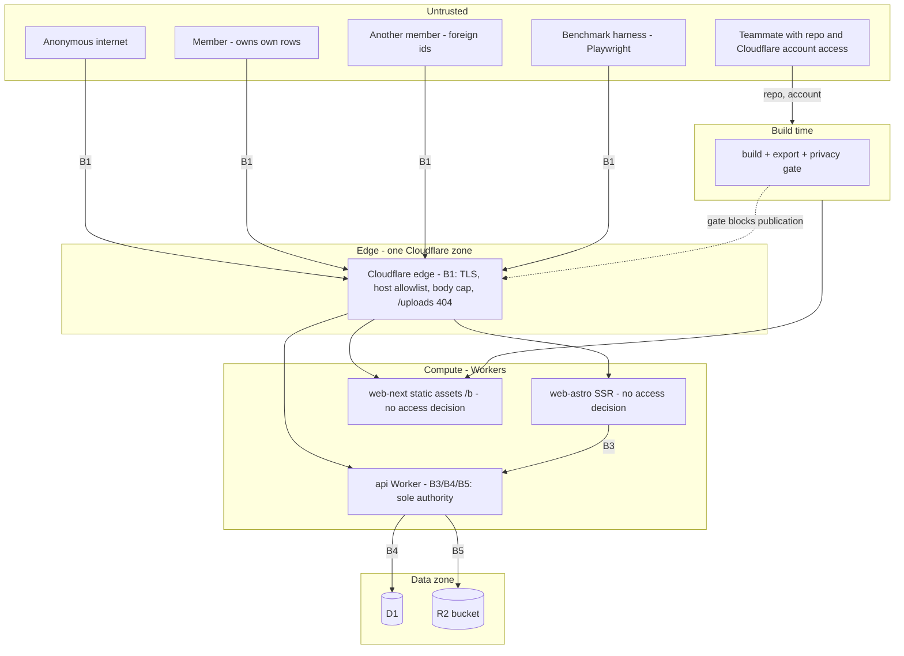

# 07 — Security Architecture

Extends `03` §5.3 without contradicting it. Consumes `01` (NFR-SEC-001..014, G-2), `04` (ADR-05..08),
`05` (composite-FK ownership, session clocks) and the locked surface. Request/response detail lives in
`06` and is referenced, not repeated. Nothing here is a measurement.

**The rule everything follows.** An advisory layer never decides. The API decides access (G-2,
NFR-SEC-004). Astro's `302`, Next's client redirect, a hidden button, a disabled submit and an
unguessable UUID are convenience or coincidence, never controls.

## 1. Assets, trust boundaries and actors

### 1.1 Assets

| Asset | Where it lives | Why it matters | Loss impact |
|---|---|---|---|
| Password | user's head / login form only; never stored | Reused across sites; a leak is not containable | Account takeover elsewhere (**Critical**) |
| `users.password_hash` | `users` row | Offline cracking target | Credential recovery at Argon2id cost (High) |
| Session token (plaintext) | browser cookie `sid` only | Full impersonation while valid | Complete compromise of one account (**Critical**) |
| `sessions.token_hash` | `sessions` row | As SHA-256 it is not replayable | Dump is not replayable (Medium) |
| Task / note content | `tasks`, `notes` | The private data the product exists to hold (NFR-SEC-012) | Privacy breach of one member (High) |
| Attachment binaries + thumbnails | R2 bucket (`env.BUCKET`) | Same content class, possibly identifying | Privacy breach (High) |
| Existence of a resource | absence vs `404` | An oracle over other members' ids | Enumeration of activity (Medium) |
| Configuration secrets | Worker bindings and Wrangler secrets, never the bundle | The D1 and R2 bindings grant all data | Total breach (**Critical**) |
| Benchmark dataset + run artifacts | `backups/`, seed output, manifests | The experiment's evidence (NFR-RESEARCH-002/003/009) | Comparison becomes unfalsifiable (Medium) |
| Argon2id and decode CPU | Worker request | Cheap flood = denial for everyone | Outage during a measured campaign (Medium) |

### 1.2 Trust boundaries and the enforcement point on each crossing

| # | Crossing | Transport | Enforcement point (authoritative) | What is explicitly **not** enforced here |
|---|---|---|---|---|
| B1 | Browser ↔ Cloudflare edge | HTTPS, one origin | Cloudflare edge: TLS, host allowlist, request-body cap, `/uploads/*` → `404`, request-id generation | Authentication. The edge makes no access decision (ADR-05) |
| B2 | Edge ↔ web-astro / web-next / api Worker | Cloudflare zone routing, one origin | Routing only. **No enforcement** | Nothing. `/b/*` is a static asset origin; Astro is one more untrusted caller |
| B3 | web-astro server fetch → api Worker | Cloudflare zone routing, `Cookie` forwarded | Worker: session verification, ownership predicate, validation | Astro's server-side redirect — a forged cookie yields only a failed API call |
| B4 | Worker ↔ D1 | same-account binding `env.DB` | SQL: `AND user_id = ?` in the same statement; composite FK as backstop | Application pre-checks that read then write (not used) |
| B5 | Worker ↔ R2 bucket | binding `env.BUCKET`, keys `<user_id>/<attachment_id>.<ext>` | `attachments`: server-generated key, prefix asserted inside `<user_id>/` | Storage-key unguessability (a property, not a control) |
| B6 | Build time ↔ runtime | Next export artifact, Astro build, `NEXT_PUBLIC_*` inlining | Static-output privacy gate (grep over `out/`, bundle, source maps) | Runtime ACLs: a file in `out/` is public by definition |
| B7 | Cloudflare account ↔ resources | Wrangler auth, D1, R2, Cron Triggers, TLS | Account access control (out of application scope) | Everything here — an account admin owns every asset |



### 1.3 Actors

| Actor | Capability | Goal against this system | In scope? |
|---|---|---|---|
| Anonymous internet | Any request, no cookie | Enumerate, register, brute force, flood | Yes |
| Member (owner) | Valid session, own rows | Legitimate use; accidental cross-tenant access via a bug | Yes |
| Another member | Valid session, foreign ids | Read/destroy others' content, plant content | Yes |
| Benchmark harness | Scripted browser on the local runner | Valid measurements; accidental data mutation | Yes (integrity, not access) |
| Teammate with repo/Cloudflare account access | Deploy, read env, read dumps | Full control by design | Out of application scope (trusted, auditable) |

## 2. Authentication

Covers FR-AUTH-001..014, NFR-SEC-001..003, NFR-SEC-007.

### 2.1 Flows

| Operation | Endpoint | Behaviour | Notes |
|---|---|---|---|
| Register | #1 | Create user + session in one transaction; `201` + `Set-Cookie` | Auto-login (A-17); duplicate email → `409` |
| Login | #2 | Verify, create session; `200` + `Set-Cookie` | Existing valid session → `409` |
| Logout | #3 | Delete the presented session row, expire the cookie | `204`; repeat → `401`, still logged out |
| Probe | #4 | `200 {user, expiresAt}` or `401` | Public-but-session-aware (O-6) |

### 2.2 Password storage and verification

- **Argon2id**, baseline `m=19456 KiB, t=2, p=1` (NFR-SEC-001), parameters inside the encoded string so
  tuning needs no migration — enforced by `CHECK (password_hash LIKE '$argon2id$%')`. Memory-hard and
  data-independent, unlike SHA-family/MD5. `p=1` keeps ~19 MiB per login, so the rate limit — not the
  hash cost — bounds aggregate memory. `@noble/hashes` is pure TypeScript, so this memory cost and the
  per-login CPU cost both land on the Worker request; the rate limit of §8.3, not a per-runtime budget,
  is what keeps concurrent logins bounded.
- **Salt**: per-user, generated by the library, stored inside the encoded hash. No application pepper:
  there is no key-management surface, and adding one creates a rotation problem with no benefit.
- **Verification** is constant-time inside the library. On the **unknown-email path a dummy hash is
  verified** so the response time does not distinguish "no such user" from "wrong password" (T-02).

### 2.3 Failure semantics and enumeration

One message for every credential failure: `401 UNAUTHENTICATED`, "invalid email or password", no
`details[]` naming a field, same status, same body shape, same redirect target (FR-AUTH-005). No field
focus difference, no cookie in the response.

Registration does disclose that an email exists (`409`), because FR-AUTH-002 requires an explicit
message. That is an accepted product disclosure, bounded by 10/min/IP (T-03).

### 2.4 Session token: generation, storage, verification

| Step | Rule | Requirement |
|---|---|---|
| Generation | 32 bytes from the platform CSPRNG, base64url | NFR-SEC-002 |
| Storage | `sha256(token)` in `sessions.token_hash` (`BLOB`, unique, `CHECK length(token_hash) = 32`); plaintext never persisted or logged | NFR-SEC-002 |
| Verification | hash the presented cookie, `SELECT … WHERE token_hash = ?`, then check `expires_at > ?` **and** `last_used_at > ?` (both bound from the Worker clock, now minus 24 h) | FR-AUTH-006/010 |
| Refresh | conditional `UPDATE … WHERE last_used_at < ?` (now minus one hour, bound from the Worker clock), then re-issue cookie with the remaining absolute lifetime | O-7 |
| Revocation | row delete at #3; all other tabs/devices refused at their next request | FR-AUTH-007/013 |
| Rotation | none on refresh — two tab requests would race and one would be refused; the idle window already bounds a leaked token | ADR-06 |

### 2.5 Login CSRF and session fixation

- **Fixation is unreachable by construction**: no pre-authentication session exists, and login always
  mints a new token into a new row. A client-supplied `sid` on login is never adopted as the resulting
  session.
- **Login CSRF is the real risk**: `POST /auth/login` needs no cookie, so `SameSite=Lax` does nothing,
  and a successful cross-site login writes `Set-Cookie` — from then on the victim's writes land in the
  attacker's account (integrity, not confidentiality). The authoritative control is the origin check on
  every unsafe method (§6.2); the advisory layer is that no page posts a login form cross-origin.

### 2.6 What MUST NOT be logged

Never, at any level, in any component: the `password` field, `password_hash`, the `sid` value, any
`Cookie`/`Authorization` header, `token_hash`, raw `/auth/*` bodies, R2 object keys,
attachment bytes, the plaintext of `q`, or a raw email used as a rate-limit key. The Worker's redaction
list covers `req.headers.cookie`, `req.headers.authorization`, `res.headers["set-cookie"]`,
`req.body.password`, `*.token_hash`, `*.password_hash`; the access serializer emits `user_id` (never
email) and the route pattern (never the query string).

## 3. Authorization

Covers NFR-SEC-004/005, FR-TASK-019, FR-NOTE-013, FR-ATT-008/010 and the permission matrix.

### 3.1 One axis, decided inside the statement

Exactly one predicate: `row.user_id = ?`, where the bound value is the `user_id` taken from the verified
session row and nowhere else. It MUST appear **inside the same SQL statement** that reads or mutates the
row (`03` §4.2, `05` §3) — never in a preceding `SELECT` whose result authorizes a second statement. A
read-then-write pair has a window and is one forgotten `AND` away from a cross-tenant write.

```sql
UPDATE tasks SET status = ?, updated_at = ? WHERE id = ? AND user_id = ? RETURNING *;  -- 0 rows ⇒ NOT_FOUND
```

### 3.2 `404` indistinguishability

`NOT_FOUND` is the outcome for absent **and** foreign rows with: the same code, the same message from the
copy deck, the same `details: []`, the same body length and the same query count (one lookup; no second
statement on the foreign path). `403` is never emitted for ownership — it would confirm the id exists,
which is exactly what an IDOR probe buys.

### 3.3 Mass assignment is structurally excluded

Owner and all derived fields are absent from every request schema, and every body schema is **strict**: an
unknown key is `VALIDATION_FAILED`, not silently dropped, so an attempted `user_id` injection is a
visible 422 rather than an invisible no-op. `PATCH /users/me` accepts `{ displayName }` only.

### 3.4 Cross-owner test matrix

Owner **A** creates a task with an attachment and a note with an attachment. Owner **B** (valid session)
issues each request. Every cell must produce the *identical* response — status, code, message, body
bytes — to the same request with a random absent UUID, and must leave A's row and binary unchanged.

| # | Request as B | Expected |
|---|---|---|
| S-11 | `GET /tasks/{A.task}` | `404 NOT_FOUND` |
| S-12 | `PATCH /tasks/{A.task}` with a new status | `404`, A's status unchanged |
| S-13 | `DELETE /tasks/{A.task}` | `404`, A's task intact |
| S-14 | `GET /notes/{A.note}` | `404` |
| S-15 | `PATCH /notes/{A.note}` (pin toggle) | `404`, pin unchanged |
| S-16 | `DELETE /notes/{A.note}` | `404`, note intact |
| S-17 | `GET /attachments/{A.att}` | `404` |
| S-18 | `GET /attachments/{A.att}/content?variant=full` | `404`, zero bytes |
| S-19 | `GET /attachments/{A.att}/content?variant=thumb` | `404`, zero bytes |
| S-20 | `POST /attachments` with `targetId = A.task` | `404`, no row, no file |
| S-21 | Same as S-20 with `targetType=note` | `404` |
| S-22 | `POST /tasks` with `userId` in the body | `422 unknown_field` |
| S-23 | `POST /notes` with `id` in the body | `422 unknown_field` |

## 4. Enforcement points

### 4.1 Authoritative vs advisory

| Control | Authoritative layer | Advisory layer | Why the advisory layer is not the protection |
|---|---|---|---|
| Route gate | API: no valid `sid` → `401` | Astro `302 /login`; Next client replace after a `401` probe | `curl` without a cookie still gets `401` |
| Ownership | SQL predicate in the same statement; uniform `404` | UI never checks per row | Cross-owner matrix asserts `404` for every foreign id |
| Aggregate counts | `dashboard` CTE scoped by `user_id` | — | No global totals endpoint exists |
| Binary read | owner-scoped row lookup before opening a file | unguessable UUID | Anonymous/cross-owner requests to real ids return `404`, zero bytes |
| Rate limit | D1 `rate_limits` table (§8.3) | disabled submit, client-side count check | A scripted burst is still throttled |
| CSRF | `SameSite=Lax` + `Origin`/`Sec-Fetch-Site` on unsafe methods | same-origin forms by construction | Forged cross-site posts fail without a token being rendered |
| `/uploads/*` | edge returns `404`; path never routed to the Worker | — | Binaries exist only behind the authenticated endpoint |
| Next.js shell | API requires the cookie for every payload | client gate (UX) | Editing the shell yields no data |
| Static output | build-time privacy gate | code review | A bundle grep fails the build |

### 4.2 Per endpoint

Failure mode = what an attacker gains if the *advisory* layer is bypassed (i.e. the request goes straight
to `/api/v1`).

| # | Endpoint | Control | Authoritative | Advisory | Failure mode bypassed |
|---|---|---|---|---|---|
| 1 | `POST /auth/register` | validation, rate limit, unique email | `auth` + limit | field hints | Spam accounts; email enumeration (accepted) |
| 2 | `POST /auth/login` | Argon2id, generic failure, rate limit, origin | `auth` | form behaviour | Credential stuffing bounded by limiter |
| 3 | `POST /auth/logout` | session row delete | `auth` | menu item | None (idempotent) |
| 4 | `GET /auth/me` | session verification | `auth` | redirect | None — `401` |
| 5-6 | `/users/me` | `WHERE id = ?` (bound from the session) | `auth` | nav | None |
| 7 | `GET /dashboard` | `user_id` in every CTE | `dashboard` | — | None |
| 8 | `GET /tasks` | `user_id` before filters | `tasks` | — | None |
| 9 | `POST /tasks` | owner from session, strict schema | `tasks` | — | None |
| 10-12 | `/tasks/:id` | `id AND user_id` in the same statement | `tasks` | — | IDOR (T-09) if the predicate were dropped |
| 13-17 | `/notes`, `/notes/:id` | same | `notes` | — | IDOR |
| 18 | `POST /attachments` | target ownership in the tx, sniff+decode, size/count, origin | `attachments` | file picker | Foreign-target plant (T-11), polyglot (T-15) |
| 19-21 | `/attachments/:id` | owner-scoped row before any file access | `attachments` | — | Binary exfiltration (T-10) |
| 22 | `GET /health` | none by design | edge routing | — | Reconnaissance only; payload limited (T-35) |

## 5. Input validation and output encoding

### 5.1 Validation at the boundary

- Every body and query is parsed by the Zod schema from `packages/contracts`; a parse failure is
  `VALIDATION_FAILED` with `details[]` built from schema paths — never Zod's raw message, never the
  offending value.
- **Strict bodies and strict queries**: an unknown key or query parameter is a 422, so `?user_id=` cannot
  ride along unnoticed.
- **SQL**: `?` placeholders only; identifiers (sort column, direction) from a fixed map. Substring search
  binds a pattern escaped for `LIKE '%q%' ESCAPE '\'`, not a concatenated one (`05` §4.4).
- **JSON body limit** 256 KiB; oversized → `413`.
- **Open-redirect defence** for `?next=`: internal absolute path only (`/`-prefixed, no `//`, no `/\`, no
  scheme, no CR/LF, length ≤ 512); anything else is discarded and the dashboard is used (T-20).

### 5.2 Output encoding and the XSS surface

Both apps render member-authored `title`, `description`, `body` and `displayName`. Escaping model is the
framework default, with the escape hatches banned:

| Surface | Rule |
|---|---|
| Astro templates | `{value}` interpolation only. `set:html` is lint-banned; `is:inline` scripts are build-banned |
| React / Next | JSX interpolation only. `dangerouslySetInnerHTML` and `innerHTML` are lint-banned |
| Attribute context | Never build a URL/attribute from unvalidated input; `href` from user content is not offered anywhere |
| CSP | `script-src 'self'` (Next: hashed inline list generated at build, staleness-tested); no `unsafe-inline`, no `unsafe-eval` |
| JSON responses | `application/json` with `nosniff`, so a JSON body cannot be sniffed as HTML |

### 5.3 Upload validation — the two-gate model

The only place internet bytes become bytes in an R2 object (NFR-SEC-009, FR-ATT-002, ADR-08).

| Gate | Checks | Rejection | Cost control |
|---|---|---|---|
| 0. Pre-body | auth, rate limit, `Content-Length` against the Cloudflare request-body limit and the 5 MiB per-file cap, target ownership | `401`/`429`/`413`/`404` | reject before buffering where possible |
| 1. Sniff | magic bytes via `file-type` ∈ `{image/jpeg, image/png, image/webp}`; SVG and everything else refused | `415` | — |
| 2. Decode | `@jsquash` decode of the sniffed image: succeeds (catches polyglots/truncation) and reports `width`/`height`; a **declared-dimension pre-check** on the header bytes rejects anything declaring > 40 MP or an edge > 12 000 px before a full decode (all A-26). There is no `limitInputPixels` knob, so the pre-check is what carries the pixel-bomb defence (T-16) | `422 undecodable_image` | bounded by the Workers per-request CPU cap — no separate decode queue is needed (A-27) |
| 3. Store | key `<user_id>/<attachment_id>.<ext-from-sniffed-mime>`; one atomic R2 `put` to that Worker-generated key, with the `<user_id>/` prefix asserted before the write | `500` | — |
| 4. Serve | `Content-Type` from stored `mime`, `nosniff`, `Content-Disposition: inline` with a generated name, never the client filename | — | `ETag` |

Client filenames are never paths, never extensions, never echoed into a header; the upload response names
the rejected file only as a sanitised basename in `details[].file` (`06` §8.4).

## 6. CSRF, CORS and cookie policy

### 6.1 Why `SameSite=Lax` is the first control

`Lax` attaches `sid` to same-site requests and top-level cross-site **GET** navigation only. Every
state-changing route is `POST`/`PATCH`/`DELETE`, so a cross-site form post arrives **without a cookie** and
is `401` before any handler logic. That is the whole CSRF defence for JSON endpoints and it costs nothing.

### 6.2 Why `Origin` is still authoritative, and why uploads force it

Two gaps make `SameSite` insufficient alone: (a) login/register need no cookie, so login CSRF is
unaffected (T-06); (b) `multipart/form-data` is CORS-safelisted, so a plain `<form enctype=multipart>`
cross-site post reaches the body parser with no preflight (T-08). Therefore every unsafe method requires
`Origin` (or, absent, `Sec-Fetch-Site: same-origin`) to equal `APP_ORIGIN`; a foreign or missing value is
`401 UNAUTHENTICATED` — deliberately identical to an absent session.

### 6.3 Why there is no CORS in production

One origin means every request is same-origin: no preflight, no `Access-Control-Allow-Origin`, no
`credentials` negotiation, nothing to misconfigure. The Worker's CORS middleware is **not registered**
on the production environment, and a smoke test asserts no response on the measured stack carries any
`Access-Control-*` header.

### 6.4 The dev allowlist and its footgun

Only `next dev` needs cross-origin (3000 → 8787): `{ origin: ['http://localhost:3000'], credentials: true }`,
registered only when the Worker runs under `wrangler dev`. `origin: '*'` (plugin default) with `credentials: true`
is rejected by browsers, so it "works" only by silently breaking cookies — and if a future version
accepted it, every site would get a credentialed read. `origin: true` (reflect any) is equally forbidden.
Both are review-blocking.

### 6.5 Response header policy (NFR-SEC-014)

Identical values from the Worker for `/api/*`, and from the static/SSR origins for `/` and `/b/*`:

| Header | Value | Note |
|---|---|---|
| `Content-Security-Policy` | `default-src 'self'; img-src 'self' data:; style-src 'self'; script-src 'self'` (+ Next build-time hashes); `frame-ancestors 'none'`; `base-uri 'none'`; `form-action 'self'` | no `unsafe-*` anywhere |
| `Strict-Transport-Security` | `max-age=31536000; includeSubDomains` | measured stack over TLS |
| `X-Content-Type-Options` | `nosniff` | all responses |
| `X-Frame-Options` | `DENY` | legacy pairing with `frame-ancestors` |
| `Referrer-Policy` | `no-referrer` | |
| `Permissions-Policy` | `camera=(), microphone=(), geolocation=()` | |
| `Cross-Origin-Opener-Policy` | `same-origin` | |
| `Cache-Control` | `no-store` on JSON; `private, max-age=86400` on binaries | T-30 |

### 6.6 The state-changing-GET ban

`GET` MUST NOT change durable state or return a body a cross-site request could not have obtained
otherwise. Consequences: logout is `POST` (a top-level GET logout would be a cross-site logout), no
`_method` override parameter exists, and no `GET` triggers a write (no view-counter, no "mark seen").

## 7. Secrets, configuration and data protection

### 7.1 Environment inventory

| Variable | Consumer | When read | Secret? | Exposure rule |
|---|---|---|---|---|
| `ENVIRONMENT` (`production`/`development`) | all | runtime | no | — |
| D1 binding `env.DB` | api Worker | deploy (Wrangler config) | **yes** (account-scoped) | same-account binding, never a connection string; never logged, never in the bundle |
| R2 binding `env.BUCKET` | api Worker | deploy (Wrangler config) | **yes** (account-scoped) | same-account binding; never logged, never in the bundle |
| `SESSION_COOKIE_NAME` | api Worker | runtime | no | |
| `SESSION_TTL_DAYS` | api Worker | runtime | no | |
| `APP_ORIGIN` | api Worker | runtime | no | must match the served origin; wrong value breaks every unsafe method |
| `UPLOAD_MAX_BYTES` | api Worker | runtime | no | |
| `PUBLIC_API_BASE_URL` | web-astro server | runtime | no | the public origin that routes `/api/*` to the Worker; server-side only, `process.env`, never `import.meta.env` |
| `NEXT_PUBLIC_API_BASE_URL` | web-next | **build time** | no (public by definition) | must remain a path/URL with no credentials |
| `LOG_LEVEL` | api Worker | runtime | no | |

The only legitimate `NEXT_PUBLIC_*` value is the API base path. Any other variable prefixed that way is a
release blocker (T-22).

### 7.2 `.env` handling

`.env.example` committed with placeholders; `.env` gitignored. Worker secrets are stored with
`wrangler secret put`, never in the bundle and never in a build context. `.dev.vars` (used by
`wrangler dev`) is gitignored. The Worker **fails to start** when a required variable or binding is
missing (no fallback database, no default password). Local D1/R2 state under `.wrangler/` and
`backups/` are gitignored.

### 7.3 Log redaction

One redaction list in the Worker's logger setup, not per call site (§2.6). A test asserts that a login
with a recognizable password string produces no log line containing it.

### 7.4 What a database dump contains

Emails, display names, Argon2id hashes, task/note content, attachment metadata including `storage_key`, and
`sessions.token_hash` — **hashes, never tokens**. The `length(token_hash) = 32` check is the evidence that no
plaintext token was ever stored, and hashing on presentation means a dump cannot be replayed. A D1 export
plus a copy of the R2 bucket is still a complete content breach, and the export is enough for offline
password cracking, which is why the hash parameters matter (T-24).

### 7.5 At rest and in transit

| Segment | Protection | Status |
|---|---|---|
| Browser ↔ Cloudflare edge | TLS terminated at the Cloudflare edge | Implemented in P8 |
| Edge ↔ Worker, Worker ↔ D1/R2 | Cloudflare internal routing, no published ports, bindings are same-account | P4 |
| D1 and R2 at rest | Cloudflare-managed encryption at rest for both D1 and R2 | Implemented |
| Backups | `wrangler d1 export` (or D1 Time Travel PITR) plus R2 object copy, both under Cloudflare access control | Implemented |

## 8. Logging and monitoring

### 8.1 What is logged

One JSON object per request from the api Worker (`console.log`, surfaced by Workers tail / Logpush), plus Cloudflare access logs and Astro request logs:

| Field | Content |
|---|---|
| `request_id` | server-generated (or validated inbound) UUID; also the `X-Request-Id` header and `error.requestId` |
| `method`, `route` | route **pattern** (`/api/v1/tasks/:id`), never the raw URL with query |
| `status`, `code`, `duration_ms` | outcome and timing |
| `user_id` | when authenticated; never the email |
| `resource_type`, `resource_id` | for owned-resource operations, so an incident is reconstructable |
| `remote_ip` | the `CF-Connecting-IP` value Cloudflare set on the request; never used as a log key |

### 8.2 Reconstructing an incident

The Cloudflare access log line (`request_id`, `CF-Connecting-IP`, status) → the api Worker JSON line
(`request_id`, `user_id`, `route`, `resource_id`, `code`, duration) → the D1 row by `resource_id`. "Who
downloaded attachment X between 14:02 and 14:07" is a filter on `resource_type=attachment`, `resource_id=X`,
`status=200`; every successful binary read is one line, every rejected one is another. Session lifecycle
events (login, logout, throttled, expired) are their own lines.

### 8.3 Rate limiting — effective guarantee, not nominal

| Limit | Scope | Key | Store | Authority |
|---|---|---|---|---|
| 10/min | auth mutations (#1, #2, #3) | `CF-Connecting-IP` | D1 `rate_limits` | Worker middleware |
| 5 failed / 15 min | login attempts per account | `(IP, email)` — hashed for the store key | D1 `rate_limits` | `auth` + middleware |
| 20/min | uploads (#18) | `user_id` | D1 `rate_limits` | Worker middleware |
| 300/min | other authenticated endpoints | `user_id` | D1 `rate_limits` | Worker middleware |
| exempt | #22 `/health` | — | — | middleware config |
| — | request body size | — | — | Cloudflare request-body limit + Worker `Content-Length` check |

Three properties are required for the limits to mean anything: **Cloudflare sets `CF-Connecting-IP`** and the
Worker keys the IP-scoped limits off that value (any client-supplied forwarding header is never trusted),
counters live in the D1 `rate_limits` table so they survive cold starts and are shared across every Worker
isolate, and authenticated routes are keyed by `user_id` rather than IP (T-19). A limiter keyed on
Cloudflare's own edge IP would let one client lock out everyone.

### 8.4 Signals that reveal abuse

| Signal | Query shape | Reading |
|---|---|---|
| `429` spike on `/auth/login` | count by `code=429, route=/auth/login` per minute | Credential stuffing (T-01) |
| `404` spike on `/attachments/:id/content` | count by `user_id`, `code=404` | IDOR probing (T-10) |
| `415`/`422` spike on `POST /attachments` | count by `user_id`, `details[].code` | Upload probing (T-15/T-16) |
| Same `user_id` with many distinct `resource_id` 404s | distinct-count per minute | Systematic enumeration (T-29) |
| `INTERNAL` spike | count by route | Availability incident, also invalidates a benchmark run |

## 9. Threat register

Severity is impact × likelihood *under this design's controls*, with the reason in one clause.
`Beta` = required for the private/lab stage; `Public` = must additionally hold before public launch.

| ID | Threat / scenario | Component | STRIDE | Impact | Likelihood | Severity (reason) | Mitigation | Authoritative point | Stage | Test |
|---|---|---|---|---|---|---|---|---|---|---|
| T-01 | Credential stuffing: leaked password lists replayed at login | api auth | Spoofing | One or more accounts taken over | High (public endpoint, no MFA) | **High** — cheap and automated, no MFA exists to stop it | Argon2id per-user salted; 10/min/IP; 5/15 min per (IP,email); generic message | `auth` + rate limiter | Beta | S-39, S-40 |
| T-02 | Account enumeration via login timing (unknown email skips the KDF) or message/status differences | api auth | Information disclosure | Attacker learns registered emails | Medium | **Medium** — enables targeted phishing, not takeover | Dummy-hash verification on the unknown-email path; one message/status/body; `details: []` | `auth` §2.2 | Beta | S-05, S-06 |
| T-03 | Registration enumeration: `CONFLICT` confirms an email exists | api auth | Information disclosure | Same as T-02 on the register surface | High (required by FR-AUTH-002) | **Low** — accepted product disclosure, bounded by 10/min/IP | Explicit message required; 10/min/IP; no per-account lockout to abuse | `auth` | Beta | S-07 |
| T-04 | Session token theft via XSS or a malicious extension reading the cookie | both web apps | Spoofing / Info disclosure | Full impersonation until idle/absolute expiry | Low if XSS prevented | **Medium** — `HttpOnly` removes script access; residual is a compromised browser | `HttpOnly; Secure; SameSite=Lax`; CSP; escaped output; no token in storage/URL | API `Set-Cookie` + §5.2 + §6.5 | Beta | S-03, S-45, S-57 |
| T-05 | Session fixation: attacker plants a known `sid` before login | api auth | Spoofing | Attacker rides the victim's session | Very low (no anonymous session) | **Low** — structurally impossible: login mints a fresh token and never adopts one | New row + token on register/login; unknown `sid` ignored | `auth` §2.5 | Beta | S-12 |
| T-06 | Login CSRF: cross-site form logs the victim into the attacker's account | api auth | Spoofing / Tampering | Victim's later writes land in the attacker's account | Medium (no cookie needed) | **Medium** — integrity loss, no confidentiality loss | Origin exact-match on all unsafe methods (`Lax` does nothing here) | API origin guard §6.2 | Beta | S-33, S-34 |
| T-07 | Classic CSRF on create/update/delete via a cross-site form post | api | Tampering | Unauthorized writes/deletes | Low (needs a cookie on the unsafe request) | **Medium** — `Lax` strips it, so this is a defence-in-depth failure | `SameSite=Lax` + origin guard; no `_method` override; POST-only logout | API §6.1-6.2 | Beta | S-33 |
| T-08 | Form-based CSRF on multipart upload (CORS-safelisted, no preflight) | api attachments | Tampering | Attacker file attached to a member's task | Low | **High** — the one endpoint where a browser form post reaches a body parser; content is attacker-chosen | Origin check mandatory for multipart; `Lax` cookie; per-target count/type limits | API origin guard + attachments §5.3 | Beta | S-35, S-36 |
| T-09 | IDOR on task/note by id (read, edit, delete, status, pin) | api tasks/notes | Elevation of privilege | Read or destroy another member's content | Medium | **High** — direct privacy/integrity breach, the classic failure of this design | `AND user_id = ?` (bound from the session) in the same statement; `404` for foreign and absent; no read-then-write | SQL predicate §3.1 | Beta | S-11..S-16 |
| T-10 | IDOR on an attachment: enumerate UUIDs to read binaries | api attachments | Info disclosure | Exfiltrate other members' images | Medium | **High** — binaries are the most sensitive content and are addressed by id | Owner-scoped SQL as the existence authority; unguessability not relied on; identical `404` with zero bytes | `attachments` §3.1 | Beta | S-17, S-18, S-19 |
| T-11 | Upload into a foreign target | api attachments | Tampering | Plant content in another account; storage exhaustion | Medium | **High** — would inject content into a victim's list | Target ownership inside the upload tx; composite FK makes the row unrepresentable | `attachments` + DB FK | Beta | S-20, S-21 |
| T-12 | Mass assignment: body carries `user_id`, `email`, `password_hash`, `storage_key` | api all | Tampering | Reassign ownership; change credentials; point at another file | Medium | **High** — one accepted key is a complete ownership bypass | Strict schemas; owner from session; derived fields absent; `PATCH /users/me` = `{displayName}` | Zod strict + `auth` §3.3 | Beta | S-22, S-23 |
| T-13 | SQL injection via `q`, `sort`, `cursor`, `:id` or body strings | api db | Tampering / Info disclosure | Full data or schema compromise | Low (all parameterized) | **High** — impact is total if one interpolation exists | `?` placeholders only; identifiers from allowlists; `LIKE '%q%' ESCAPE '\'` with a bound escaped pattern; lint + review | D1 access layer §5.1, ADR-03 | Beta | S-24, S-25 |
| T-14 | Stored XSS in title/description/body/displayName | both web apps | Tampering / Spoofing | Session-scoped actions as the victim; exfiltration | Medium | **High** — the only client-side path into a member's session context | Framework escaping; `set:html`/`dangerouslySetInnerHTML`/`innerHTML` lint-banned; CSP without `unsafe-inline` | §5.2 + §6.5 | Beta | S-57, S-58, S-45 |
| T-15 | Script execution via uploaded SVG or an HTML polyglot served from the API origin | api attachments | Tampering | Script in the origin's context | Low | **High** — same-origin script defeats every cookie control | Allowlist by sniff `{jpeg,png,webp}`; no SVG; real decode; `nosniff`; generated disposition name | `attachments` §5.3 | Beta | S-26, S-27 |
| T-16 | Decompression / pixel bomb: small file, huge declared dimensions | api attachments | DoS | Worker memory/CPU exhaustion during a campaign | Medium | **High** — a few hundred KB can OOM one request isolate | Declared-dimension pre-check rejects > 40 MP or an edge > 12 000 px before full decode (A-26); `@jsquash` decode must succeed; concurrency bounded by the Workers per-request CPU cap (A-27) | `attachments` §5.3 | Beta | S-28, S-29 |
| T-17 | Path traversal via a crafted filename or a future stored-key misuse | api attachments | Tampering | Read/write outside the R2 key prefix | Very low (filenames are never paths) | **High if it occurs** (arbitrary object write) | Server-generated key; extension from sniffed MIME; `<user_id>/` prefix asserted before every `put`; one atomic R2 `put` per key | `attachments` §5.3 | Beta | S-30 |
| T-18 | Upload flood / oversized bodies to exhaust CPU or storage | api, edge | DoS | Outage during a run | Medium | **Medium** — bounded, but one failure domain | 5 MB / 10 files / 10 per target; 20/min/user; Cloudflare request-body limit plus a Worker `Content-Length` check; auth + limit before body consumption | `attachments` + middleware + edge | Beta | S-31, S-41 |
| T-19 | Rate-limit bypass by IP rotation, or all clients collapsing into one bucket | api, edge | DoS / Bypass | Unlimited guessing, or a global login outage | Medium | **High** — a limiter keyed on the edge IP is worse than none | Cloudflare sets `CF-Connecting-IP`; the Worker keys off that value and ignores any client-supplied forwarding header; per-`user_id` key for authed routes | Middleware + edge §8.3 | Beta | S-42, S-43 |
| T-20 | Open redirect via `?next=` to an attacker origin | both web apps | Tampering / Phishing | Credential phishing through a trusted link | Medium | **Medium** — no token leakage, but credible phishing | Internal absolute path only; `//`, `/\`, scheme, CR/LF rejected; length cap | Redirect builder §5.1 | Beta | S-37 |
| T-21 | Response splitting / header injection via a client `X-Request-Id` or a filename | api | Tampering | Cache poisoning, header smuggling | Low | **Medium** — the runtime rejects CR/LF, so this is defence in depth | Server-generated request id (client value accepted only under a strict regex); filenames never echoed | API §5.1, §5.3 | Beta | S-38 |
| T-22 | Secret leakage into the client bundle or static export | web-next build | Info disclosure | Binding credentials published | Low by design, catastrophic if real | **Critical** — a leaked binding credential is total compromise | One legitimate `NEXT_PUBLIC_` value; Wrangler build config keeps secrets out of the bundle; source maps off; grep gate over `out/` and bundles | Build-time gate B6, §7.2 | Beta | S-51, S-52 |
| T-23 | Token replay from a D1 export or a `sessions` copy | db | Spoofing | Mass impersonation | Low | **High** if tokens were stored plaintext | SHA-256 only; `length(token_hash) = 32`; hash on presentation; export treated as secret | `auth` + DB check §2.4, §7.4 | Beta | S-04, S-13 |
| T-24 | Offline cracking of dumped password hashes | db | Info disclosure | Password recovery → reuse elsewhere | Medium (dumps happen) | **Medium** — bounded by Argon2id cost, not prevented | Argon2id `m=19456,t=2,p=1`; per-user salt; documented parameters | `auth` §2.2 | Beta | S-02 |
| T-25 | Session survives logout in a second tab or a cached client view | api, web-next | Spoofing | Continued access after the member thinks they are out | Medium | **Medium** — `401` must clear caches to be honest | Row delete; any `401` clears the Next per-view cache and replaces the route; Astro re-requests per document | `auth` + client cache policy §2.4 | Beta | S-14, S-15 |
| T-26 | Expired/revoked session accepted because expiry relied on a nightly job | api | Spoofing | Long-lived zombie sessions | Low | **High if expiry were job-dependent** | Validity evaluated on every read; the Cron Trigger sweep is hygiene only | `auth` SQL §2.4 | Beta | S-09, S-10 |
| T-27 | Expired session rows accumulate; cleanup Cron Trigger fails or overlaps | api Worker | Availability | Table growth; a silent sweep failure mistaken for safety | Medium | **Low** — read-path validation keeps expiry authoritative | Idempotent single-statement delete; failure logged and retried | Sessions Cron Trigger (`03` §11) | Beta | S-44 |
| T-28 | Information disclosure in error bodies (stack, SQL, paths, versions) | api | Info disclosure | Reconnaissance; path/credential exposure | Medium | **Medium** — aids every other attack | Fixed envelope with the closed code set; `INTERNAL` carries no detail; `details[]` from schema paths only | API error handler §5.1 | Beta | S-58, S-59 |
| T-29 | Existence oracle via distinguishable responses | api | Info disclosure | Confirms ids belong to someone | Medium | **Medium** — enables targeted IDOR/enumeration | Uniform `NOT_FOUND`; identical body; one query on both paths; validate-then-lookup order | SQL predicate + mapper §3.2 | Beta | S-18, S-19 |
| T-30 | Private data cached by the edge or an intermediary | edge, api | Info disclosure | One member's data served to another | Low (no edge cache on `/api/*`) | **High if a cache ever appears** | `no-store` on JSON; `private` on binaries; no cache rule on the Worker route | API headers §6.5 | Beta | S-46 |
| T-31 | Clickjacking to force a destructive action | both web apps | Tampering | Forced delete/status change | Low | **Low** — destructive actions require an in-app confirm (FR-UI-007) | `frame-ancestors 'none'` + `X-Frame-Options: DENY` | Headers §6.5 | Beta | S-45 |
| T-32 | CSP bypass through an inline script (Astro `is:inline` or a stale Next hash list) | both web apps | Tampering | XSS payload executes despite CSP | Medium | **Medium** — a build test or a parity failure catches it, so it is not silent | Build test forbidding `is:inline`; generated Next hash list with a staleness test; no `unsafe-inline` | Build gate §6.5 | Beta | S-47, S-48 |
| T-33 | Log injection via newlines/control characters in UA, `q` or a header | api logs | Repudiation | Forged or unreadable audit trail | Low | **Low** — structured JSON escapes; no string interpolation into a line | Worker JSON serialization; fixed field set; enums for outcomes | Logger config §8.1 | Beta | S-60 |
| T-34 | Attachment bytes lingering after delete (client cache, orphan R2 object) | browser cache, R2 bucket | Info disclosure | Deleted image still visible to that browser | Medium | **Low** — same-device only | Every new request `404`s; orphan sweep over R2 keys with a 24 h age guard; `private` cache | `attachments` §5.3 | Beta | S-61 |
| T-35 | Health endpoint used for reconnaissance | api health | Info disclosure | Confirms DB availability | High (public) | **Low** — availability is already observable; no data | Payload limited to `{status, db}` today, with `{status, db, storage}` (R2 `head()`) pending D-5; no version, binding names, counts or error text | `health` §4.2 #22 | Beta | S-49 |
| T-36 | Benchmark evidence tampering or contamination (dataset drift, mismatched build ids) | seed, harness | Tampering | Invalid or unfalsifiable comparison | Medium (four contributors, one pinned Cloudflare runtime/region) | **Medium** — the deliverable's credibility | Deterministic seed; dataset checksum in the manifest; no pairing across build ids; PR review | seed + manifest `08` | Beta | S-62 |
| T-37 | Harness credentials or seeded accounts reused outside the lab | harness | Spoofing | Access to benchmark accounts | Low | **Low** — seeded accounts hold synthetic data only | Seed-generated strong passwords in a gitignored file; synthetic dataset (A-04) | seed script §7.2 | Beta | S-63 |

## 10. Security test plan

Inputs to `09`. All security tests address the **API directly** with a typed client from
`packages/test-utils`, not through a UI (G-2, NFR-SEC-004); where a browser is required it is Playwright
against the routed stack behind the Cloudflare zone. Integration tests run under
`@cloudflare/vitest-pool-workers` against a **real local D1** created from the migrations (same engine as
production), and session-time tests run against a config with short TTLs (same code path).

**IDs are not contiguous.** This table defines 56 tests across the `S-01..S-63` numbering: `S-01`, `S-50`,
`S-53`, `S-54`, `S-55` and `S-56` are unused, and a row may carry two IDs where one procedure covers both
(e.g. `S-24, S-25`). The unused numbers are reserved and are not references to missing work; nothing here
or downstream may treat the range as fully occupied.

### 10.1 Authentication and session

| ID | Ref | Level | Asserts | Expected |
|---|---|---|---|---|
| S-02 | NFR-SEC-001 | integration | stored `password_hash` matches `$argon2id$` and verifies | no plaintext anywhere |
| S-03 | NFR-SEC-003 | integration | `Set-Cookie` attributes on login | `HttpOnly; SameSite=Lax; Path=/; Secure` in prod mode |
| S-04 | NFR-SEC-002 | integration | D1 row holds 32-byte hash, not the token | hash ≠ token; `length(token_hash) = 32` |
| S-05 | T-02 | integration | login with unknown email vs wrong password | same status, code, body length |
| S-06 | T-02 | integration | timing difference between the two paths | within the dummy-hash noise band (recorded, not a hard threshold) |
| S-07 | T-03 | integration | register existing email | `409`, explicit message (accepted disclosure) |
| S-08 | FR-AUTH-013 | integration | logout then reuse the old cookie | `401` |
| S-09 | FR-AUTH-010 | integration (short TTL) | idle-expired session | `401` |
| S-10 | FR-AUTH-006 | integration (short TTL) | absolute-expired session | `401`, refresh cannot extend it |
| S-12 | T-05 | integration | login with a pre-set `sid` | new token issued; supplied value ignored |

### 10.2 Authorization — cross-owner matrix

| ID | Ref | Level | Asserts | Expected |
|---|---|---|---|---|
| S-11..S-16 | T-09 | integration | the six task/note operations in §3.4 | each `404`, target unchanged |
| S-17..S-19 | T-10 | integration | attachment metadata + both variants | `404`, zero bytes |
| S-20, S-21 | T-11 | integration | upload to a foreign task/note | `404`, no row, no R2 object |
| S-22, S-23 | T-12 | integration | `userId`/`id` in create bodies | `422 unknown_field` |
| S-18b | T-29 | integration | foreign id vs random absent id | byte-identical responses |

### 10.3 Upload battery

| ID | Ref | Level | Asserts | Expected |
|---|---|---|---|---|
| S-24, S-25 | T-13 | integration | `q` with `%`, `_`, `\`, and `sort` with an injected column | escaped/literal match; sort from allowlist or `422` |
| S-26 | T-15 | integration | text file renamed `.png` | `415` |
| S-27 | T-15 | integration | valid SVG | `415` |
| S-28 | T-16 | integration | PNG declaring 50 000 × 50 000 | `422`, bounded memory |
| S-29 | T-16 | integration | truncated PNG | `422 undecodable_image` |
| S-30 | T-17 | integration | filename `../../x.png` | stored under the generated R2 key; nothing outside the `<user_id>/` prefix |
| S-31 | T-18 | integration | 6 MiB file; 11th attachment | `413`; `422 attachment_limit` |
| S-32 | FR-ATT-009 | integration | mid-pipeline failure | no row, no visible R2 object |

### 10.4 CSRF, origin and redirects

| ID | Ref | Level | Asserts | Expected |
|---|---|---|---|---|
| S-33 | T-07 | integration | `POST /tasks` with `Origin: https://evil.test` | `401`, no row |
| S-34 | T-06 | integration | `POST /auth/login` with a foreign origin | `401`, no `Set-Cookie` |
| S-35 | T-08 | integration | multipart post with a foreign origin | `401`, no file written |
| S-36 | T-08 | integration | multipart with no `Origin` and `Sec-Fetch-Site: cross-site` | `401` |
| S-37 | T-20 | e2e | login with `?next=https://evil.test`, `//evil`, `/\evil` | redirected to the dashboard, never off-site |
| S-38 | T-21 | integration | `X-Request-Id: a\r\nX-Injected: 1` | rejected or replaced; no injected header |

### 10.5 Rate limits

| ID | Ref | Level | Asserts | Expected |
|---|---|---|---|---|
| S-39, S-40 | T-01 | integration | 11th login attempt in a minute; repeated failures per (IP,email); a distinct `(bucket,key,window_start)` or a reset `rate_limits` table per test | `429` + `Retry-After` |
| S-41 | T-18 | integration | 21st upload in a minute | `429` |
| S-42 | T-19 | integration | spoofed forwarding header from the client | ignored; key derived from `CF-Connecting-IP` set by Cloudflare |
| S-43 | T-19 | integration | two distinct users behind one edge IP | independent buckets |
| S-44 | T-27 | integration | Sessions Cron Trigger run twice | second run deletes nothing; expiry unaffected |

### 10.6 Headers, CSP, static output and encoding

| ID | Ref | Level | Asserts | Expected |
|---|---|---|---|---|
| S-45 | NFR-SEC-014, T-31 | e2e | headers on `/`, `/b/`, `/api/v1/health` | full policy per §6.5, identical in both apps |
| S-46 | T-30 | integration | `Cache-Control` on JSON and binaries | `no-store` / `private` |
| S-47 | T-32 | build | Astro pages contain no `is:inline` script | zero occurrences |
| S-48 | T-32 | build | Next build emits a script hash list matching the rendered page | no CSP violation in the e2e console |
| S-49 | T-35 | integration | `/health` body | only `status`/`db` today; `storage` appears only once D-5 is approved |
| S-51, S-52 | T-22 | build | grep `out/`, bundles, source maps for a seeded email, any binding credential, `password` | zero hits; source maps absent |
| S-57, S-58 | T-14 | e2e (both apps) | a task titled `` and a note body with `<script>` | rendered as text; no dialog, no console error |
| S-59 | T-28 | integration | every error response | matches the envelope; no stack/SQL/path |
| S-60 | T-33 | integration | UA containing `\n{"fake":true}` | one JSON log line, escaped |
| S-61 | T-34 | integration | deleted attachment re-request | `404`; orphan sweep (Cron Trigger) leaves no R2 object after the grace window |
| S-62 | T-36 | integration | reseed the same dataset id | identical checksums in the manifest |
| S-63 | T-37 | manual | seeded credentials location | gitignored; not present in any committed file |

## 11. Residual risks and accepted gaps

### 11.1 What this design does not defend

| # | Gap | Reasoning | Trigger that changes it |
|---|---|---|---|
| G-1 | No MFA | Not in the brief; adds an enrolment flow whose UX would have to be identical in both apps and would compete with the benchmark | Any public deployment with real accounts |
| G-2 | No per-device session revocation UI | Session list/revoke is not a §3 feature; logout-all is achieved by row deletion only | A user-visible "active sessions" requirement |
| G-3 | Single D1 database, single R2 bucket; the Workers scale horizontally by default | ADR-01/ADR-15; no availability requirement exists in `01` | A stated uptime target, or a multi-region storage requirement |
| G-4 | TLS at the Cloudflare edge only | TLS terminates at the Cloudflare edge with Cloudflare-managed certificates; no in-application TLS to manage | A requirement for end-to-end TLS to a specific origin |
| G-5 | No WAF / bot defence | Rate limits + Argon2id are the only brute-force controls | Sustained attack evidence |
| G-6 | No AV/content scanning on upload | No dependency available or required; the two-gate model blocks script vectors, not malware | Any non-image upload type |
| G-7 | No application-level encryption at rest beyond Cloudflare's own | D1 and R2 are encrypted at rest by Cloudflare; there is no application-managed key surface | Regulated data needing customer-managed keys |
| G-8 | Last-write-wins on PATCH | No precondition/version field in the contract (Q-14) | A requirement for conflict detection |
| G-9 | `storage_key` (R2 object keys) present in D1 exports | Needed for the orphan sweep; protects nothing an export does not already expose | Multi-tenant storage sharing |

### 11.2 Cross-document items needing a decision

| # | Inconsistency | Where | Proposed resolution |
|---|---|---|---|
| C-1 | `/health` has no storage signal, while readiness must reflect it | `03` O-3 vs NFR-REL-007 | Approve `storage` and the `503` success envelope (`06` D-5) |
| C-2 | `PATCH /users/me` has no FR consumer | `06` D-1 | Drop before G3, or add an FR for editing `displayName` |
| C-3 | Exact vs stable attachment order | FR-ATT-012 vs `05` §3.5 | Accept `(created_at, id)` and document the tie-break; add `position` only if review rejects it |
| C-4 | Thumbnail 480 px (older note) vs 320 px (FR-ATT-004) | `05` O5 | 320 px, already applied in `03`/`05`/`06` |

### 11.3 Open questions

| ID | Question | Default taken here |
|---|---|---|
| SQ-1 | Is a per-account lockout acceptable, or only per-(IP,email) throttling? | Throttling only — lockout is a self-DoS vector |
| SQ-2 | Should `?next=` accept absolute same-origin URLs? | No — internal path only |
| SQ-3 | Is a `Report-To`/CSP-report endpoint required? | No; violations are caught by the e2e console assertion |
| SQ-4 | A-26/A-27 decode limits (40 MP, ≤12 000 px edge, pre-decode check, Workers CPU cap) — confirm | Yes, as written |

## 12. Assumptions introduced here

| ID | Assumption | If wrong |
|---|---|---|
| A-26 | Upload decode limits: reject before full decode anything declaring > 40 MP or an edge > 12 000 px; `@jsquash` decode must succeed | A pixel bomb becomes a DoS; raise limits only with measured CPU headroom |
| A-27 | The Workers per-request CPU cap bounds how much decode work one request can do, so N concurrent uploads cannot exhaust capacity without an explicit queue | A cheaper CPU plan changes the bound; re-measure before raising limits |
| A-28 | Cloudflare sets `CF-Connecting-IP` on every request and the Worker keys IP-scoped limits off that value only | Rate limiting keys become spoofable or collapse to one bucket (T-19) |
| A-29 | The Cloudflare request-body limit plus the Worker `Content-Length` check sit just above the 5 MiB per-file cap | Oversized bodies reach the Worker and are rejected later, wasting CPU |
