# 10 — Implementation Roadmap

Relative schedule: **W1..W12** (A-01). If the deadline is shorter, compress by merging P2 into P1 and
P12 into P11 — never by removing P9/P10, which produce the project's evidence. Owner names are people;
phase gates are approvals, not ceremonies.

## 1. Phase overview

| Phase | Name | Weeks | Owner | Gate |
|---|---|---|---|---|
| P1 | Planning & discovery | W1 | architect + project owner | **G1** blueprint approved |
| P2 | UI/UX specification | W1–W2 | Hamzah + Azra | **G2** tokens + screen inventory frozen |
| P3 | Data model & API contract | W2 | Iqram | **G3** contract frozen (`packages/contracts` tagged) |
| P4 | Repository & environment setup | W2–W3 | Iqram | **G4** `dev` runs all three apps from a clean clone |
| P5 | Backend development | W3–W6 | Iqram | **G5** all endpoints + integration tests green |
| P6 | Astro frontend | W4–W8 | Hamzah | **G6a** Astro feature-complete |
| P7 | Next.js frontend | W4–W8 | Azra | **G6b** Next feature-complete, static-output check green |
| P8 | Integration | W8–W9 | Iqram | **G7** both apps behind one origin, parity run green |
| P9 | Functional testing | W9–W10 | Erika | **G8** test matrix green, defects triaged |
| P10 | Performance benchmarking | W10–W11 | Erika | **G9** all runs complete, raw data archived |
| P11 | Analysis & documentation | W11–W12 | Erika | **G10** report draft reviewed by all |
| P12 | Final presentation | W12 | Erika | **G11** owner sign-off |

```mermaid
gantt
  title Phase schedule (relative weeks)
  dateFormat  X
  axisFormat  W%I
  section Foundation
  P1 Planning            :p1, 0, 1
  P2 UI/UX spec          :p2, 1, 2
  P3 Data + API contract :p3, 1, 2
  P4 Repo + environment  :p4, 2, 2
  section Backend
  P5 API development     :p5, 3, 4
  section Frontends
  P6 Astro SSR           :p6, 4, 5
  P7 Next.js SSG         :p7, 4, 5
  section Verification
  P8 Integration         :p8, 8, 2
  P9 Functional testing  :p9, 9, 2
  P10 Benchmarking       :p10, 10, 2
  P11 Analysis + report  :p11, 11, 2
  P12 Presentation       :p12, 11, 1
```



## 2. Tasks

Every task names one owner. "Both FE" means the change must land in `apps/web-astro` and
`apps/web-next` before the task is done.

### P1 — Planning & discovery (W1)

| ID | Task | Owner | Depends on | Deliverable |
|---|---|---|---|---|
| T-101 | Discovery: purpose, users, boundaries, constraints | architect | — | `00`, `02` |
| T-102 | Requirements with IDs, priorities, acceptance criteria | requirements analyst | T-101 | `01` |
| T-103 | System architecture + ADRs | architecture analyst | T-102 | `03`, `04` |
| T-104 | Data model + API contracts | database/API designers | T-102, T-103 | `05`, `06` |
| T-105 | Security, performance, test plans | security/perf/test specialists | T-104 | `07`, `08`, `09` |
| T-106 | Roadmap, risks, team matrix, UI spec, review | architect | T-101..T-105 | `10`..`14` |
| T-107 | Owner approves the blueprint | project owner | T-106 | G1 recorded in `12` §7 |

### P2 — UI/UX specification (W1–W2)

| ID | Task | Owner | Depends on | Deliverable |
|---|---|---|---|---|
| T-201 | Finalize tokens into `packages/design-tokens` | Hamzah | G1 | `tokens.css`, `tokens.json` |
| T-202 | Component inventory with states (C-01..C-23) | Hamzah + Azra | T-201 | component checklist |
| T-203 | Screen inventory + route map for both apps | Azra | T-202 | route table confirmed against `14` §4 |
| T-204 | Copy strings file | Hamzah | T-202 | `packages/contracts/src/copy.ts` |
| T-205 | Acceptance + parity checklist per FR | Erika | T-102 | checklist in `09` appendix |
| T-206 | Map the 11 benchmark scenarios to screens | Erika | T-203 | scenario→screen table |

### P3 — Data model & API contract (W2)

| ID | Task | Owner | Depends on | Deliverable |
|---|---|---|---|---|
| T-301 | Schema review → numbered migration plan | Iqram | `05` | migration list (`0001_init`…) |
| T-302 | `packages/contracts` scaffold: types, Zod schemas, error codes, route constants | Iqram | T-301 | compilable package |
| T-303 | Contract tests (schema round-trip, enum closure, envelope) | Erika | T-302 | Vitest suite |
| T-304 | Freeze + tag `contracts@0.1.0` | Iqram | T-302, T-303 | G3 |
| T-305 | Mock API from contract (dev fixture server) | Iqram | T-304 | `scripts/mock-api` so P6/P7 never block |

### P4 — Repository & environment setup (W2–W3)

| ID | Task | Owner | Depends on | Deliverable |
|---|---|---|---|---|
| T-401 | `git init`, `main`, remote, branch protection, PR template, commit convention | Iqram | — | repo with rules from `DEVELOPMENT-GUIDELINES.md` |
| T-402 | **Repair pnpm** (`corepack prepare pnpm@9 --activate` or `npm i -g pnpm`) | Iqram | — | `pnpm -v` works (P-01) |
| T-403 | **Create the D1 database and bind it** (`wrangler d1 create`) | Iqram | — | `wrangler d1 execute --command='SELECT 1'` succeeds (P-02, P-03) |
| T-404 | Workspace skeleton: `pnpm-workspace.yaml`, root `package.json`, tsconfig bases, eslint/prettier | Iqram | T-402 | `pnpm install` succeeds |
| T-405 | `infra/`: `wrangler.jsonc` (Workers routes / Pages project, bindings, custom domain; one origin, `/`, `/b`, `/api`) | Iqram | T-403 | `wrangler deploy` serves the origin |
| T-406 | `.env.example` + config loader with schema validation | Iqram | T-404 | documented env contract |
| T-407 | Seed + dataset generator (deterministic, ID-tagged) | Iqram + Erika | T-301 | `scripts/seed --dataset=m1` |
| T-408 | CI: typecheck, lint, unit, integration (local D1 via `vitest-pool-workers`), e2e skeleton | Iqram | T-404 | green pipeline on `main` |
| T-409 | Environment parity checklist | Erika | T-403 | checked list in `09` appendix |

### P5 — Backend development (W3–W6)

| ID | Task | Owner | Depends on | Deliverable |
|---|---|---|---|---|
| T-501 | Worker skeleton: Elysia router, middleware (cookie, security headers, D1-backed rate limit, multipart `request.formData()`), error envelope, structured JSON logger | Iqram | T-404 | `GET /health` green |
| T-502 | Migration `0001_init` (5 tables, indexes) | Iqram | T-301 | `wrangler d1 migrations apply` from empty works |
| T-503 | Auth module: register, login, logout, me, PBKDF2-SHA256, session table, cookie | Iqram | T-502 | auth integration tests |
| T-504 | Authorization helper + `WHERE user_id` rule + 404 semantics | Iqram | T-503 | ownership tests |
| T-505 | Tasks module (list w/ cursor+filters+search, CRUD) | Iqram | T-504 | module + tests |
| T-506 | Notes module (list, CRUD, pinned ordering) | Iqram | T-504 | module + tests |
| T-507 | Attachments: multipart, sniffing, size limit, R2 `put`, `@jsquash` thumbnail, stream endpoint, delete | Iqram | T-505, T-506 | module + tests |
| T-508 | Dashboard aggregate endpoint | Iqram | T-505, T-506 | module + test |
| T-509 | Contract tests run against the live API | Erika | T-505, T-506, T-507, T-508 | contract suite green |
| T-510 | Per-request timing logs for the harness | Iqram | T-501 | log fields documented |
| T-511 | Maintenance Cron Trigger: session purge, orphan R2 object sweep, orphan row reconciliation (M1–M3) | Iqram | T-502, T-507 | Cron Trigger configured in `wrangler.jsonc` |
| T-512 | Backup + restore drill: `wrangler d1 export` + R2 object copy (or D1 Time Travel), one rehearsed restore, dataset checksum compared (NFR-REL-008, M5) | Iqram | T-407 | recorded rehearsal with checksum |
| T-513 | Admin module: `users.role`/`users.status` migration, #23-#26 member CRUD, role gate with 404-not-403, self-lockout `409`, session invalidation on disable (BCR-01) | Iqram | T-504 | `api/integration/admin-members.int.test.ts` green |

### P6 — Astro frontend (W4–W8)

| ID | Task | Owner | Depends on | Deliverable |
|---|---|---|---|---|
| T-601 | Project setup: `output:'server'`, `@astrojs/node` standalone, runtime API base | Hamzah | T-404, T-304 | dev server proxies `/api` |
| T-602 | Sign-in-proxy/transport layer: server-side fetch with cookie forwarding, 401 handling | Hamzah | T-503, T-601 | `lib/api.ts` |
| T-603 | Auth pages (login, register) with validation, states | Hamzah | T-602 | pages + tests |
| T-604 | App shell, sidebar, nav, account menu, logout | Hamzah | T-603 | shell |
| T-605 | Landing page | Hamzah | T-201 | `/` |
| T-606 | Dashboard (counts + recent tasks/notes + search entry) | Hamzah | T-604, T-508 | `/app` |
| T-607 | Task list: search, filters, pagination, thumbnails | Hamzah | T-604, T-505 | `/tasks` |
| T-608 | Task detail + edit + delete confirm + status update | Hamzah | T-607 | `/tasks/[id]` |
| T-609 | Notes list + detail + pin + edit/delete | Hamzah | T-604, T-506 | `/notes`, `/notes/[id]` |
| T-610 | Attachments UI: dropzone, progress, thumbnails, lightbox, remove | Hamzah | T-607, T-609, T-507 | shared components |
| T-611 | Empty/loading/error/success states across screens | Hamzah | T-603..T-610 | state matrix complete |
| T-612 | Accessibility + responsive pass | Hamzah | T-611 | checklist ≥ AA |

### P7 — Next.js frontend (W4–W8)

| ID | Task | Owner | Depends on | Deliverable |
|---|---|---|---|---|
| T-701 | Project setup: `output:'export'`, `basePath:'/b'`, `images.unoptimized`, env base URL | Azra | T-404, T-304 | static build |
| T-702 | Single-shell client router (`?view=&id=&mode=`) + history handling | Azra | T-701 | router |
| T-703 | Data layer `lib/api.ts` with `credentials:'include'`, 401 → login, error mapping | Azra | T-701, T-503 | client |
| T-704 | Auth bootstrap: `GET /auth/me` on load, skeleton, redirect | Azra | T-703 | shell gate |
| T-705 | Auth pages (login, register) | Azra | T-703 | pages |
| T-706 | Landing page (shared assets, static) | Azra | T-201 | `/b/` |
| T-707 | Dashboard | Azra | T-704, T-508 | view |
| T-708 | Task list: search, filters, cursor pagination, thumbnails | Azra | T-707, T-505 | view |
| T-709 | Task detail/edit/delete/status | Azra | T-708 | view |
| T-710 | Notes list + detail + pin | Azra | T-707, T-506 | view |
| T-711 | Attachments UI (same components, React) | Azra | T-708..T-710 | components |
| T-712 | States + skeleton dimension budget (CLS guard) | Azra | T-704..T-711 | state matrix complete |
| T-713 | Static-output privacy check: `out/` contains no user data | Azra | T-712 | documented grep gate |

### P8 — Integration (W8–W9)

| ID | Task | Owner | Depends on | Deliverable |
|---|---|---|---|---|
| T-801 | Deploy Worker + D1 + R2 + Pages (Astro) + Next static assets on one origin; production environment only | Iqram | T-405, G6a, G6b | one-origin stack |
| T-802 | Cookie/redirect smoke across both apps under the proxy | Iqram + Erika | T-801 | signed-in flow works on `/` and `/b` |
| T-803 | Cross-app parity run (same dataset, same assertions) | Erika | T-802 | parity report |
| T-804 | Fix integration defects, triage list | all | T-803 | defects closed or accepted |
| T-805 | Documentation of run commands (README) | Iqram | T-801 | onboarding doc |
| T-806 | Deploy `apps/admin` at `/admin` on the same origin; run the admin-free build gate over both member outputs (FR-ADMIN-006) | Hamzah + Azra | T-513, T-801 | admin console reachable, member builds contain zero admin routes |

### P9 — Functional testing (W9–W10)

| T-901 | Execute the `09` test matrix; log defects with requirement IDs | Erika | T-803 |
| T-902 | Security test pass (auth, ownership, upload, headers) | Erika + Iqram | T-901 |
| T-903 | Accessibility and responsive pass | Erika | T-901 |
| T-904 | Regression re-run after fixes; G8 sign-off | Erika | T-903 |

### P10 — Performance benchmarking (W10–W11)

| T-1001 | Harness: Playwright + Lighthouse driver, run manifest, raw output | Erika | T-409 |
| T-1002 | Dry runs on both apps, threshold/rate-limit sanity | Erika | T-1001, T-801 |
| T-1003 | Cache-cold and cache-warm runs, **≥10 repetitions per scenario** and per app, first repetition discarded, raw samples archived (NFR-RESEARCH-004; this supersedes any smaller count) | Erika | T-1002 | raw sample files + summary |
| T-1004 | Archive raw data + summarize medians/IQR | Erika | T-1003 |

### P11 — Analysis & documentation (W11–W12)

| T-1101 | Results tables + charts per metric and scenario | Erika | T-1004 |
| T-1102 | Architecture, data, API chapters from `.planning` (rewritten for the report, not copy-pasted) | Iqram | T-1101 |
| T-1103 | Frontend implementation chapters | Hamzah + Azra | T-1101 |
| T-1104 | Threats to validity + limitations section | Erika | T-1101 |
| T-1105 | Full-document consistency review | all | T-1104 |

### P12 — Final presentation (W12)

| T-1201 | Slide deck, demo script, live fallback recording | Erika | T-1105 |
| T-1202 | Owner sign-off | project owner | T-1201 |

## 3. Blocking prerequisites (must clear before P4 completes)

| ID | Prerequisite | Blocks | Owner | Fallback |
|---|---|---|---|---|
| P-01 | Repair/install pnpm (corepack shim currently broken) | T-404, every workspace command | Iqram | npm workspaces (same layout) |
| P-02 | Authenticate Wrangler (`wrangler login`) | T-403, T-405, T-801 | Iqram | none — hard requirement |
| P-03 | Create D1 database + R2 bucket | T-502, integration tests | Iqram | none — hard requirement |
| P-04 | `git init` + remote + branch protection | T-401, review workflow | Iqram | none — hard requirement |
| P-05 | Version pinning (`.nvmrc`, `packageManager`, `engines`, lockfile) | R-18, benchmark reproducibility | Iqram | none — hard requirement |

These are the only tasks that touch the machine outside the repo. They are documented, not executed,
in Phase 1.

## 4. Critical path and parallelism

```
P1 → P2/P3 → P4 → P5 ─┬→ P8 → P9 → P10 → P11 → P12
                      ├→ P6 (Astro) ─┘
                      └→ P7 (Next)  ─┘
```

- **Critical path:** P1 → P3 → P4 → P5 → P8 → P9 → P10 → P11 → P12. Only P5 has slack because the
  frontends can start at contract freeze (G3) against the mock API (T-305).
- **Parallelizable:** P2 with P3; P6 with P7 with P5 (after G3); T-407/T-409 with P5.
- **Serial by necessity:** G3 before P6/P7 code (no invented contracts); T-801 before T-1003 (measure
  the real deployment, not three dev servers).

## 5. Milestones

| ID | Milestone | Evidence | Week |
|---|---|---|---|
| M1 | Blueprint approved | G1 in `12` §7 | W1 |
| M2 | Contract frozen | tag + green contract tests | W2 |
| M3 | Environment reproducible | clean clone → `pnpm dev` in one page | W3 |
| M4 | API feature-complete | G5 + integration suite | W6 |
| M5 | Both frontends feature-complete | G6a, G6b + parity run | W9 |
| M6 | Evidence complete | G9 raw data archived | W11 |
| M7 | Report + demo | G10, G11 | W12 |

## 6. Definition of Done (task level)

A task is done when: its deliverable exists at the named path; its requirement IDs' acceptance
criteria are demonstrably met; tests at the required level pass; both frontends are updated if the
task says "both FE"; `typecheck`/`lint`/`test` are green in CI; the PR description names the
verification commands; and `.planning/` is updated in the same PR for any shape/route/status change.

## 7. Approval gates

| Gate | Approver | Cannot be skipped because |
|---|---|---|
| G1 blueprint | project owner | Every later phase cites these documents |
| G3 contract freeze | Iqram, reviewed by Hamzah | Both frontends build on it |
| G6a/G6b feature-complete | Erika (parity checklist) | Divergence must be caught before integration |
| G9 benchmark complete | Erika | Report cannot start on partial data |
| G11 final | project owner | Deliverable acceptance |
