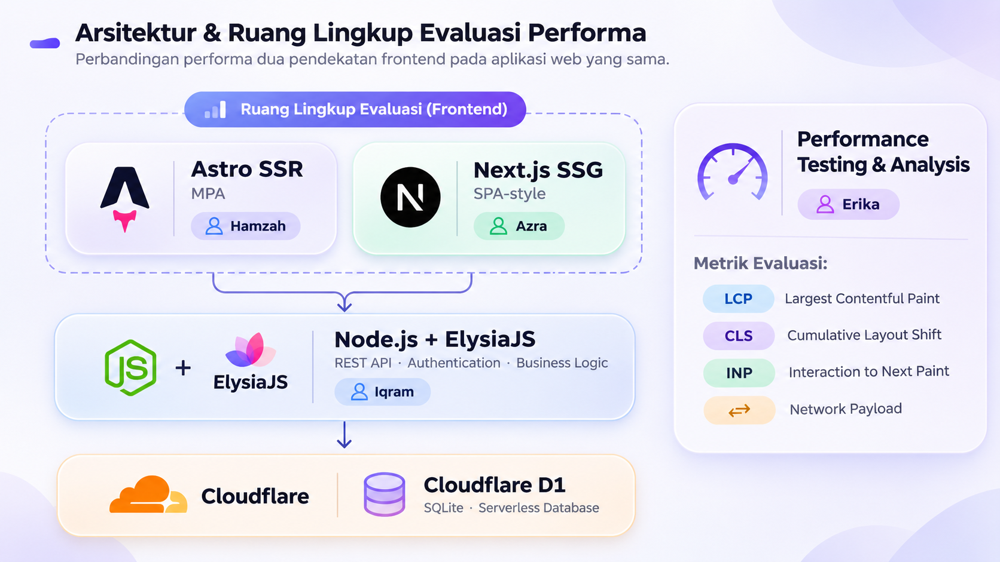

# Task & Notes — SSR/MPA vs SSG/SPA

A group assignment that builds one product twice and measures the difference between two rendering
models. The product is a personal task and note workspace with image attachments; the point of the
exercise is the comparison, not the feature list.



```
Astro SSR (MPA)        Next.js SSG (SPA-style)
        \                    /
     Cloudflare Worker + Elysia (REST API · auth · business logic)
                    |
              Cloudflare D1 (SQLite · Serverless Database)
```

Both frontends must look and behave identically. Only the rendering model differs — that parity is what
makes the benchmark meaningful.

## Status

| Phase | State |
|---|---|
| 1 — Blueprint (`.planning/00`…`14`) | Complete, awaiting owner sign-off |
| 2 — Design (`design/`) | Design system, 43 frames covering the 11 member screens, admin console extension, landing sections, 5 diagrams |
| 3 — Implementation | Not started. No `package.json`, no app source yet |

## Start here

| If you are… | Read |
|---|---|
| An AI agent | [`AGENTS.md`](AGENTS.md) → [`RULES.md`](RULES.md) → [`DESIGN.md`](DESIGN.md) |
| A team member writing code | [`AGENTS.md`](AGENTS.md) §5, then the blueprint document for your area |
| Looking for a decision or requirement | `.planning/12-architecture-review.md` (index of the blueprint) |
| Wondering where a file goes | [`STRUCTURE.md`](STRUCTURE.md) |
| Contributing code | [`CONTRIBUTING.md`](CONTRIBUTING.md) |
| Reporting a vulnerability | [`SECURITY.md`](SECURITY.md) |
| Building or reviewing UI | [`DESIGN.md`](DESIGN.md) and `.planning/14-ui-ux-specification.md` |
| Opening the design | `design/rweb-task-management.figcraft` (FigCraft), renders in `design/exports/` |

## Repository

```
.planning/        the approved blueprint: requirements, architecture, ADRs, data, API, security,
                  performance, testing, roadmap, risks, review, team matrix, UI spec
design/           FigCraft file, design system and screen specs, diagrams, icons, exports
design/exports/   PNG renders of every page for review
AGENTS.md         how an agent works in this repo
RULES.md          numbered MUST/NEVER rules, citable in review
DESIGN.md         visual system: tokens, components, screens, states, copy, accessibility
STRUCTURE.md      the full tree: what exists now, what Phase 3 creates, where each file goes
DEVELOPMENT-GUIDELINES.md  branching, PRs, reviews, testing obligations
```

Dependency direction, once code exists: `apps/* → packages/*`. Never the reverse.

## Team

| Area | Owner | Reviewer |
|---|---|---|
| `packages/contracts`, `apps/api`, `infra/` | Iqram | Hamzah |
| `apps/web-astro` | Hamzah | Azra |
| `apps/web-next` | Azra | Hamzah |
| `design-tokens`, UI specification | Hamzah + Azra | Iqram |
| Benchmark protocol, dataset, harness, results | Erika | Iqram |
| Testing, performance analysis, final report | Erika (runs at the end of the roadmap) | Project owner |

Full detail: `.planning/13-team-responsibility-matrix.md`.

## Conventions

- Branches: `feat|fix|docs|chore|test/<area>-<slug>`. No direct pushes to `main`.
- Commits: Conventional Commits, one logical change each.
- Contracts first: a shape change lands in `packages/contracts`, then in both apps in the same PR.
- User data never enters the Next.js static output; the API is the only authorization gate.
- Benchmark numbers are admissible only with a run ID and raw files (`.planning/08`).

## Open items before the build starts

- `git init` + first push (this commit), then protect `main`.
- Owner sign-off on the blueprint (`.planning/04` ADRs are all `Proposed`).
- Phase 3 scaffold: pnpm workspace, `apps/*`, `packages/*`.
- Admin console is an extension awaiting approval (BCR-01, `design/09-admin-console.md`).
