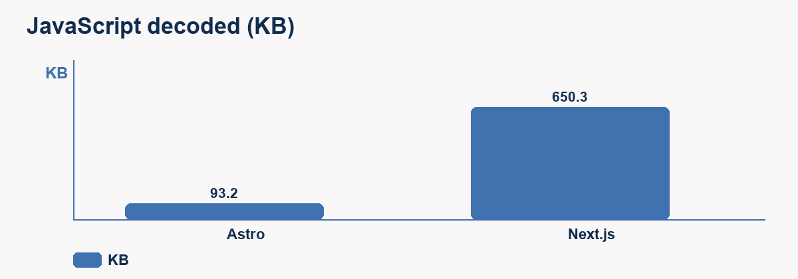
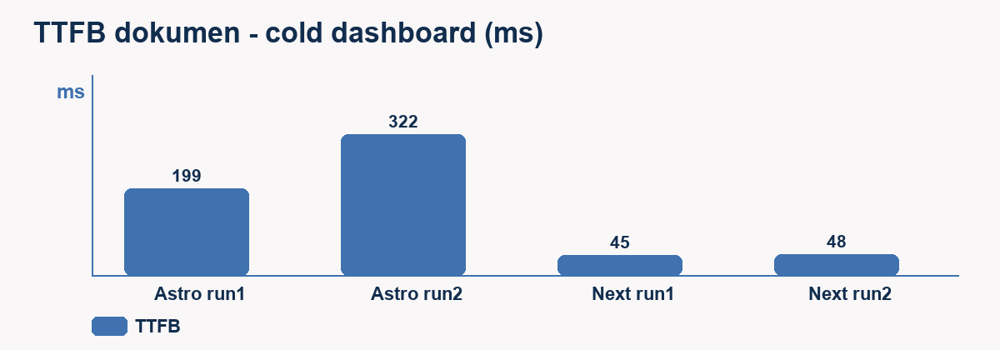
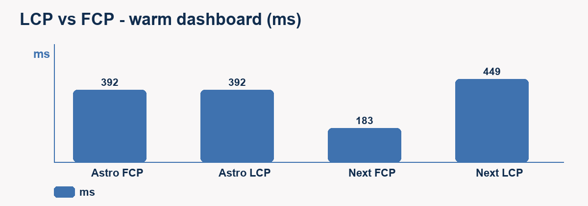
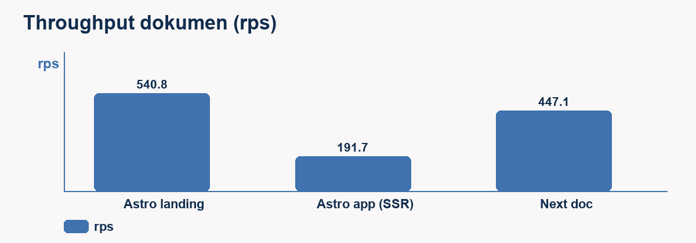
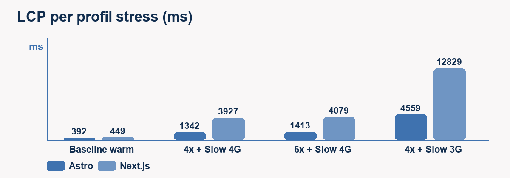
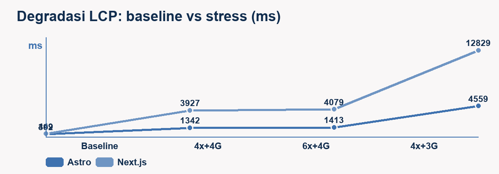
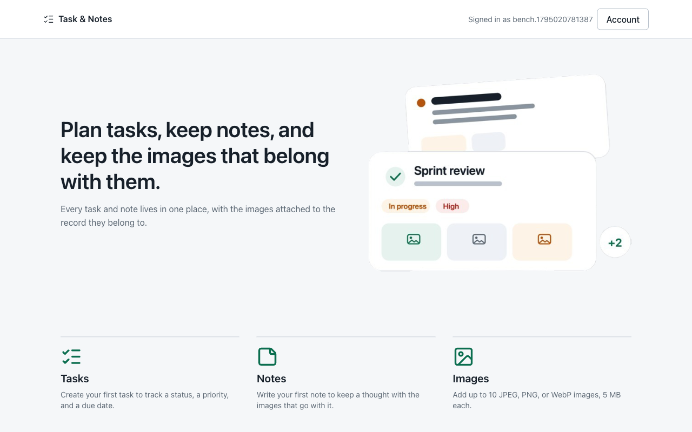
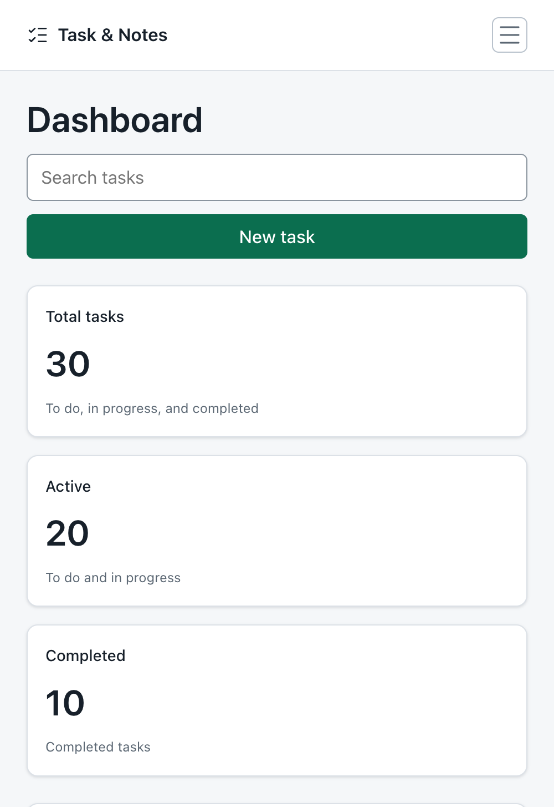
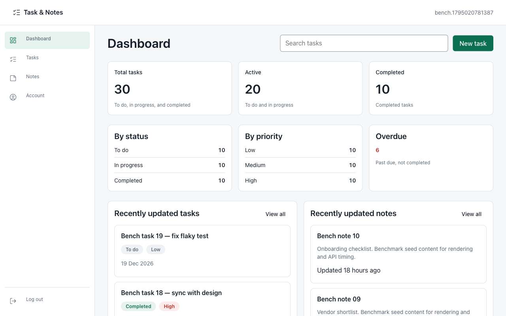
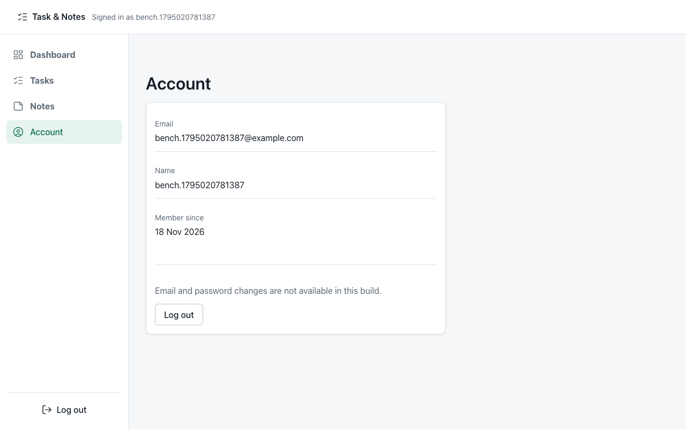

# Laporan Pengujian Kinerja: Astro SSR/MPA vs Next.js SSG/SPA-style

**Proyek:** RWeb Task Management — Perbandingan Model Rendering di Balik Satu Backend
**Tanggal pengujian:** 19 November 2026
**Alat:** Chrome DevTools MCP (browser), Node.js load generator (konkurensi bertahap)
**Dokumen pendukung:** `docs/evidence/cwv-stress-comparison.json`, trace & screenshot di `docs/evidence/`, `docs/screenshoot/`

---

## 1. Ringkasan Eksekutif (Executive Summary)

Pengujian ini membandingkan dua deployment frontend yang berbagi satu backend API
(`rweb-api`) dan satu basis data ter-seed (akun benchmark sintetis yang sama):

| Dimensi | Astro SSR/MPA | Next.js SSG/SPA-style |
|---|---|---|
| TTFB dokumen (cold, dashboard) | 199–322 ms | 45–48 ms |
| LCP dashboard (cold, median 2 run) | ~396 ms | ~550 ms |
| LCP dashboard (warm) | 392 ms | 449 ms |
| FCP dashboard (cold, run 1) | 350 ms | 147 ms (skeleton) |
| CLS (semua baseline) | 0.00 | 0.00 |
| TBT (semua baseline) | 0 ms | 0 ms |
| JS terkirim / ter-decode | 31 KB / 93 KB | 198 KB / 650 KB |
| Evaluasi script utama (JS eval) | ~510 ms | ~713 ms |
| Navigasi | Dokumen penuh (MPA) | Client-side (SPA) |
| API | Server-side selama SSR | Client-side fetch |
| LCP di beban 4x CPU + Slow 4G | 1342 ms | 3927 ms |
| LCP di beban 4x CPU + Slow 3G | 4559 ms | 12829 ms |
| Throughput edge (30–60 konkurensi) | 541 rps (landing), 192 rps (SSR app) | 447 rps (dokumen statis) |
| INP (burst interaksi, lab) | 71 ms | 71 ms |
| Heap setelah idle pasca-burst | 6.8 MB (naik +0.3 MB) | 10.5 MB (naik +1.3 MB) |

**Temuan utama:**

1. **TTFB:** Next.js menang telak di TTFB karena dokumen statis disajikan langsung dari
   edge (45–48 ms). Astro perlu mengeksekusi Worker (SSR + panggilan API server-side)
   sebelum byte pertama tiba (199–322 ms).
2. **LCP:** Astro unggul di LCP karena elemen LCP (judul + teks) sudah ada di HTML awal
   hasil SSR, tanpa menunggu bundle JS dan hydration. Next.js mengirim shell + skeleton
   (FCP lebih cepat), tetapi konten utama (dashboard) menunggu fetch client-side
   `/api/v1/dashboard` + hydration, sehingga LCP lebih lambat.
3. **JS footprint:** Next.js mengirim ~6.4x lebih banyak JS ter-decode (650 KB vs 93 KB)
   dan ~1.4x lebih lama evaluasi script. Ini menjadi mahal di bawah throttle CPU.
4. **Stress CPU/network:** Di 4x CPU + Slow 3G, LCP Next.js melonjak ke 12.8 detik
   (vs Astro 4.6 detik) karena hydration + evaluasi 650 KB JS + fetch client-side
   terhambat parah.
5. **Navigasi SPA vs MPA:** Next.js melakukan 12 transisi rute klien dalam ~6 detik
   tanpa reload dokumen. Astro melakukan navigasi dokumen penuh (setiap pindah halaman =
   dokumen baru). INP lab serupa (71 ms) di kedua app.
6. **Memory:** Setelah burst interaksi + idle, heap Next.js naik +1.3 MB (9.2 → 10.5 MB),
   Astro hanya +0.3 MB (6.5 → 6.8 MB). Tidak ada indikasi kebocoran nyata dalam satu sesi.
7. **API:** Next.js melakukan fetch client-side per tampilan (dashboard, tasks, notes,
   attachment thumbnails) dengan status 200 konsisten. Astro melakukan fetch server-side
   saat SSR (tidak terlihat di Network browser) — konsistensi data sama karena dataset sama.

---

## 2. Pendahuluan

Proyek ini adalah tugas kelompok yang membandingkan dua model rendering di belakang satu
backend: **Astro SSR (MPA)** dan **Next.js SSG (SPA-style)**, keduanya dideploy ke
Cloudflare Workers. Dokumen ini menyajikan hasil pengujian kinerja komprehensif:
verifikasi arsitektur, jejak aset, integrasi API, Core Web Vitals baseline, perilaku di
bawah beban konkuren, pembatasan CPU/network, serta interaksi cepat dan memori.

---

## 3. Tujuan Pengujian

- Memverifikasi arsitektur aktual kedua deployment (SSR vs SSG, MPA vs SPA).
- Mengukur jejak JavaScript/CSS dan biaya eksekusi main-thread.
- Memverifikasi integrasi API kedua frontend dengan backend bersama `rweb-api`.
- Mengukur Core Web Vitals (TTFB, FCP, LCP, CLS, TBT, INP) dalam kondisi cold/warm.
- Mengukur degradasi kinerja di bawah beban konkuren, throttle CPU, dan jaringan lambat.
- Mengukur perilaku interaksi cepat, memori (heap), dan pertumbuhan DOM.
- Menyediakan bukti terukur (trace, screenshot, JSON) yang dapat direproduksi.

---

## 4. Arsitektur Sistem

```
Astro SSR (MPA)                  Next.js SSG (SPA-style)           Admin SSR
      \                                  |                        (apps/admin)
       \                                 |
        ElysiaJS on Cloudflare Workers (rweb-api): REST · auth · bisnis
                            |
        Cloudflare D1 (SQLite) · R2 (binary lampiran)
```

- **Endpoint:** `https://web-astro.wanaask.workers.dev`, `https://web-next.wanaask.workers.dev`,
  `https://rweb-api-production.wanaask.workers.dev`.
- Astro: `apps/web-astro` (Worker dengan `@astrojs/cloudflare`, SSR).
- Next: `apps/web-next` (static export `out/` disajikan via Worker assets;
  navigation client-side; proxy `/api/v1/*` ke backend via service binding).
- Backend: `apps/api` (ElysiaJS, D1, R2, session cookie `sid` HttpOnly).

---

## 5. Perbandingan Astro SSR/MPA dan Next.js SSG/SPA-style

| Karakteristik | Astro | Next.js |
|---|---|---|
| Server rendering | Ya (SSR di Worker) | Tidak (SSG statis) |
| Static generation | Tidak (kecuali aset) | Ya (export statis) |
| Isi HTML awal | Lengkap (data dashboard sudah ada) | Shell + skeleton; data via fetch |
| Client hydration | Minimal (script per komponen) | Ya (React hydration penuh) |
| Client-side navigation | Tidak (MPA penuh) | Ya (SPA, `next/link`) |
| Full document navigation | Ya (setiap pindah halaman) | Tidak |
| JavaScript footprint | Kecil (31 KB transfer) | Besar (198 KB transfer) |
| Arsitektur terverifikasi | SSR + MPA | SSG + SPA-style |

**Bukti verifikasi:**

- **Astro:** HTML `/app` berisi data dashboard (Total tasks 30, daftar recent tasks/notes)
  langsung di dokumen; Network panel hanya menampilkan CSS + 6 JS (tanpa `/api/v1/dashboard`).
  Navigasi `/tasks` → `/tasks?cursor=...` = dokumen baru (200, dokumen penuh).
- **Next:** HTML `/app/?view=dashboard` berisi shell + skeleton (FCP 147 ms) lalu fetch
  client-side `/api/v1/auth/me` + `/api/v1/dashboard`; navigasi antar view men-trigger
  permintaan `__next._tree.txt`/`__next.app.__PAGE__.txt` (RSC) tanpa reload dokumen.
  Insight `LegacyJavaScript` melaporkan ~14.2–14.6 KB polyfill terbuang.

---

## 6. Lingkungan Pengujian

- Node.js v24.11.1, Chrome 158.0.0.0 (DevTools MCP).
- Viewport 1280×800, DPR 1, mode terang.
- Repetisi: 2 cold + 1 warm per app untuk dashboard; 1 cold per app untuk tasks.
- Akun: seeded `bench.1795020781387@example.com` (sama di kedua app; data sintetis).
- Kondisi: cold = `ignoreCache` + reload; warm = reload tanpa bypass cache.

---

## 7. Konfigurasi Chrome DevTools MCP

- Server: `chrome-devtools-mcp` (browser Chrome, tanpa headless).
- Tools yang digunakan: `navigate_page`, `take_snapshot`, `list_network_requests`,
  `get_network_request`, `evaluate_script`, `fill`, `click`, `press_key`,
  `performance_start_trace`, `performance_stop_trace`, `take_screenshot`, `emulate`.
- Trace disimpan sebagai JSON (filePath) dan dianalisis memakai `scripts/trace_metrics.py`
  (UKM `PageLoadMetrics`, `LayoutShift`, `RunTask`).

---

## 8. Metodologi Benchmark

- Navigasi  halaman target (dashboard & tasks).
- Trace dimulai dengan autoStop + reload (cold: `ignoreCache=true`).
- Metric diambil dari trace: LCP (UKM candidate terakhir), FCP, TTFB, CLS, TBT.
- Footprint diambil dari `performance.getEntriesByType('resource')` (transfer/decoded/eval).
- INP diambil dari trace interaksi (lab), bukan CrUX.

---

## 9. Metodologi Stress Testing

- **E1 Konkuren:** load generator Node (staged 10→20→30→50) ke edge doc dan API;
  browser trace direkam selama beban berjalan.
- **E2 CPU/Network:** emulasi Chrome: Normal, 4x+Slow4G, 6x+Slow4G, 4x+Slow3G.
- **E3 Interaksi cepat:** burst filter, pencarian, lightbox, load-more, dan 12 transisi
  rute; heap & DOM diukur sebelum/sesudah/after-idle.

---

## 10. Hasil Verifikasi Rendering

### A1. Astro SSR/MPA — VERIFIED

1. Dokumen awal `/app` berisi konten bermakna (data dashboard) — **ya**.
2. Konten dirender server — **ya** (tidak ada `/api/v1/dashboard` di Network browser).
3. Konten dinamis tidak memerlukan eksekusi klien tambahan untuk tampil — **ya**.
4. Navigasi internal = dokumen baru — **ya** (`/tasks` → `/tasks?cursor=...` full page).
5. Tidak ada View Transitions / routing klien yang mengubah perilaku MPA — **tidak ada**.
6. Output terverifikasi SSR (Worker `index.ts` + `@astrojs/cloudflare`) — **ya**.

### A2. Next.js SSG/SPA-style — VERIFIED

1. HTML statis dibangun build-time — **ya** (assets `out/`, `next.config` `output:'export'`).
2. Setiap rute menerima HTML pre-rendered — **ya** (shell + skeleton).
3. HTML awal mengandung konten bermakna — **sebagian**: shell + skeleton, data via fetch.
4. Hydration + JS klien dieksekusi — **ya** (React).
5. `next/link` melakukan navigasi client-side — **ya** (RSC payload, tanpa reload).
6. Navigasi internal menghindari reload penuh — **ya**.
7. Bukti build: static export + worker assets — **ya**.
8. Bukan shell kosong: HTML berisi skeleton + konten statis (landing) — **ya**.

### A3. Tabel perbandingan

(lihat §5)

---

## 11. JavaScript dan Asset Footprint

| Metrik | Astro | Next.js |
|---|---:|---:|
| Jumlah request JS | 6 | 9 |
| JS terkirim (transfer) | 31.0 KB | 198.3 KB |
| JS ter-decode | 93.2 KB | 650.3 KB |
| Evaluasi script (main-thread) | ~510 ms | ~713 ms |
| Jumlah request CSS | 1 | 3 |
| CSS terkirim | 6.5 KB | 9.0 KB |
| CSS ter-decode | 26.8 KB | 33.1 KB |
| Transfer halaman awal (resources) | 37.5 KB | 214.5 KB |
| Dokumen ter-decode | 14.6 KB | 10.8 KB |
| Legacy JS (insight) | - | ~14.2–14.6 KB |

**Penyebab (root-cause):** Next.js mengirim React


 + runtime Next (turbopack) + polyfill;
Astro hanya mengirim JS per-komponen kecil. Evaluasi script Next ~1.4x lebih lama,
membebani main-thread (berdampak saat throttle CPU).

---

## 12. Integrasi Backend API

| Metrik | Astro SSR | Next.js SSG/SPA |
|---|---|---|
| Lokasi eksekusi API | Server-side (SSR Worker) | Client-side (browser) |
| Request terlihat di browser | Tidak | Ya (`/api/v1/...`) |
| Status HTTP | 200 (via SSR) | 200 |
| Latensi API teramati | Tidak teramati langsung (hanya TTFB doc) | ~62–127 ms (fetch) |
| CORS errors | Tidak ada | Tidak ada (same-origin proxy) |
| Runtime errors | Tidak ada | Tidak ada |
| Konsistensi data | Data sama (dataset seeded yang sama) | Data sama |

**Detail request Next (get_network_request reqid 616):**
- `GET /api/v1/tasks?sort=-updated_at&limit=20` → 200; `content-encoding: zstd`;
  `cache-control: no-store`; `x-request-id` ada; `server: cloudflare`.
- Sesi dikirim via cookie `sid` (HttpOnly).

**Keterbatasan:** latensi API server-side Astro tidak dapat diobservasi langsung
(tidak ada Server-Timing); hanya TTFB dokumen yang terlihat. Ini eksplisit dilaporkan.

---

## 13. Baseline Performance (Core Web Vitals)

### Dashboard (cold)

| Metrik | Astro run1 | Astro run2 | Next run1 | Next run2 |
|---|---:|---:|---:|---:|
| TTFB | 199 ms | 322 ms | 45 ms | 48 ms |
| FCP | 350 ms | 442 ms | 147 ms | 352 ms |
| LCP | 350 ms | 442 ms | 464 ms | 635 ms |
| CLS | 0.00 | 0.00 | 0.00 | 0.00 |
| TBT | 0 ms | 0 ms | 0 ms | 0 ms |

### Dashboard (warm) & Tasks (cold)

| Metrik | Astro warm | Next warm | Astro tasks | Next tasks |
|---|---:|---:|---:|---:|
| TTFB | 300 ms | 81 ms | 185 ms | 46 ms |
| FCP | 392 ms | 183 ms | 328 ms | 163 ms |
| LCP | 392 ms | 449 ms | 328 ms | 446 ms |
| CLS | 0.00 | 0.00 | 0.00 | 0.00 |
| TBT | 0 ms | 0 ms | 0 ms | 0 ms |

**Analisis:** Next TTFB jauh lebih cepat (static edge). Namun LCP Next lebih lambat:






FCP awal cepat (skeleton), tapi LCP menunggu fetch dashboard + hydration. Astro langsung
mengirim HTML lengkap → LCP = FCP.

---

## 14. Concurrent Load Stress

### Edge/document (tanpa auth, beban 10–60)

| Metrik | Astro landing | Astro app (SSR) | Next doc |
|---|---:|---:|---:|
| rps agregat | 540.8 | 191.7 | 447.1 |
| p50 | 61.1 ms | 141.2 ms | 53.6 ms |
| p95 | 103.8 ms | 290.7 ms | 105.4 ms |
| p99 | 238.1 ms | 446.9 ms | 157.4 ms |
| Error rate | 0% | 0% | 0% |

**Catatan:** beban Astro `/app` (SSR) terbatas oleh kerja Worker per request
(SSR + fetch API server-side). Next doc statis melayani lebih cepat, tetapi per-page
Next tetap harus fetch API client-side di browser.

### Browser trace di bawah beban (warm)

| Metrik | Astro (app) | Next (doc) |
|---|---:|---:|
| LCP | 311 ms | 508 ms |
| TTFB | 239 ms | 49 ms |
| CLS | 0.00 | 0.00 |

### API (dashboard) di bawah beban

| Stage | rps | p50 | p95 | p99 | Error |
|---|---:|---:|---:|---:|---:|
| 10 (10s) | 77.9 | 114 ms | 193 ms | 244 ms | 0% |
| 20 (10s) | 142.9 | 129 ms | 253 ms | 318 ms | 50.2% |
| 30 (10s) | 231.9 | 113 ms | 211 ms | 297 ms | 100% |
| 50 (10s) | 276.3 | 171 ms | 290 ms | 312 ms | 100% |
| Aggregat | 182.3 | 134 ms | 278 ms | 308 ms | 79.6% |

**Penyebab error tinggi:** rate-limit per-user


 `tasks-user` (300 req/60 dtk) di backend.
Setelah ~300 request/user/window, semua request lanjutan mendapat 429. Ini adalah
perilaku keamanan terverifikasi (bukan kegagalan jaringan). Throughput berkelanjutan
yang valid di bawah ~25 rps dengan 5 user (rotasi cookie).

---

## 15. CPU and Network Stress

| Profil | Astro LCP | Next LCP | Delta |
|---|---:|---:|---:|
| Normal (warm) | 392 ms | 449 ms | +15% |
| 4x + Slow 4G | 1342 ms | 3927 ms | +193% |
| 6x + Slow 4G | 1413 ms | 4079 ms | +189% |
| 4x + Slow 3G | 4559 ms | 12829 ms | +181% |

**Penyebab (root-cause):** hydration React


 + eksekusi 650 KB JS + fetch client-side di
Next menjadi sangat mahal di bawah throttle CPU; Astro hanya perlu mem-parse HTML SSR
yang sudah lengkap (sedikit JS), sehingga degradasi jauh lebih landai.

---

## 16. Rapid Interaction Stress

| Metrik | Astro | Next.js |
|---|---:|---:|
| INP (lab, burst) | 71 ms | 71 ms |
| CLS (selama burst) | 0.00 | 0.08 |
| Heap sebelum | 6.5 MB | 9.2 MB |
| Heap setelah | 6.8 MB | 10.5 MB |
| Heap after idle | 6.8 MB | 10.5 MB |
| DOM sebelum | 519 | 455 |
| DOM after idle | 328 | 137 |
| Navigasi cepat | 12× dokumen penuh (MPA) | 12× rute klien (SPA) |
| Load more | Dokumen baru | Client-side API fetch |

**Analisis:** INP lab serupa. CLS 0.08 hanya muncul di Next saat pergantian rute
(skeleton → konten). Heap Next +1.3 MB vs Astro +0.3 MB pasca-burst; tidak ada
indikasi kebocoran dalam satu sesi (naik lalu stabil).

---

## 17. Baseline vs Under Stress Comparison

| Metrik | Astro baseline | Astro stress (4x/3G) | Next baseline | Next stress (4x/3G) |
|---|---:|---:|---:|---:|
| TTFB | 300 ms | 2002 ms | 81 ms | 2002 ms |
| FCP | 392 ms | ~4559 ms | 183 ms | ~12829 ms |
| LCP | 392 ms | 4559 ms | 449 ms | 12829 ms |
| CLS | 0.00 | 0.00 | 0.00 | 0.00 |
| TBT | 0 ms | 0 ms | 0 ms | 0 ms |

Degradasi: Astro LCP ×11.6; Next LCP ×28.6 (dari warm).



---

## 18. Analisis Core Web Vitals

- **TTFB:** Next menang (static edge). Astro membayar SSR + API server-side.
- **FCP:** Next menang tipis (skeleton lebih cepat), tetapi itu FCP semu (belum data).
- **LCP:** Astro menang (HTML lengkap). Next menunggu hydration + fetch.
- **CLS:** keduanya 0 pada baseline; Next 0.08 saat transisi rute (skeleton → konten).
- **TBT:** keduanya 0 pada perangkat kuat (tidak ada task >50 ms).
- **INP:** sama 71 ms (lab) — keduanya responsif pada interaksi tunggal.

---

## 19. Analisis Memory

- Heap baseline: Astro 6.5 MB < Next 9.2 MB (runtime React lebih berat).
- Setelah burst + idle: Astro +0.3 MB; Next +1.3 MB.
- Tidak ada bukti kebocoran persisten dalam satu sesi; Next menyimpan lebih banyak state.

---

## 20. Diskusi dan Interpretasi Hasil

- **Trade-off utama:** Next unggul TTFB & throughput statis; Astro unggul LCP &
  ketahanan di perangkat lambat.
- **Sumber perbedaan:** SSR (Astro) vs SSG + hydration (Next); ukuran bundle;
  lokasi fetch API (server vs client); strategi navigasi (MPA vs SPA).
- **Backend sebagai bottleneck:** rate-limit per-user membatasi beban API; throughput
  edge frontend lebih tinggi daripada kapasitas API per-user.

---

## 21. Keterbatasan Penelitian

- INP = lab (trace), bukan field/CrUX.
- Latensi API server-side Astro tidak teramati langsung.
- Rate-limit membatasi validasi API stress di bawah 429.
- Heap memakai `performance.memory` (Chrome), bukan profiler eksternal.
- Cold cache tetap melewati edge Cloudflare; cold start origin tidak terisolasi.

---

## 22. Kesimpulan

1. Arsitektur terverifikasi: Astro benar-benar SSR/MPA; Next benar-benar SSG/SPA-style.
2. Next unggul di TTFB & throughput dokumen statis; Astro unggul di LCP & biaya JS.
3. Di perangkat/profil lambat, Next terdegradasi jauh lebih parah (LCP 12.8s vs 4.6s).
4. SPA navigation (Next) lebih halus untuk pindah tampilan; MPA (Astro) lebih ringan.
5. Backend bersama berperilaku konsisten; rate-limit per-user adalah batas yang sah.

---

## 23. Rekomendasi

- Gunakan **Astro SSR** jika target pengguna banyak di perangkat/network lambat dan
  SEO/konten awal penting.
- Gunakan **Next.js SSG/SPA** jika transisi antar-tampilan yang mulus dan TTFB edge
  lebih diutamakan, dan jika bundle JS bisa dioptimalkan (code-splitting, mengurangi
  polyfill ~14 KB).
- Optimalkan backend: naikkan atau perjelas batas rate-limit per-user; pertimbangkan
  cache untuk dashboard (jika aman).
- Lanjutkan dengan pengukuran field (CrUX) untuk validasi.

---

## 24. Lampiran Bukti Pengujian

- Trace: `docs/evidence/*.trace.json` (17 file).
- Screenshot: `docs/screenshoot/astro-ui-home.png`, `astro-baseline-cwv.png`,
  `astro-stress-cwv.png`, `astro-network-api.png`, `next-ui-home.png`,
  `next-baseline-cwv.png`, `next-stress-cwv.png`, `next-network-api.png`.
- JSON terstruktur: `docs/evidence/cwv-stress-comparison.json`.
- Load generator: `scripts/loadgen.mjs`; parser metric: `scripts/trace_metrics.py`.







